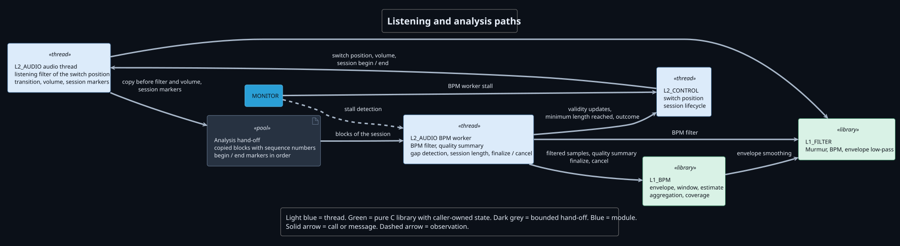
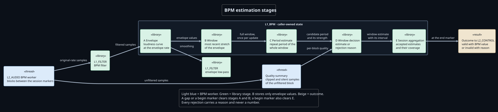

# Listening filter and BPM analysis architecture

Two signal paths leave the audio thread: the listening path plays the microphone signal through the
selected listening filter, and the analysis path estimates the heart rate from a copy of the same
signal. The analysis path runs on its own thread, so listening never waits for the analysis. Both
paths receive their input from the audio thread, which also marks where a session begins and ends,
so the analysis sees the session boundaries at the exact block boundary.

## Terms

| Term | Meaning |
| --- | --- |
| Envelope | The outline of a signal's loudness over time, without its oscillation. The filtered heart sound oscillates many times per heart sound; rectifying it (turning negative values positive) and smoothing it leaves one slow rise and fall per heart sound or per heartbeat. Because it changes slowly, far fewer values per second describe it than the audio. |
| Analysis window | The most recent stretch of the envelope that one estimate looks at. |
| Repeat period | The time after which the envelope pattern repeats, which is the time between two heartbeats. The heart rate in BPM is 60 divided by the repeat period in seconds. |
| Coverage | The part of a session covered by accepted window estimates. Overlapping windows count once. |

## Responsibilities

| Component | Responsible for | Not responsible for |
| --- | --- | --- |
| `L1_FILTER` | Band filters as caller-owned instances: fixed characteristics, filter state, processing a block of samples, clearing the state | Which filter a path selects; the switch position; threads; transitions between filters |
| `L1_BPM` | Heart-rate estimation as caller-owned state: the envelope, the analysis window, the period estimate, one estimate or one rejection reason per window, and the session aggregation with its coverage | The BPM filter in front of it; threads; session boundaries; gap detection; indication |
| `L2_AUDIO` audio thread | The listening path: applying the listening filter of the switch position, the transition between filters, the volume; copying every received block into the analysis hand-off before the listening filter; placing the session begin and end markers of `L2_CONTROL` between the blocks they separate | Session decisions; analysis results; waiting for the BPM worker |
| `L2_AUDIO` BPM worker | The analysis path: applying the BPM filter, summarizing the clipped and silent samples of each unfiltered block, feeding `L1_BPM` with the filtered blocks between a begin and an end marker and their quality summaries, detecting missing blocks and resetting the window, measuring the session length in samples, reporting once per session that the minimum length is reached, finalizing or cancelling the session at the end marker, posting validity updates and the outcome | Starting or stopping a session; listening; delivery |
| `L2_CONTROL` | The switch position and the session lifecycle: sending the session begin with its identity and frozen settings and the session end on Stop to the audio thread; the indication of the minimum length and of the outcome | Signal processing; measuring the session length |
| `MONITOR` | Detecting a stalled BPM worker | Recovering the worker |

`L1_FILTER` and `L1_BPM` are pure C libraries without RTOS, heap or logging. `L1_BPM` uses
`L1_FILTER` for the smoothing inside its envelope; `L1_FILTER` uses no other module. Both compute in
single-precision floating point; `L2_AUDIO` converts the integer microphone samples on the way in and
back to integer samples at the output limit.

## Filters

`L1_FILTER` is the filter library of the firmware. It holds every filter that the firmware uses, each
with a fixed characteristic and a name. Filter coefficients are constant data, separate from the code
that applies them; no interface changes them at run time. Each caller owns the state of its instances.
Every filter is causal: it processes each value as it arrives, without looking ahead.

| Filter | Used by | Purpose |
| --- | --- | --- |
| Murmur | `L2_AUDIO` audio thread, Murmur position | keeps the band of the heart sounds and murmurs for listening |
| BPM | `L2_AUDIO` audio thread, BPM position; `L2_AUDIO` BPM worker | keeps the band of the heart sounds and removes slow pressure changes and noise; the operator hears what the analysis receives |
| Envelope low-pass | `L1_BPM` | smooths the rectified signal into a loudness curve in which each heartbeat is one shape; it also removes the content that a lower envelope rate cannot represent |

## Signal paths

*Listening and analysis paths.* Source: [puml/signal-paths.puml](puml/signal-paths.puml)

- **Listening:** Raw applies no band filter, Murmur applies the Murmur filter, and BPM applies the BPM
  filter so that the operator hears what the analysis receives. Each path owns its filter instance;
  the listening BPM filter and the analysis BPM filter share their characteristics but not their state.
- **Analysis:** the BPM worker always applies the BPM filter, whatever the switch position. Its input
  is taken before the listening filter and the volume, so neither changes the result.
- **Rate:** both paths receive blocks at the original sample rate. Any reduction of the rate for the
  analysis happens inside `L1_BPM`.

## BPM estimation stages

*BPM estimation stages.* Source: [puml/bpm-estimation.puml](puml/bpm-estimation.puml)

`L1_BPM` estimates the heart rate from the repeat period of the whole heartbeat pattern, not from
single heart sounds. Whether the first and second heart sound appear as two shapes or merge into one
does not matter: the estimate looks for how often the pattern repeats.

| Stage | Responsible for | Passes on |
| --- | --- | --- |
| A Envelope | rectifying the filtered samples, smoothing them with the envelope low-pass and reducing the rate | envelope values at the envelope rate |
| B Window | keeping the most recent stretch of envelope values; the envelope is the only signal `L1_BPM` stores | the full window, once per update |
| C Period estimate | finding the repeat period of the whole window, its strength and its rival periods | candidate period and strength |
| D Window decision | accepting the candidate or rejecting it with a reason, using its strength, its rivals, the quality summaries of the window's blocks and the previous estimates | one window estimate with its time interval, or one rejection reason |
| E Session aggregation | collecting the accepted window estimates and their intervals; at the end marker, the coverage and one valid value or one rejection reason | the measurement result |

- A begin marker clears every stage, A to E, including the previous estimates and the quality
  summaries that stage D keeps.
- A gap clears stages A and B and the quality summaries of the cleared window.
- Clipping cuts parts out of the microphone signal, and the BPM filter hides it. The quality
  summary therefore comes from the unfiltered block and reaches stage D next to the filtered samples.
- Every rejection carries a reason and never a number.
- Stage C runs once per update on the BPM worker and may take longer than one audio block; it never
  runs on the audio thread. The analysis hand-off holds enough blocks to cover the longest run of
  stage C, so an update on its own never causes a gap.

## Session lifecycle

- On Start, `L2_CONTROL` sends the session begin with the session identity and the frozen settings to
  the audio thread. The audio thread places a begin marker into the analysis hand-off before the
  first block of the session. The begin marker carries the sequence number of that block.
- On the begin marker, the BPM worker clears the window and the aggregation. It analyses only the
  blocks between a begin and an end marker.
- On Stop, `L2_CONTROL` sends the session end, and the audio thread places an end marker after the
  last block of the session. The end marker carries the sequence number of that block.
- On the end marker, the BPM worker compares the session length, counted in samples from the
  sequence numbers of the two markers, with the minimum session length. Dropped block copies
  therefore change the coverage, never the session length. A shorter session is cancelled: the aggregation is
  discarded without a result. A session of at least the minimum length is finalized into one
  immutable measurement result: valid with a BPM value, or invalid with a reason and no numeric
  value.
- When the session length reaches the minimum, the worker reports it once to `L2_CONTROL`, which
  changes the indication. The indication and the decision at the end marker count the same samples,
  so a session that shows the minimum is never cancelled for being too short.
- The worker reports the outcome to `L2_CONTROL`: cancelled, or the measurement result.
- A previous estimate or result is never reused for a new session.

## Hand-offs

| Hand-off | From | To | Carries | Receiver falls behind |
| --- | --- | --- | --- | --- |
| Session begin and end | `L2_CONTROL` | `L2_AUDIO` audio thread | session identity, frozen settings | a full queue refuses the command; `L2_CONTROL` keeps its previous state |
| Analysis blocks and session markers | `L2_AUDIO` audio thread | `L2_AUDIO` BPM worker | copied blocks with sequence numbers; begin and end markers in stream order | the audio thread drops a block copy, and the worker detects the gap from the sequence numbers and resets the window; a marker is never dropped and keeps its place in the order; listening continues |
| Validity updates | `L2_AUDIO` BPM worker | `L2_CONTROL` | values tagged with the session identity | posted without waiting; a validity update is dropped when the queue is full; `L2_CONTROL` ignores values of an earlier session |
| Minimum length reached, session outcome | `L2_AUDIO` BPM worker | `L2_CONTROL` | values tagged with the session identity | posted without waiting and never dropped: each has a place that only `L2_CONTROL` clears by reading it; `L2_CONTROL` ignores values of an earlier session |

## Threads

The BPM worker runs below the audio thread and below `L2_CONTROL`, so analysis load delays neither
the audio blocks nor the control events. No lock is shared between the audio thread and the BPM
worker; the analysis hand-off is their only connection. One ordered hand-off carries both the blocks
and the session markers, so no block can arrive before its begin marker or after its end marker.

## Faults

- A missing block invalidates the affected window, not the session; coverage decides whether the
  session still gives a valid result.
- A poor signal gives an invalid result with a reason instead of a number.
- A stalled BPM worker is an error that `MONITOR` detects and reports to `L2_CONTROL`. During a
  session, listening continues until the operator stops the examination. During Analysing, the
  report ends Busy: `L2_CONTROL` discards the session and shows the error, so a stalled worker never
  leaves the device Busy.

## Verification allocation

| Scenario | Trace | Expected outcome |
| --- | --- | --- |
| Tones through each switch position | [REQ-03](../../requirements/system-requirements.md#req-03), VT-03 | Murmur and BPM weaken the tones outside their bands relative to Raw |
| Switch change while listening | [REQ-03](../../requirements/system-requirements.md#req-03), VT-03 | The new filter takes effect without a click |
| Switch position or volume changed during a session | [REQ-03](../../requirements/system-requirements.md#req-03), VT-06 | The analysis input and the result are unchanged |
| Session of at least the minimum length on a chest | [REQ-06](../../requirements/system-requirements.md#req-06), VT-06 | One valid result within the acceptance limit of the reference |
| Stop before the minimum length | [REQ-07](../../requirements/system-requirements.md#req-07), VT-06 | Cancelled; no result |
| Stop one block before and one block after the minimum length | [REQ-07](../../requirements/system-requirements.md#req-07), VT-06 | The shorter session is cancelled; the longer one gives an outcome |
| Analysis hand-off full when Stop arrives | VT-06 | The end marker follows the last block of the session; the session is not lost |
| First or last block copy of a session dropped | [REQ-07](../../requirements/system-requirements.md#req-07), VT-06 | The session length is unchanged; a session at the minimum length is not cancelled |
| `L2_CONTROL` event queue full when the outcome is posted | VT-06 | The outcome still reaches `L2_CONTROL`; Busy ends |
| Stop right after the minimum-length indication | [REQ-07](../../requirements/system-requirements.md#req-07), VT-06 | The session is finalized, not cancelled |
| Open air or rubbing for a whole session | [REQ-08](../../requirements/system-requirements.md#req-08), VT-06 | Invalid result with a reason; no BPM value |
| Windows with clipped stretches | [REQ-08](../../requirements/system-requirements.md#req-08), VT-06 | The window decision sees the clipped share; a window beyond its limit is rejected with the clipping reason |
| Slow heart rate with two separate heart sounds, fast heart rate with merged heart sounds | [REQ-06](../../requirements/system-requirements.md#req-06), VT-06 | The heart rate of both, neither doubled nor halved |
| Analysis blocks dropped during a session | VT-06 | Listening continues; the affected window is rejected |
| BPM worker stalled | VT-09 | Error after the operator stops; listening uninterrupted until then |
| BPM worker stalls after Stop, before the outcome | VT-09 | Busy ends with the stall error; no result is sent |
| Same recording through `L1_BPM` on the host and on the target | VT-06 | Identical estimates and result |
