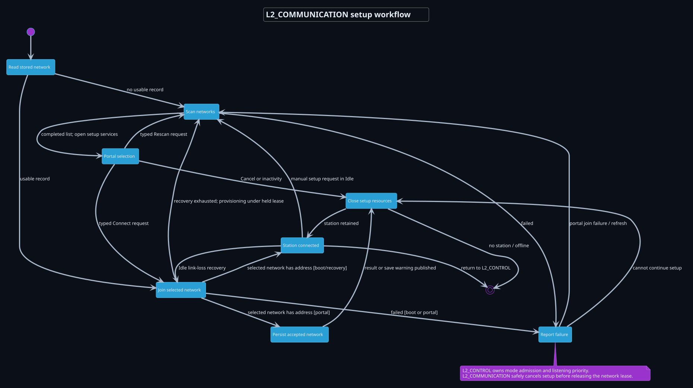
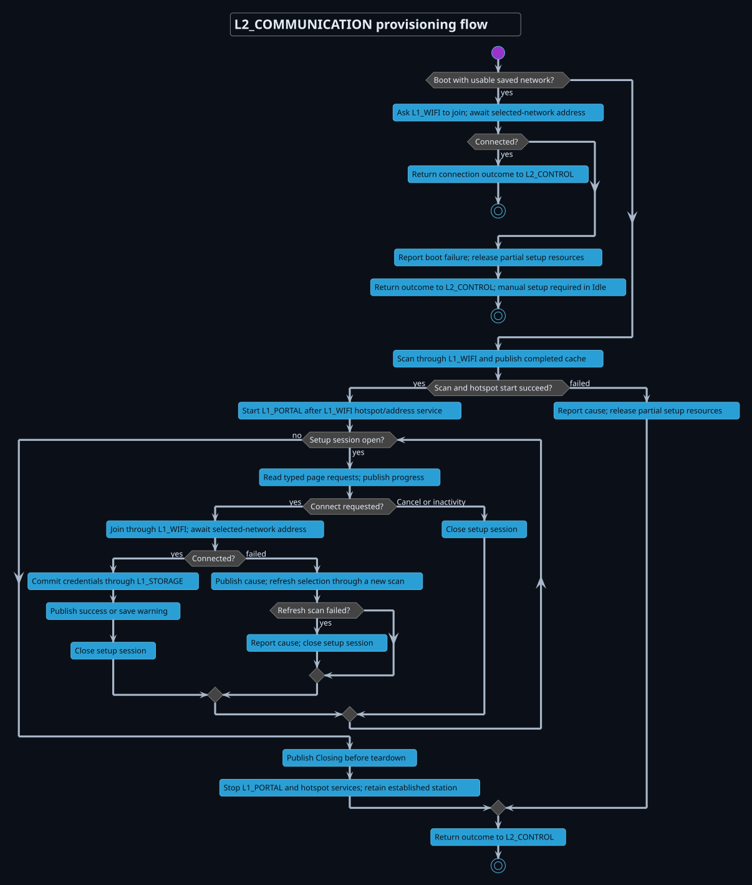
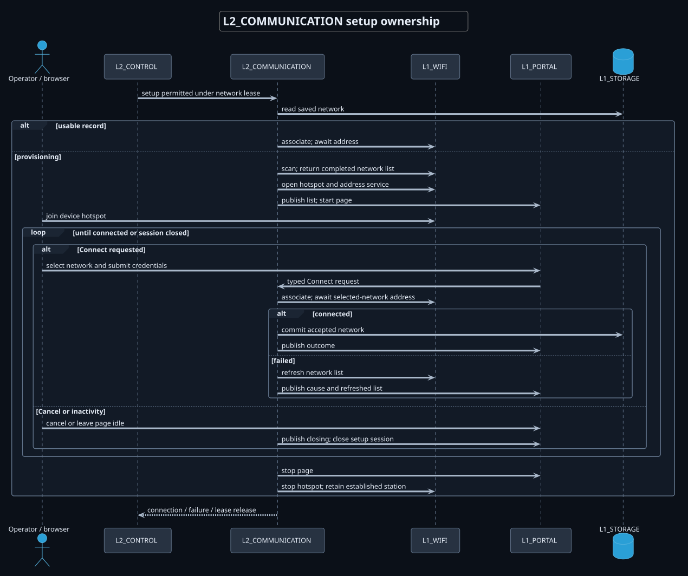
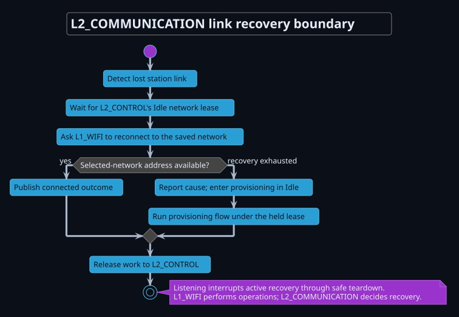
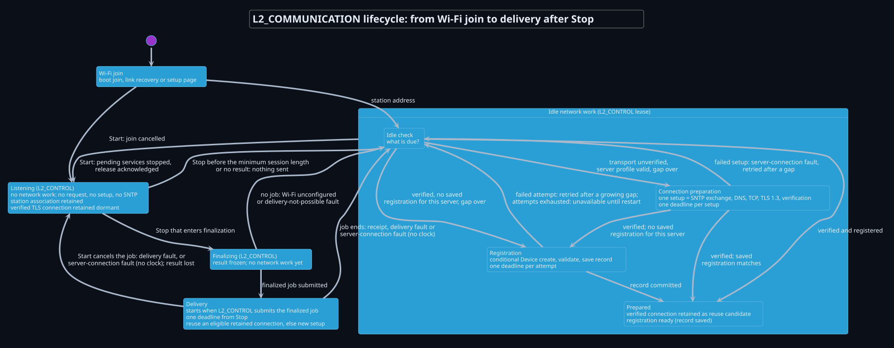

# COMMUNICATION architecture

L2_COMMUNICATION owns the setup workflow and recovery policy under the L2_CONTROL network lease. It composes L1_WIFI radio and address operations, L1_STORAGE persistence and L1_PORTAL typed requests and status publication. L2_CONTROL owns mode admission. Listening requests trigger safe setup teardown before lease release. Lower services never change controller state.

The [diagram viewer](setup-workflows.html) presents these architecture views. The general station and provisioning model is documented under [L1_WIFI](../WIFI/README.md), and the browser boundary under [L1_PORTAL](../PORTAL/README.md).

[Time synchronization](time-ownership.md) defines ownership of the SNTP (Simple Network Time Protocol) exchange and how server communication depends on the device clock: L1_WIFI performs the exchange and L2_COMMUNICATION coordinates it. Time from SNTP is used without authentication of the time server. [Secure transport](secure-transport.md) and [FHIR and server communication](server-communication.md) build on this clock boundary.

## Setup state machine

*Which setup state follows each outcome and page request?* Source: [puml/setup-state.puml](puml/setup-state.puml).

## Provisioning flow

*How does the device get from boot to a connected station, with or without the setup page?* Source: [puml/setup-flow.puml](puml/setup-flow.puml).

## Setup ownership sequence

*Which module performs each setup step, and in which order?* Source: [puml/setup-sequence.puml](puml/setup-sequence.puml).

## Link recovery

*What happens when the station link is lost?* Source: [puml/link-recovery.puml](puml/link-recovery.puml).

## Communication lifecycle

*Which network work runs in Idle, during listening and after Stop?* Source: [puml/communication-lifecycle.puml](puml/communication-lifecycle.puml).
