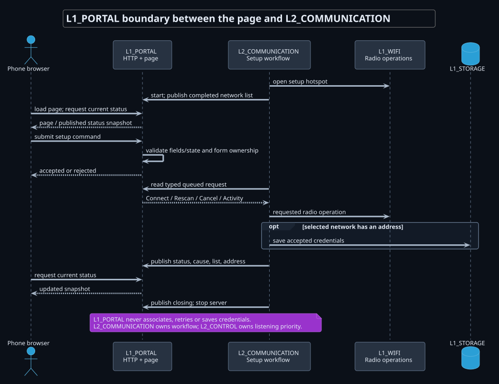

# PORTAL architecture

L1_PORTAL owns the HTTP server and setup page. It validates and queues typed Connect, Rescan, Cancel and Activity requests for L2_COMMUNICATION, and exposes the published status, network list, cause and station address. L2_COMMUNICATION owns setup, retries and persistence sequencing, and L1_WIFI owns radio and address operations. L1_PORTAL never joins networks or saves credentials.

*Which requests pass from the page to L2_COMMUNICATION, and what does the page see in return?* Source: [puml/portal-boundary.puml](puml/portal-boundary.puml).

[L2_COMMUNICATION](../COMMUNICATION/README.md) defines the setup workflow.
