# System architecture

The [viewer](review.html) presents the system architecture views except Input ownership and Server profile, and [view notes](VIEW-NOTES.md)
document their scope, hardware naming and runtime assumptions.

[Firmware structure and runtime ownership](firmware-structure.md) defines the layers and call directions, the ownership of each module, the threads, the hand-offs between them and the listening and network lease.

[Feedback ground rules](feedback-principles.md) define indication ownership and fault containment.

[Server profile](server-profile.md) defines how a device receives its server endpoint, keep-alive and trusted certificate.

## Architecture

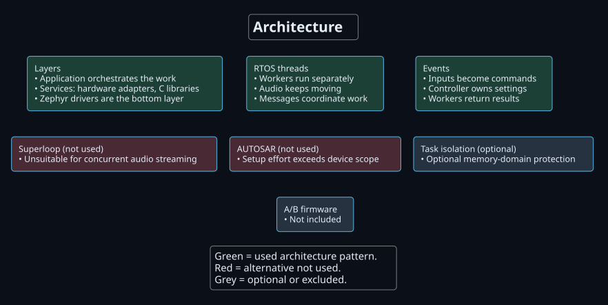

*Which architecture patterns does the firmware use, and which alternatives does it leave out?* Source: [puml/architecture-choice.puml](puml/architecture-choice.puml).

## System context

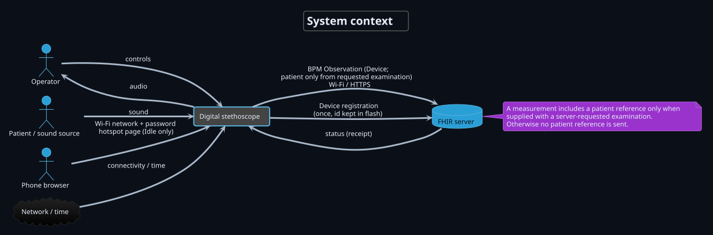

*What lies outside the device, and what does it exchange with each neighbour?* Source: [puml/system-context.puml](puml/system-context.puml).

## System components

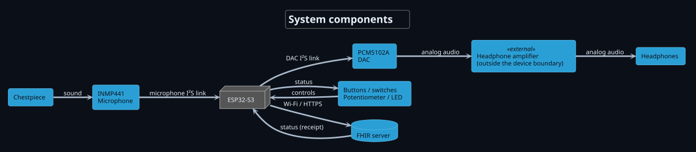

*Which hardware parts make up the device, and how does it connect to the outside?* Source: [puml/system-components.puml](puml/system-components.puml).

## Electrical interfaces

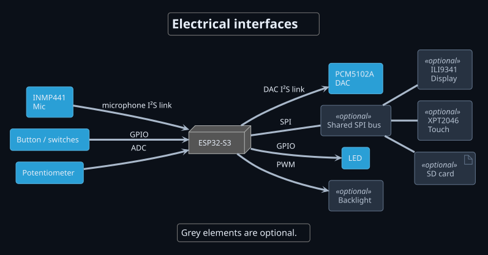

*Which electrical connection links each part to the ESP32-S3?* Source: [puml/electrical-interfaces.puml](puml/electrical-interfaces.puml). The [view notes](VIEW-NOTES.md#hardware-naming) name the two I2S links.

## Software components

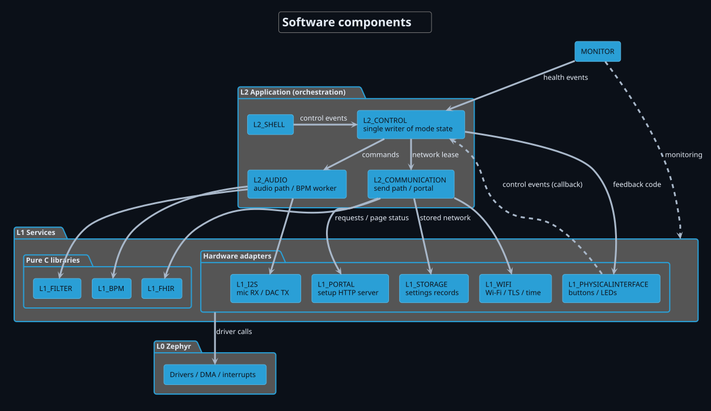

*Which firmware modules exist in each layer, and which modules does each one use?* Source: [puml/software-components.puml](puml/software-components.puml). The [module map](firmware-structure.md#static-dependency-and-module-map) defines what each module owns.

## Input ownership

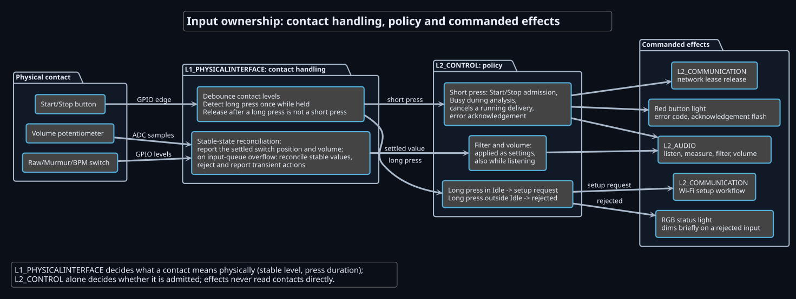

*Which module interprets a contact, and which one decides what it does?* Source: [puml/input-ownership.puml](puml/input-ownership.puml). The [view notes](VIEW-NOTES.md#input-ownership) describe the split.

## Threads

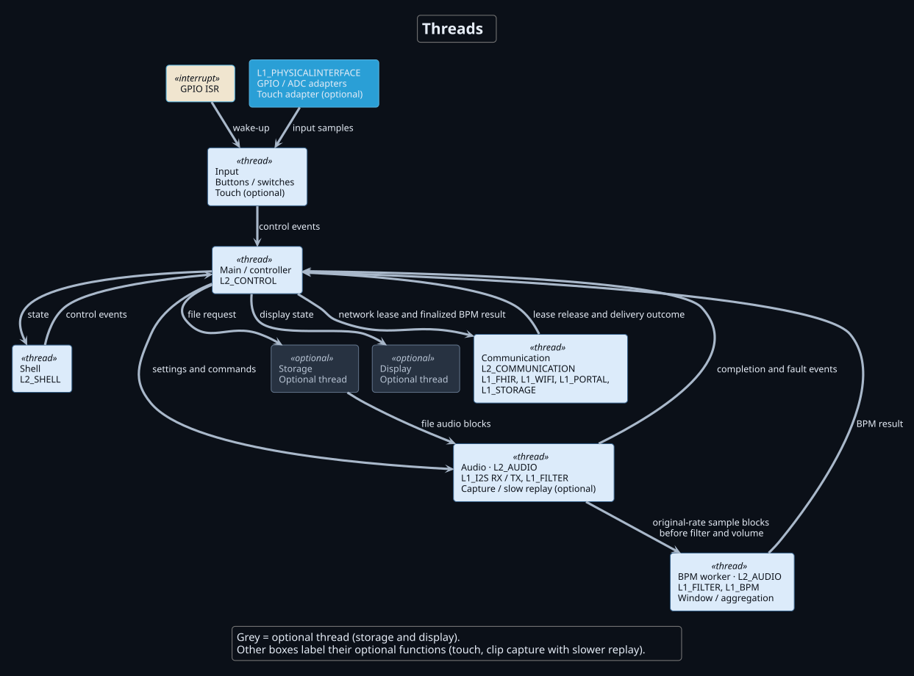

*Which worker runs each module, and how do the workers exchange data?* Source: [puml/runtime-ownership.puml](puml/runtime-ownership.puml). The [hand-off rules](firmware-structure.md#threads-and-hand-offs) define each exchange.

## Listening

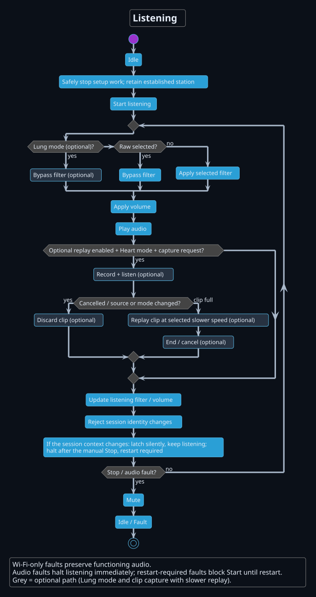

*What happens to the microphone signal before the operator hears it?* Source: [puml/listening-workflow.puml](puml/listening-workflow.puml).

## Session and error transitions

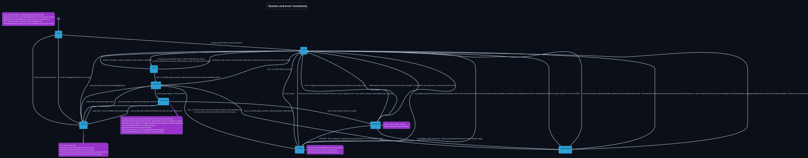

*Which workflow state follows Start, Stop, a fault or a delivery outcome?* Source: [puml/session-state.puml](puml/session-state.puml).

## BPM measurement

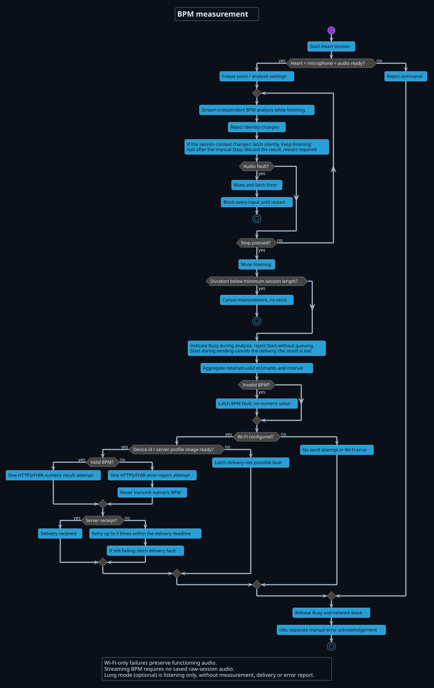

*How does a measurement session become a delivered result or an error report?* Source: [puml/measurement-workflow.puml](puml/measurement-workflow.puml).

## Server profile

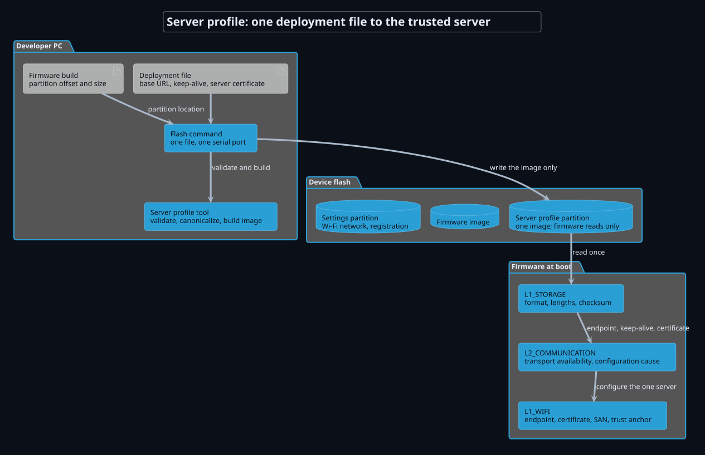

*How does the server endpoint and certificate get from the deployment file onto the device?* Source: [puml/server-profile.puml](puml/server-profile.puml). The [server profile architecture](server-profile.md) defines the responsibilities.
