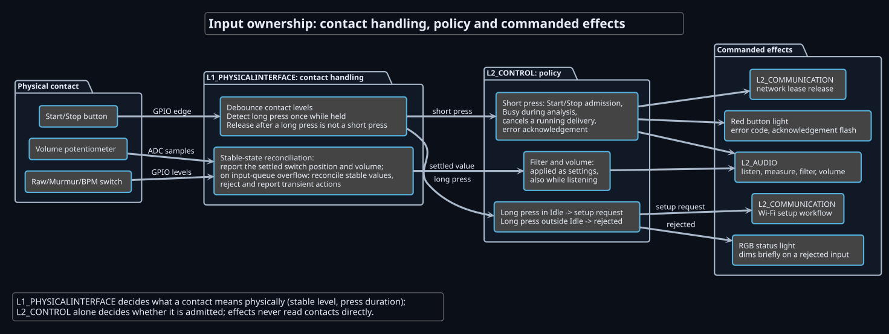

# Architecture view boundaries

These notes define the scope and boundaries of the views in the [architecture viewer](review.html).

| View | Source | Boundary |
|---|---|---|
| Architecture | [architecture-choice.puml](architecture-choice.puml) | Layers (L2 orchestrates, L1 adapts hardware or holds pure C libraries, L0 is Zephyr), RTOS workers and events. Task isolation is optional. A/B firmware is not included. |
| System context | [system-context.puml](system-context.puml) | Device as a black box; the device initiates FHIR requests and receives status responses as the receipt. Test tooling is outside the normal-use view. |
| System components | [system-components.puml](system-components.puml) | Hardware and external connections; ESP32 remains a black box. Networking is Wi-Fi plus HTTPS. |
| Electrical interfaces | [electrical-interfaces.puml](electrical-interfaces.puml) | Hardware connection types and chip roles, plus optional interfaces marked grey. |
| Software components | [software-components.puml](software-components.puml) | Firmware modules: L2 orchestration, L1 hardware adapters and pure C libraries, L0 Zephyr. Libraries include no Zephyr headers; MONITOR observes across layers. |
| Input ownership | [input-ownership.puml](input-ownership.puml) | Contact handling in L1_PHYSICALINTERFACE, policy in L2_CONTROL, commanded effects. See [Input ownership](#input-ownership). |
| Threads | [runtime-ownership.puml](runtime-ownership.puml) | Runtime workers, the modules they run and their interactions. Touch belongs to Input and the BPM worker belongs to `L2_AUDIO`. Original-rate blocks reach BPM before volume control, and BPM uses its own analysis filter independent of the listening switch. |
| Listening | [listening-workflow.puml](listening-workflow.puml) | Selected filter or Raw bypass, volume, playback and optional bounded capture/replay. Heart can select Raw; optional Lung mode is Raw listening only. |
| BPM measurement | [measurement-workflow.puml](measurement-workflow.puml) | Freeze measurement settings and acquire until Stop; cancel without sending below the minimum session length, otherwise finalize subject to quality/coverage. Aggregate after listening stops, then deliver the result or the error report. |

## Input ownership

L1_PHYSICALINTERFACE decides what a contact means physically. L2_CONTROL alone decides admission, Busy and acknowledgement ([feedback ground rules](feedback-principles.md)). Effects act only on L2_CONTROL commands.

## Hardware naming

The electrical interfaces view labels the two I2S links of the audio path by their role:

| Presentation | Role | Controller role |
|---|---|---|
| Microphone I2S link | INMP441 microphone input | ESP32-S3 I2S receive controller |
| DAC I2S link | PCM5102A DAC output | ESP32-S3 I2S transmit controller |

`L1_PHYSICALINTERFACE` owns the Start/Stop button, the Raw/Murmur/BPM switch, the volume
potentiometer, the button LED and the RGB status light. The device ends at the DAC line output; the
headphone amplifier is outside the device boundary.

## Scope

- DSP algorithms are pure C libraries in L1 (`L1_FILTER`, `L1_BPM`) so the same code can run in host tests.
- Queues carry bounded events or buffer handles. BPM collects successive original-rate
  blocks into its own analysis window; it never waits for an entire replay clip.
- During replay, BPM continues receiving original-rate microphone audio.
- Measurement and session timing is configurable.
- FHIR result delivery is a device-initiated conditional create with bounded retries and receipt verification without readback. The [examination-request boundary](../COMMUNICATION/server-communication.md) is separate. Network work waits until listening stops.
- The firmware runs on a single processor core.

## Diagram notation

Display, touch, SD-card storage, clip capture with slower replay and Lung mode are optional.
Grey elements carry an `optional` stereotype, and boxes combining core and optional functions mark
the optional responsibilities in their labels. Component views use PlantUML component diagrams, and
listening and measurement views use activity diagrams.
