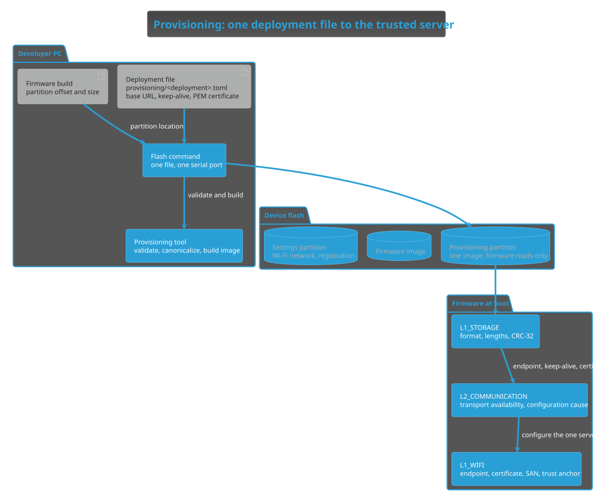

# Provisioning architecture

## Basis and scope

This Architecture-stage proposal allocates how a device receives its one server: endpoint, keep-alive and trusted certificate. It refines the [TLS trust boundary](https://github.com/DemonicPsychoII/DigitalStethoscope/pull/80) and the separate provisioning image and flash layout from the [design review of 2 November 2026](https://github.com/DemonicPsychoII/DigitalStethoscope/pull/104). Its requirements basis is REQ-09, REQ-11 and REQ-13. It defines components, responsibilities, boundaries and dependencies; the file format, image format, validation rules and commands belong to detailed design.

Nico decided on 4 November 2026 that one file per server deployment holds everything the image needs, that this file is TOML with the certificate embedded as PEM text, that deployment files are versioned in the repository, and that one flash command validates, builds and writes the image [1]. These are project decisions, not measurements. The design review had already placed endpoint and certificate in an image separate from the firmware [2].

## Responsibilities and dependencies

Editable source: [provisioning.puml](provisioning.puml).

| Owner | Responsibility | Boundary |
| --- | --- | --- |
| Deployment file | The single reviewed source of one server deployment: base URL, server keep-alive and the public server certificate. | Public data only. Never a private key, keystore, password or patient context. |
| Provisioning tool (developer PC) | Validate the file, canonicalize the base URL, check the certificate against the endpoint, build the versioned image with its checksum and check that it fits the partition. | Writes no firmware and no other partition. Does not obtain a certificate from the network. |
| Flash command (developer PC) | Take one deployment file and one serial port, run the tool and write the image at the partition location taken from the firmware build. | The firmware image and the settings partition stay unchanged. |
| Provisioning partition (device flash) | Hold exactly one image, independent of firmware updates and settings erasure. | The firmware reads it and never writes it. |
| L1_STORAGE | Read the image once at boot and check its format, lengths and checksum. | Does not interpret the endpoint or the certificate. |
| L2_COMMUNICATION | Load the image at boot, decide whether secure transport is available and report a configuration cause otherwise. | A missing or invalid image never blocks Wi-Fi setup or offline listening. |
| L1_WIFI | Parse the endpoint, parse the certificate, require a Subject Alternative Name that matches the endpoint and make the certificate the only trust anchor. | No fallback endpoint, no fallback certificate and no insecure mode. |

Dependency direction: the deployment file feeds the host tool; the tool depends on the firmware build only for the partition location. On the device, COMMUNICATION reads through STORAGE and configures WIFI; nothing on the device depends on the deployment file or the tool. A server change means a new file revision and a new image, not a firmware build.

## Trust boundary

Whoever can flash the device can change its server; physical access is the trust assumption of the design review [2]. The image checksum detects corruption, not tampering, and the MVP image carries no signature.

The deployment file contains only public information, so it can be versioned and reviewed like source code. A server change is visible in review as a changed endpoint or certificate. The server's private key and keystore stay with the server deployment.

The device trusts the provisioned certificate directly and verifies the server identity against its Subject Alternative Names, without Common Name fallback [3]. The tool applies the same identity rule before flashing, so a certificate that cannot match the endpoint is rejected on the developer PC rather than at the next boot.

## Open and deferred decisions

- The flash layout keeps the board's settings partition until [TICKET-214](https://nfrie.atlassian.net/browse/TICKET-214) moves it; the provisioning partition location is the same in both layouts.
- Signed images, several servers per device, network or portal enrollment and a project certificate authority remain outside this version, as in the design review [2].
- Detailed design defines the file format, its validation, the image format and the command interface.

## Verification allocation

These scenarios allocate future verification; they do not add a generated test batch or claim execution.

| Scenario | Trace | Expected outcome |
| --- | --- | --- |
| Valid deployment file flashed | REQ-09/REQ-11; VT-08 | Boot reports the provisioned server; secure preparation uses that endpoint and certificate. |
| Invalid deployment file | REQ-11; VT-08 | The tool rejects it before writing; the device keeps its previous image. |
| Certificate without matching Subject Alternative Name | REQ-11; VT-08 | Rejected by the tool; a device that boots with such an image reports a configuration cause and no secure transport. |
| Missing or corrupted image | REQ-11/REQ-13; VT-08/VT-09 | Secure transport unavailable with a configuration cause; Wi-Fi setup and offline listening unaffected. |
| Firmware update or settings erasure | REQ-11/REQ-12; VT-08 | The image remains and is accepted at the next boot. |
| Deployment file content | VT-11 | Inspection finds no private key, keystore, password or patient context. |

## Sources

[1] Nico, *Provisioning deployment-file decisions*, personal communication, T3 Code, 4 November 2026, [conversation](t3-thread://v2/d5e44f69-2ecc-4a3e-917b-31a7b084c12b/b0a0170f-70da-43f5-89a6-38c67da80e40), accessed 4 November 2026. Recorded in the [source register](../../../../thesis-material/quellen.md#nico_provisioning_decisions_20261104). Project decisions, not measurements.

[2] Andreas Summerer and Nico, *Design review of time, TLS and FHIR*, review meeting, 2 November 2026, 10:30–11:30, notes by Nico with resolutions in the [T3 conversation](t3-thread://v1/d5e44f69-2ecc-4a3e-917b-31a7b084c12b), accessed 2 November 2026; resolutions applied in [PR #104](https://github.com/DemonicPsychoII/DigitalStethoscope/pull/104). Recorded in the [source register](../../../../thesis-material/quellen.md#summerer_design_review_20261102). Project decisions, not measurements.

[3] Peter Saint-Andre and Rich Salz, *Service Identity in TLS*, IETF RFC 9525, November 2023, sections 4 and 6, DOI [10.17487/RFC9525](https://doi.org/10.17487/RFC9525), <https://www.rfc-editor.org/rfc/rfc9525>, accessed 4 November 2026. Recorded in the [source register](../../../../thesis-material/quellen.md#ietf_service_identity_9525_2023).
