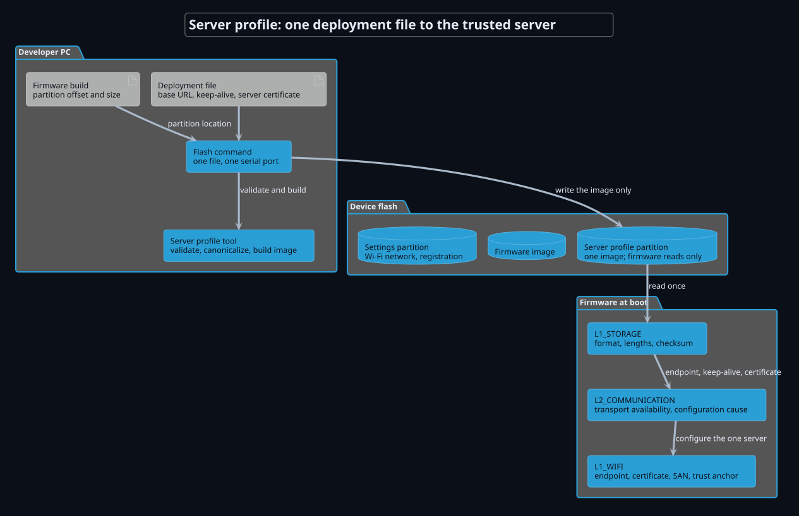

# Server profile architecture

## Basis and scope

Server profile provisioning defines how a device receives its single server endpoint, keep-alive and trusted certificate in a flash image separate from the firmware. It refines the [TLS trust boundary](../COMMUNICATION/secure-transport.md) under [REQ-09](../../requirements/system-requirements.md#req-09), [REQ-11](../../requirements/system-requirements.md#req-11), [REQ-12](../../requirements/system-requirements.md#req-12) and [REQ-13](../../requirements/system-requirements.md#req-13).

One deployment file per server holds the endpoint, keep-alive and public certificate. Deployment files are versioned separately from firmware builds, and a single host flash command validates the file, builds the server profile image and writes it to its dedicated flash partition.

## Responsibilities and dependencies

Editable source: [puml/server-profile.puml](puml/server-profile.puml).

| Owner | Responsibility | Boundary |
| --- | --- | --- |
| Deployment file | The single reviewed source of one server deployment: base URL, server keep-alive and the public server certificate. | Public data only. Never a private key, keystore, password or patient context. |
| Server profile tool (developer PC) | Validate the file, canonicalize the base URL, check the certificate against the endpoint, build the versioned image with its checksum and check that it fits the partition. | Writes no firmware and no other partition. Does not obtain a certificate from the network. |
| Flash command (developer PC) | Take one deployment file and one serial port, run the tool and write the image at the partition location taken from the firmware build. | The firmware image and the settings partition stay unchanged. |
| Server profile partition (device flash) | Hold exactly one image at a fixed start, independent of firmware updates, the settings size and an erase of the settings partition; a whole-flash erase removes it. | The firmware reads it and never writes it. |
| L1_STORAGE | Read the image once at boot and check its format, lengths and checksum. | Does not interpret the endpoint or the certificate. |
| L2_COMMUNICATION | Load the image at boot, decide whether secure transport is available and report a configuration cause otherwise. | A missing or invalid image never blocks Wi-Fi setup or offline listening. |
| L1_WIFI | Parse the endpoint, parse the certificate, require a Subject Alternative Name that matches the endpoint and make the certificate the only trust anchor. | No fallback endpoint, no fallback certificate and no insecure mode. |

Dependency direction: the deployment file feeds the server profile tool on the developer PC; the tool depends on the firmware build only for the partition location. On the device, L2_COMMUNICATION reads the image through L1_STORAGE and configures L1_WIFI; nothing on the device depends on the deployment file or the tool. A server change means a new file revision and a new image, not a firmware build.

## Trust boundary

Whoever can flash the device can change its server; physical access is the trust assumption. The image checksum detects corruption, not tampering, and the image carries no signature. Without secure boot the same physical access can replace the firmware itself, so an image signature alone would add no protection. The device uses neither secure boot nor image signing.

The deployment file contains only public information, so it can be versioned and reviewed like source code. The source repository holds test deployments only; a real deployment keeps its file with that deployment. A server change is visible in review as a changed endpoint or certificate. The server's private key and keystore stay with the server deployment.

The device trusts the server profile's certificate directly and verifies the server identity against its Subject Alternative Names, without Common Name fallback [1]. The tool applies the same identity rule before flashing, so a certificate that cannot match the endpoint is rejected on the developer PC rather than at the next boot.

## Partition independence

The server profile has a fixed location in flash that is independent of the settings: a settings size change never moves it, and it never changes between firmware versions, so an updated firmware still finds an image flashed earlier. The settings have their own fixed start in front of it. The firmware's own partition table defines both partitions.

## Verification allocation

| Scenario | Trace | Expected outcome |
| --- | --- | --- |
| Valid deployment file flashed | [REQ-09](../../requirements/system-requirements.md#req-09)/[REQ-11](../../requirements/system-requirements.md#req-11); VT-08 | Boot reports the configured server; secure preparation uses that endpoint and certificate. |
| Invalid deployment file | [REQ-11](../../requirements/system-requirements.md#req-11); VT-08 | The tool rejects it before writing; the device keeps its previous image. |
| Certificate without matching Subject Alternative Name | [REQ-11](../../requirements/system-requirements.md#req-11); VT-08 | Rejected by the tool; a device that boots with such an image reports a configuration cause and no secure transport. |
| Missing or corrupted image | [REQ-11](../../requirements/system-requirements.md#req-11)/[REQ-13](../../requirements/system-requirements.md#req-13); VT-08/VT-09 | Secure transport unavailable with a configuration cause; Wi-Fi setup and offline listening unaffected. |
| Firmware update or settings-partition erase | [REQ-11](../../requirements/system-requirements.md#req-11)/[REQ-12](../../requirements/system-requirements.md#req-12); VT-08 | The image remains and is accepted at the next boot. |
| Deployment file content | VT-11 | Inspection finds no private key, keystore, password or patient context. |

## Sources

[1] Peter Saint-Andre and Rich Salz, *Service Identity in TLS*, IETF RFC 9525, November 2023, sections 4 and 6, DOI [10.17487/RFC9525](https://doi.org/10.17487/RFC9525), <https://www.rfc-editor.org/rfc/rfc9525>, accessed 4 November 2026.
