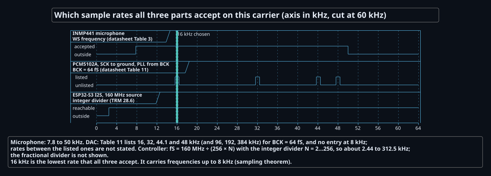
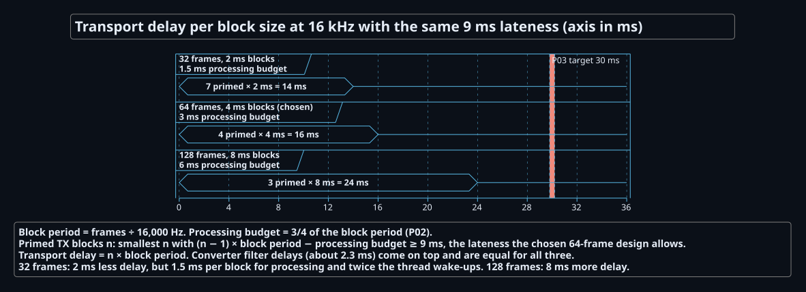
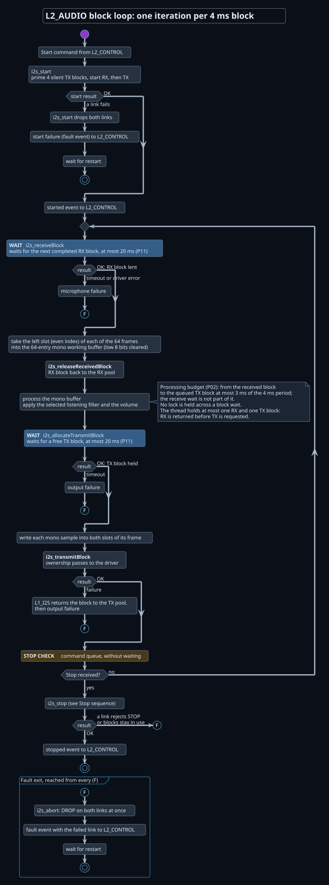
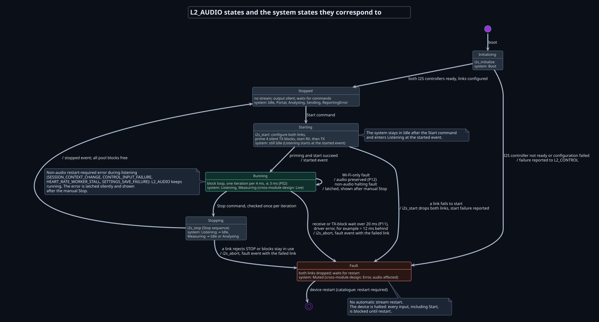
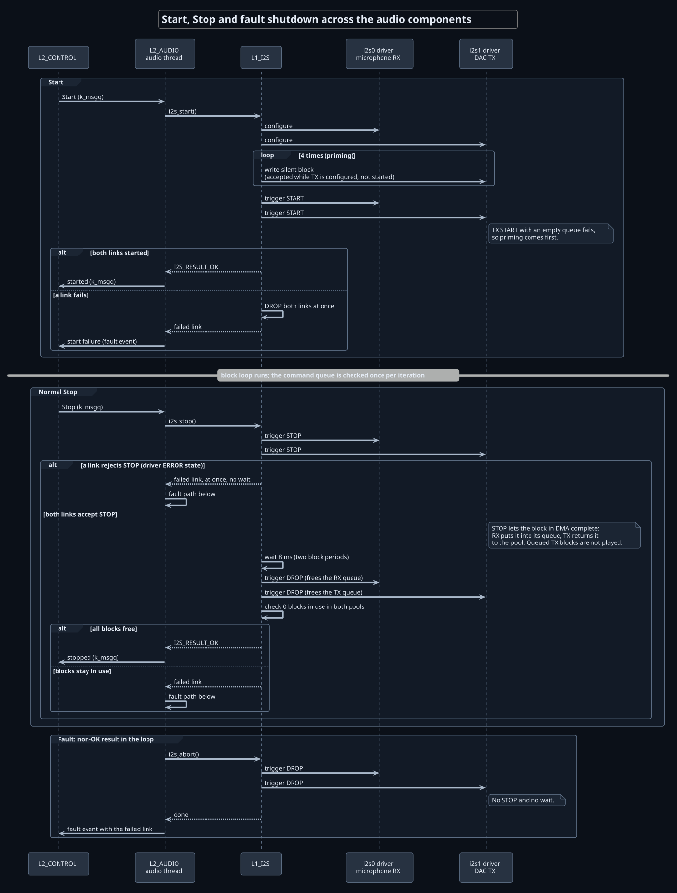
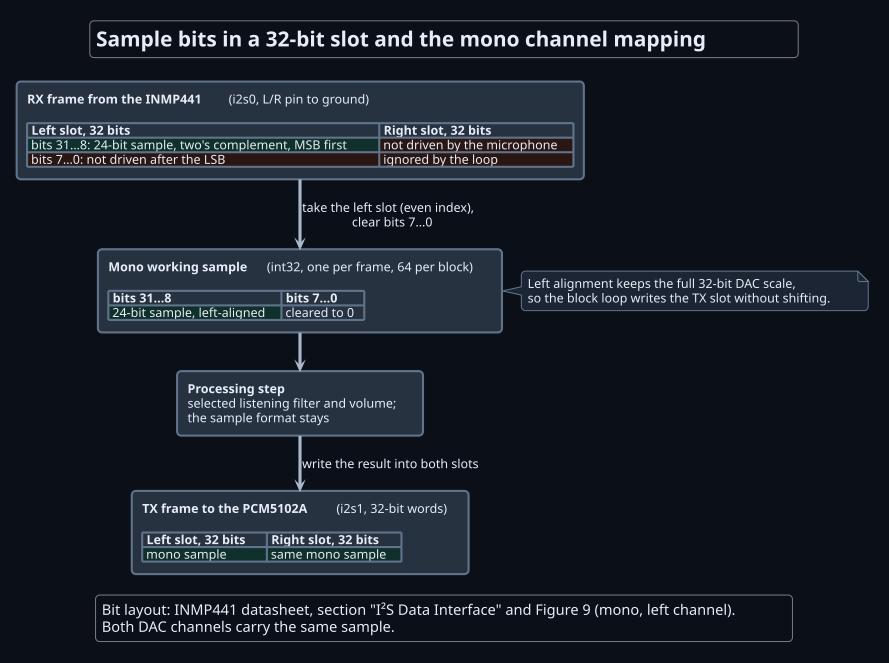
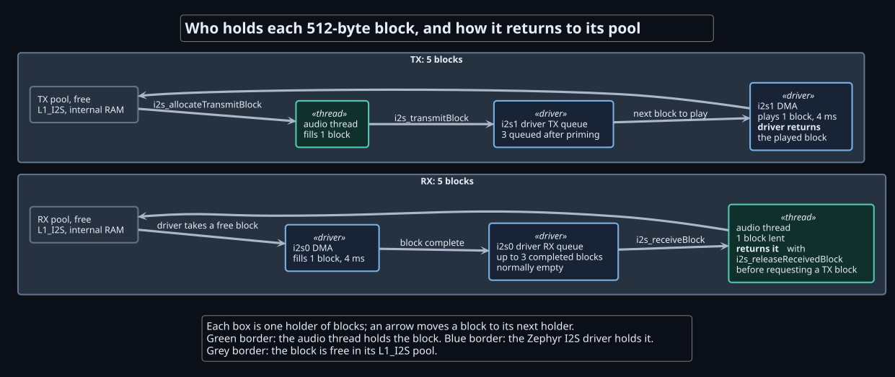
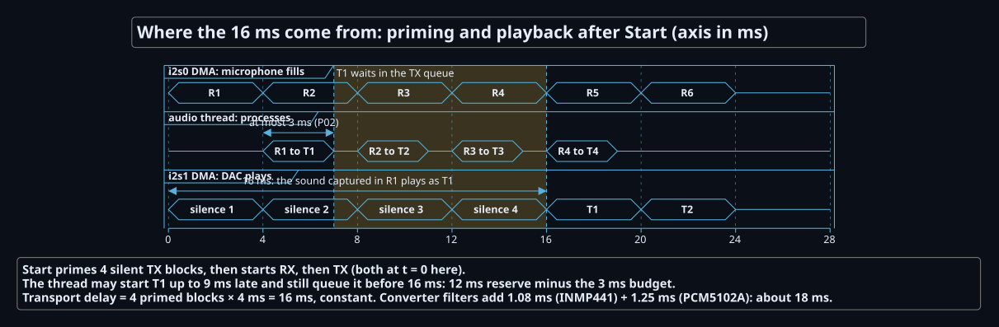
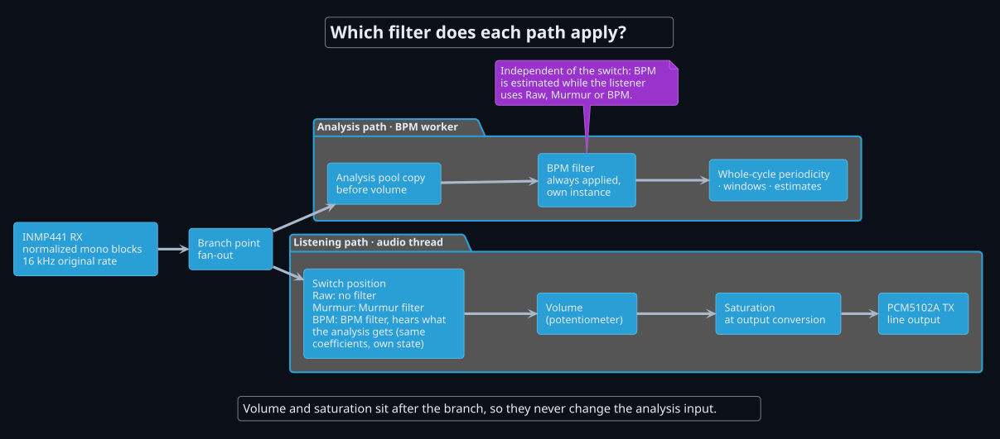
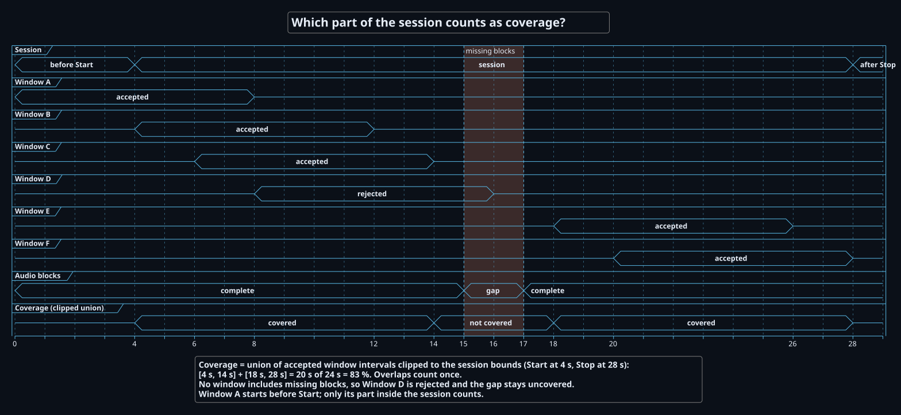

# Audio interfaces and behavior

`L1_I2S` owns both I2S links and their block pools. `L2_AUDIO` owns the block loop and reports to
`L2_CONTROL`. The [AUDIO architecture](../../architecture/AUDIO/README.md) defines these
responsibilities. The audio path carries samples from the microphone to the DAC. Its processing
step applies the selected listening filter and the volume.

| View | Editable source | Answers |
| --- | --- | --- |
| Block loop | [puml/block-loop.puml](puml/block-loop.puml) | In which order does one block pass, where does the thread wait, where is Stop checked? |
| States | [puml/audio-state.puml](puml/audio-state.puml) | Which states does `L2_AUDIO` have, and which system states do they correspond to? |
| Start and Stop | [puml/start-stop-sequence.puml](puml/start-stop-sequence.puml) | In which order are the links primed, started and shut down? |
| Sample format | [puml/sample-format.puml](puml/sample-format.puml) | Where is the sample in the 32-bit slot, and how does it reach both DAC channels? |
| Buffer circulation | [puml/buffer-circulation.puml](puml/buffer-circulation.puml) | Who holds each block, and how does it return to its pool? |
| Priming and playback | [puml/priming-timing.puml](puml/priming-timing.puml) | Where do the 16 ms of transport delay come from? |
| Sample rate | [puml/sample-rate-range.puml](puml/sample-rate-range.puml) | Which sample rates do all three parts accept? |
| Block size | [puml/block-size-delay.puml](puml/block-size-delay.puml) | What does the block size cost in delay? |
| Filter signal flow | [puml/shared-filter-signal-flow.puml](puml/shared-filter-signal-flow.puml) | Which filter does each path apply, and where do volume and saturation sit? |
| Analysis coverage | [puml/shared-analysis-coverage.puml](puml/shared-analysis-coverage.puml) | Which part of the session counts as coverage? |

## Stream configuration

Both links use the same word size, slot count and sample rate, so both controllers derive the same
clock dividers from the same default clock source [1].

| Setting | Value | Reason |
| --- | --- | --- |
| Links | `i2s0` RX from the INMP441, `i2s1` TX to the PCM5102A | The microphone and the DAC each have their own link ([electrical interfaces](../../architecture/system/README.md)) |
| Format | RX: Zephyr `I2S_FMT_DATA_FORMAT_LEFT_JUSTIFIED` with `I2S_FMT_FRAME_CLK_INV`. TX: `I2S_FMT_DATA_FORMAT_I2S`. The ESP32-S3 drives bit and frame clock on both links | The microphone and the DAC both take their clocks from the ESP32-S3. RX: see [receive format](#receive-format) |
| Channels, word size | 2 channels, 32-bit words | The driver accepts only two channels [1]; equal word sizes keep the dividers equal [1] |
| Sample rate | 16,000 Hz (P01) | [Rationale](#sample-rate-and-block-size-rationale) |
| Block | 64 frames × 2 slots × 4 bytes = 512 bytes, 4 ms | P01. Below the 4092-byte DMA descriptor limit, so each block uses one descriptor [1] |
| RX pool | 5 blocks; the driver's RX queue holds 3 blocks (`CONFIG_I2S_ESP32_RX_BLOCK_COUNT`) | 3 completed blocks waiting, 1 in DMA, 1 lent to the audio thread |
| TX pool | 5 blocks; the driver's TX queue holds 4 blocks (`CONFIG_I2S_ESP32_TX_BLOCK_COUNT`) | 4 blocks primed before TX starts (1 in DMA and 3 queued afterwards), 1 being filled |
| Memory | Both pools in internal DMA-capable RAM, defined at build time | Pools stay in internal RAM rather than PSRAM |

## Receive format

The RX link uses `I2S_FMT_DATA_FORMAT_LEFT_JUSTIFIED` with `I2S_FMT_FRAME_CLK_INV` so that the
24-bit INMP441 sample fills bits 31 to 8 of the 32-bit left slot, matching the
[sample format](#sample-format). Standard `I2S_FMT_DATA_FORMAT_I2S` shifts the received word one bit
left on this link, discarding the sign bit and leaving bit 8 unused.

- Combining `I2S_FMT_DATA_FORMAT_LEFT_JUSTIFIED` with `I2S_FMT_FRAME_CLK_INV` keeps the left slot on
  WS low and disables the one-bit shift after the WS edge, sampling one bit clock earlier [1].
- The TX link keeps the standard format.

## Sample-rate and block-size rationale

The sample rate must lie inside the range of the microphone, the DAC and the I2S controller.

*Which sample rates do all three parts accept on this carrier?*

| Part | Range or limit | Source |
| --- | --- | --- |
| INMP441 | WS (frame clock) frequency 7.8–50 kHz; 64 SCK per stereo frame | [2], Table 3 (p. 5) and section "I²S Data Interface" (p. 11) |
| PCM5102A | Sampling frequency 8–384 kHz in general. On the carrier SCK is tied to ground, so the DAC builds its clock from BCK with its PLL. For that mode, Table 11 lists BCK for 16, 32, 44.1, 48, 96, 192 and 384 kHz at 64 fS and has no entry at 8 kHz; 32-bit words need BCK = 64 fS | [3], "Electrical Characteristics" (p. 7), Table 2 (p. 15), section 9.3.5.3 and Table 11 (p. 25) |
| ESP32-S3 I2S | Master clock = source ÷ (N + b/a), integer part N = 2…256; source 160 MHz (`PLL_F160M`, the driver default) | [4], section 28.6; [1]; [5] |
| ESP32-S3 I2S at 32-bit words | With a master clock of 256 × fS and the integer divider N = 2…256, fS = 160 MHz ÷ (256 × N) spans 2.44–312.5 kHz. At 16 kHz, N = 39.0625 requires the fractional divider, which the TRM notes may add clock jitter. | [1], [4], [5] |

- 16 kHz is the lowest rate that the microphone accepts and the DAC lists for its PLL mode on this
  carrier; 8 kHz is not listed for the DAC [2] [3].
- Taking the lowest common rate keeps data and processing per second lowest.
- A 16 kHz rate represents content up to 8 kHz [6].

*What does the block size cost in delay, for the same lateness the 64-frame design allows?*

| Block | Period | Processing budget (P02 share) | Primed TX blocks n | Transport delay |
| --- | --- | --- | --- | --- |
| 32 frames | 2 ms | 1.5 ms | (n − 1) × 2 ms − 1.5 ms ≥ 9 ms → 7 | 14 ms; 2 ms less, but twice as many thread wake-ups |
| 64 frames (chosen) | 4 ms | 3 ms | 4 | 16 ms |
| 128 frames | 8 ms | 6 ms | (n − 1) × 8 ms − 6 ms ≥ 9 ms → 3 | 24 ms; below 30 ms, but 8 ms more |

Transport delay and reserve follow from the Zephyr ESP32 I2S driver queue behavior [1].

## Service boundary

Every `L1_I2S` operation returns an `i2s_result`: `I2S_RESULT_OK`, `I2S_RESULT_MICROPHONE_FAILURE`
or `I2S_RESULT_OUTPUT_FAILURE`. The two failure values identify the failed link and map to the
catalogue codes `MICROPHONE_FAILURE` and `AUDIO_OUTPUT_FAILURE`. `L1_I2S` logs the driver error code
and does not retry.

| Interface | Inputs | Outputs and ownership |
| --- | --- | --- |
| `i2s_initialize()` | One call at boot | Checks that both I2S controllers are ready and configures both links. No stream runs afterwards. It cannot tell whether the microphone or the DAC is connected: neither answers on its link, so a missing device is not detected at boot. |
| `i2s_start()` | Called while stopped | Configures both links again, primes 4 silent TX blocks, starts RX, then TX. On failure it drops both links as `i2s_abort()` does and returns the failed link. |
| `i2s_stop()` | While running, for a normal Stop | Stops both links in the [Stop sequence](#stop-sequence) and returns every pool block; no further sound. Returns the failed link if a link rejects `STOP` or blocks stay in use. Repeated calls are harmless. |
| `i2s_abort()` | After an audio fault | Triggers `DROP` on both links at once, without `STOP` or a wait; no further sound. Blocks the driver held at that moment may stay in use; the required restart clears them. Repeated calls are harmless. |
| `i2s_receiveBlock(receivedFrames)` | Pointer for the result | Waits at most the receive wait (P11) for the next completed RX block and lends it to the caller. A timeout or driver error is a microphone failure. |
| `i2s_releaseReceivedBlock(receivedFrames)` | A lent RX block | Returns it to the RX pool. |
| `i2s_allocateTransmitBlock(transmitFrames)` | Pointer for the result | Waits at most the TX-block wait (P11) for a free TX block. A timeout is an output failure. |
| `i2s_transmitBlock(transmitFrames)` | A filled TX block | Queues it for the DAC; ownership passes to the driver. On failure `L1_I2S` returns the block to the pool and reports an output failure. |
| `i2s_getPoolUse(receivePoolHighestUse, transmitBlocksInDriver)` | Pointers for the two values | Read-only, for [monitoring](#monitoring): the RX pool's highest use since boot and the TX blocks currently held by the driver. Always `I2S_RESULT_OK`. |

## Block loop

`L2_AUDIO` runs one audio thread with one deterministic processing path: read, process, send.

*In which order does one block pass, where does the thread wait, and where is Stop checked?*

- The audio thread has the highest priority of all application threads.
- Processing budget (P02): from the received block to the queued TX block at most 3 ms; the wait
  for the next block is not part of it. No lock is held across a block wait.
- The processing step applies the selected listening filter and the volume. The Raw position
  applies no band filter ([P08](parameters.md)).
- The volume from `L2_CONTROL` is a linear gain of 0–100 % with saturation that keeps the
  [sample format](#sample-format). The volume starts at 0 % and is 0 % for a failed or absent
  potentiometer reading. It passes as an atomic value, so the audio thread never waits for it.
- The mono working buffer has 64 entries, 256 bytes, owned by the audio thread. Left-slot
  extraction follows the [sample format](#sample-format).
- The thread returns the RX block before it requests a TX block, so it never holds more than one
  block of each pool.

## States

*Which states does `L2_AUDIO` have, and which system states do they correspond to?*

The left column lists the `L2_AUDIO` states. The system state names come from the
[session state view](../../architecture/system/README.md) and the state table of the
[cross-module design](../cross-module.md#state-entryprocessexit).

| `L2_AUDIO` state | System state | Basis |
| --- | --- | --- |
| Initializing | Boot (session view); Playback Boot (cross-module design) | `i2s_initialize` at boot; no stream |
| Stopped | Idle, Portal, Analysing, Sending, ReportingError | Idle is muted with no transport; sending holds the network lease with audio stopped |
| Starting | Idle until the `started` event | The system stays in Idle on the Start command and enters Listening on the `started` event |
| Running | Listening, Measuring (session view); Live (cross-module design) | The block loop runs; Wi-Fi-only faults preserve it ([P12](../FEEDBACK/parameters.md)) |
| Stopping | Listening → Idle; Measuring → Idle or Analysing | Every system Stop mutes audio |
| Fault | Muted (session view); Error, audio affected (cross-module design) | `MICROPHONE_FAILURE`, `AUDIO_WORKER_STALL` and `AUDIO_OUTPUT_FAILURE` require a restart ([catalogue](../FEEDBACK/catalogue.md)). The device is halted and blocks every input, including Start, until restart |

State mapping rules:

- The system stays in Idle on the Start command and enters Listening on the `started` event.
- A non-audio restart-required error during listening (`SESSION_CONTEXT_CHANGE`, `CONTROL_INPUT_FAILURE`, `HEART_RATE_WORKER_STALL` and `SETTINGS_SAVE_FAILURE`) does not stop
  `L2_AUDIO`: `L2_CONTROL` latches it silently, listening continues, and the error is shown and
  applies its clear rule after the operator stops the examination manually.
- `L2_AUDIO` in Fault never starts again: the device is halted, every input including Start is
  blocked, and only a restart leaves Fault.

## Start, Stop and faults

*In which order are the links primed, started and shut down?*

- **Boot:** `i2s_initialize`; no stream is started. Ready: Stopped. Failure: reported to
  `L2_CONTROL`.
- **Start while stopped:** `i2s_start` primes the TX queue before starting TX, then the block loop
  runs and emits `started` or the start failure. The Zephyr I2S driver requires a non-empty TX queue
  before `START` [1].
- **Stop:** leave the loop, `i2s_stop`; on success `stopped` event and output silent. A failed
  `i2s_stop` is an audio fault and takes the fault path below.
- **Any non-OK result in the loop:** `L2_AUDIO` calls `i2s_abort`, emits a fault event identifying
  the failed link and waits for restart. `L2_CONTROL` shows the catalogue error, which requires a
  restart. The stream does not restart automatically.

### Stream faults

- A stream fault includes a deadline miss. If the audio thread falls more than three blocks (12 ms,
  processing included) behind, the Zephyr I2S driver stops the stream [1], and the stream remains
  stopped until configured and started again.
- A stream fault stays a restart-required error under the catalogue: a Start after a fault needs a
  device restart.

### Stop sequence

A normal Stop lets the block in DMA finish and then discards both queues. A fault discards both
queues immediately without waiting.

For a normal Stop, `i2s_stop` [1]:

1. triggers `STOP` on both links: the block in DMA completes; the driver puts it into the RX queue
   or returns it to the TX pool, and queued TX blocks are not played. A link that entered the
   driver's ERROR state, for example after an RX DMA error, rejects `STOP`; `i2s_stop` then
   returns that link at once, without the wait;
2. waits 8 ms, two block periods, so the block in DMA completes on both links;
3. triggers `DROP` on both links, which returns the queued blocks;
4. checks that both pools have 0 blocks in use; blocks still in use are a failure.

| Zephyr I2S driver constraint [1] | Design consequence |
| --- | --- |
| `DROP` frees queued blocks without releasing the active DMA block | Stopping with `DROP` alone leaks one RX block and one TX block per session until the pools cannot start. `i2s_stop` therefore triggers `STOP` and waits for DMA completion before `DROP`. |

## Sample format

*Where is the sample in the 32-bit slot, and how does it reach both DAC channels?*

- The INMP441 sends each sample as 24-bit two's complement, MSB first, in a word of 32 bit clocks,
  and stops driving its data pin after the LSB [2]. With L/R tied to ground it sends on the left
  slot only [2].
- The sample therefore fills the top 24 bits of the 32-bit left slot. The microphone does not drive
  the 8 bits after the LSB, so the loop clears them.
- The mono working sample is left-aligned in `int32_t` with its low 8 bits cleared, so the block
  loop writes it into both 32-bit DAC slots without shifting.
- The PCM5102A receives 32-bit words [3].

## Timing and sizing

*Who holds each block, and how does it return to its pool?*

*Where do the 16 ms of transport delay come from?*

| Quantity | Derivation | Value |
| --- | --- | --- |
| Block period | 64 frames ÷ 16,000 Hz | 4 ms |
| Block size | 64 frames × 2 slots × 4 bytes; two slots because the driver accepts only stereo, 4 bytes because a 24-bit sample needs a 32-bit slot [1] | 512 bytes |
| RX pool | 3 completed blocks waiting + 1 in DMA + 1 lent to the audio thread | 5 blocks, 2,560 bytes |
| TX pool | 4 queued blocks (the primed ones, 1 of them in DMA) + 1 being filled | 5 blocks, 2,560 bytes |
| Mono working buffer | 64 samples × 4 bytes | 256 bytes |
| RX reserve | 3 waiting blocks × 4 ms | 12 ms for processing and lateness together before RX overruns |
| TX reserve | 3 queued blocks behind the one in DMA × 4 ms | 12 ms for processing and lateness together before TX runs empty; with the 3 ms budget the thread may start a block up to 9 ms late |
| Transport delay | 4 primed TX blocks × 4 ms. The first RX block fills and is processed while the primed blocks play, so neither adds delay; processing time uses up reserve instead | 16 ms, constant |
| Converter delay | Digital filters at 16 kHz: INMP441 17.2 ÷ fS [2]; PCM5102A normal-latency filter 20 ÷ fS, selected because FLT is tied to ground on the carrier [3] | 1.08 ms + 1.25 ms; about 18 ms from sound to line output, below the P03 target of 30 ms |
| Processing budget | Three quarters of the block period (P02) | At most 3 ms per block |
| Block waits | 5 block periods ([P11](../cross-module.md#parameters)) | 20 ms; a normal block arrives within 4 ms |
| Internal RAM | 2,560 + 2,560 + 256 bytes | 5,376 bytes, plus thread stack and driver descriptors |

The transport delay and the reserves follow from the driver behavior [1] and the converter
datasheets [2] [3]. P03 is judged by ear under [REQ-05](../../requirements/system-requirements.md#req-05). The
[block-size comparison](#sample-rate-and-block-size-rationale) applies the same derivation to 32-
and 128-frame blocks.

The internal RAM figure counts the transport blocks and the mono working buffer before DMA
descriptors, alignment and driver overhead. A mono int32 analysis block is 256 bytes plus handles
and metadata.

## DSP and measurement design

*Which filter does each path apply, and where do volume and saturation sit?*

`L2_AUDIO` preserves filter state across continuously evaluated listening paths and clears filter histories on source reset. Signed microphone samples are normalized once and saturated only at output conversion, with clipping counters.

BPM analysis estimates heart rate from whole-cycle periodicity after the BPM filter and excludes missing blocks from every window. Invalid windows are rejected with a reason rather than producing a numeric estimate. Session coverage is the union of accepted window intervals clipped to the session bounds.

*Which part of the session counts as coverage?*

## Monitoring

`L2_AUDIO` records these values:

| Value | Read from | Shows |
| --- | --- | --- |
| Processed blocks, stream faults | Counters in `L2_AUDIO` | Activity and faults |
| Longest iteration time | Measured per iteration | A deadline miss before it becomes a stream fault |
| RX pool highest use | `i2s_getPoolUse` (`receivePoolHighestUse`, high-water mark since boot) | A deadline miss before it becomes a stream fault; only the RX pool has a fixed limit below 5 blocks |
| TX blocks in the driver, over time | `i2s_getPoolUse` (`transmitBlocksInDriver`, read before the thread allocates its TX block) | A level that drifts over a long run shows that the two links do not run at the same rate |

The pools are private to `L1_I2S`, hence the query. RX starts before TX, so the thread can
queue its TX block just before the DAC returns the played one; the TX pool can then reach 5 blocks
and the TX driver queue 4 in normal operation [1].

## Expected verification

| Scenario | Basis | Expected result |
| --- | --- | --- |
| Boot with both links ready | VT-01, [REQ-01](../../requirements/system-requirements.md#req-01) | Stopped; no TX stream and no sound before Start |
| Boot with an I2S controller not ready or its configuration rejected, injected on the host at the driver boundary | VT-01 | Failure for that link; `L2_CONTROL` shows `MICROPHONE_FAILURE` or `AUDIO_OUTPUT_FAILURE` |
| Stop while a link is in the driver's ERROR state, injected on the host at the driver boundary | VT-01 | No `stopped` event; both links dropped; restart-required fault reported |
| Start, then Stop, 10 times in a row | [REQ-01](../../requirements/system-requirements.md#req-01), [REQ-02](../../requirements/system-requirements.md#req-02), VT-04 | `started` after priming and RX before TX; `stopped`, output silent; after every Stop all 5 blocks of each pool are free |
| Heart sounds after Start | [REQ-02](../../requirements/system-requirements.md#req-02) | Audible on both channels within 2 s |
| Processing step with a known RX block, Raw position and 100 % volume | VT-03 | Both TX slots of every frame equal the left RX slot with its low 8 bits cleared; the right RX slot is ignored |
| Receive wait expires | VT-01 | Microphone failure; stream stopped; catalogue error |
| Thread more than 12 ms behind, processing included | VT-02 | Driver stops the stream; fault reported; no hang and no repeated stale audio |
| 10 min of listening under load | VT-02 | No fault; longest iteration time ≤ 3 ms; RX pool use below 5; constant TX level (no drift) |
| Tap on the chestpiece | [REQ-05](../../requirements/system-requirements.md#req-05) | No noticeable delay |

## Sources

[1] The Zephyr Project, *ESP32 I2S driver and its Kconfig*, source revision
`357467a011cd2557a1a3f0b4be83d817c4addc9b`,
[i2s_esp32.c](https://github.com/zephyrproject-rtos/zephyr/blob/357467a011cd2557a1a3f0b4be83d817c4addc9b/drivers/i2s/i2s_esp32.c)
and
[Kconfig.esp32](https://github.com/zephyrproject-rtos/zephyr/blob/357467a011cd2557a1a3f0b4be83d817c4addc9b/drivers/i2s/Kconfig.esp32),
accessed 10 November 2026.

[2] TDK InvenSense, *INMP441 Omnidirectional Microphone with Bottom Port and I²S Digital Output*,
document DS-INMP441-00, revision 1.0, 6 February 2014, Table 1 "Electrical Characteristics"
(digital filter group delay 17.2/fS, p. 4), Table 3 "Serial Data Port Timing Specifications" (WS
frequency 7.8–50 kHz, p. 5), section "I²S Data Interface" (24-bit words, 64 SCK per stereo frame,
L/R pin selects the channel, data pin tri-stated after the LSB, p. 11) and Figure 9 (mono output,
left channel, p. 12), [datasheet](https://www.farnell.com/datasheets/1824785.pdf), accessed
11 November 2026.

[3] Texas Instruments, *PCM510xA 2.1 VRMS, 112/106/100 dB Audio Stereo DAC with PLL and 32-bit,
384 kHz PCM Interface*, SLAS859C, revised May 2015, "Electrical Characteristics" (sampling
frequency 8–384 kHz, p. 7), "Filter Characteristics–1: Normal" (delay time 20 tS, p. 9), Table 2
(32-bit words with BCK = 64 fS, p. 15), section 9.3.5.3 and Table 11 (BCK rates for PLL
operation, p. 25), [datasheet](https://www.ti.com/lit/ds/symlink/pcm5102a.pdf), accessed
11 November 2026.

[4] Espressif Systems, *ESP32-S3 Technical Reference Manual*, version 1.8, 2026, chapter 28
"I2S Controller", section 28.6 "TX/RX Clock" (pp. 1044–1046),
[manual](https://www.espressif.com/sites/default/files/documentation/esp32-s3_technical_reference_manual_en.pdf),
accessed 13 November 2026.

[5] Zephyr Project, *hal_espressif ESP32-S3 clock tree definitions and I2S low-level divider
limits*, revision `3d4d922a4d2994f844790ec031a584ec71240485` (the revision pinned by Zephyr
`357467a`), `I2S_CLK_SRC_DEFAULT = SOC_MOD_CLK_PLL_F160M`, accessed 13 November 2026.

[6] C. E. Shannon, "Communication in the Presence of Noise", *Proceedings of the IRE*, vol. 37,
no. 1, pp. 10–21, January 1949, DOI [10.1109/JRPROC.1949.232969](https://doi.org/10.1109/JRPROC.1949.232969).
