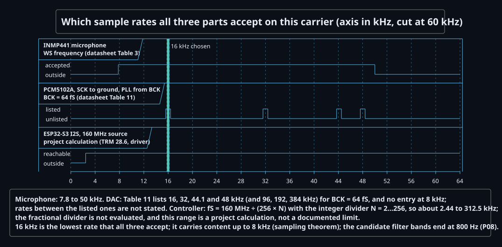
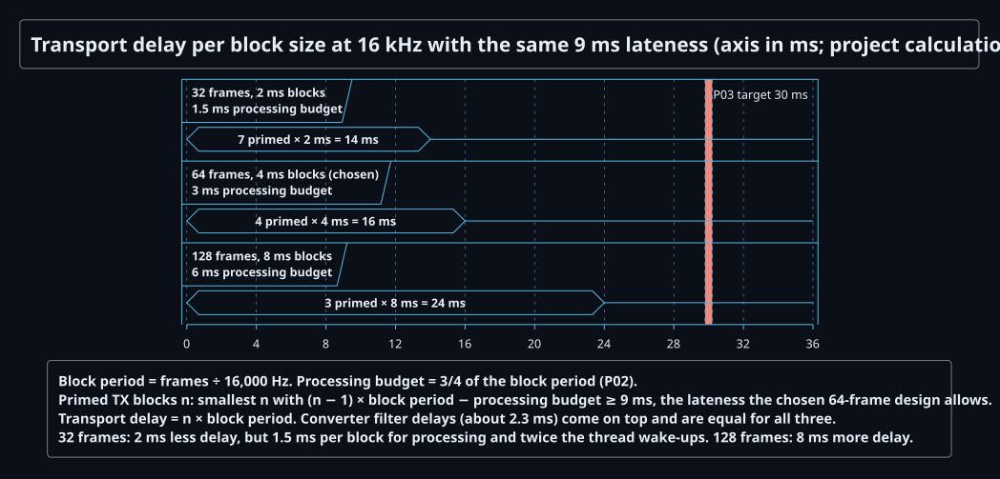
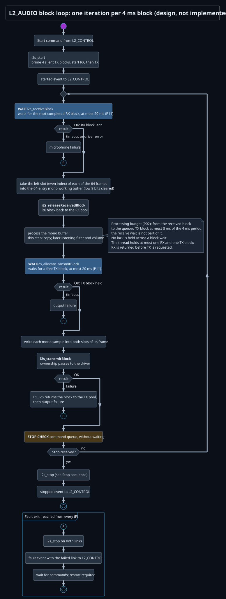
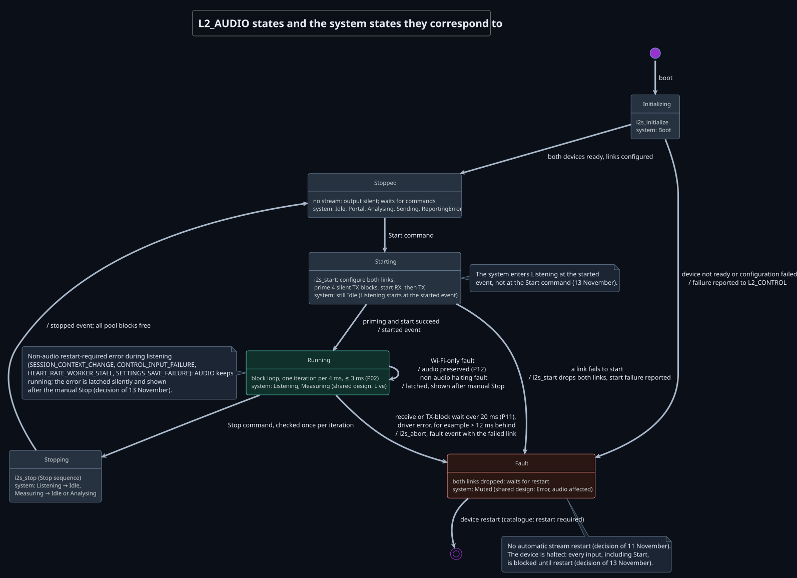
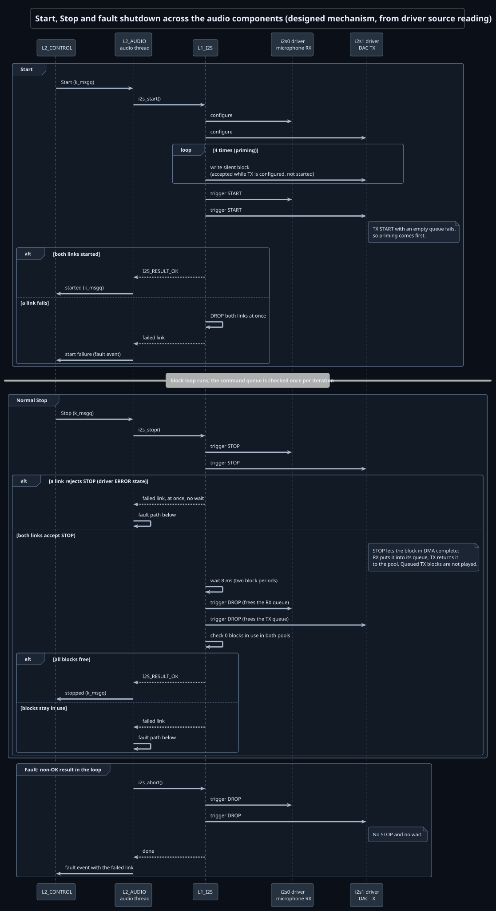
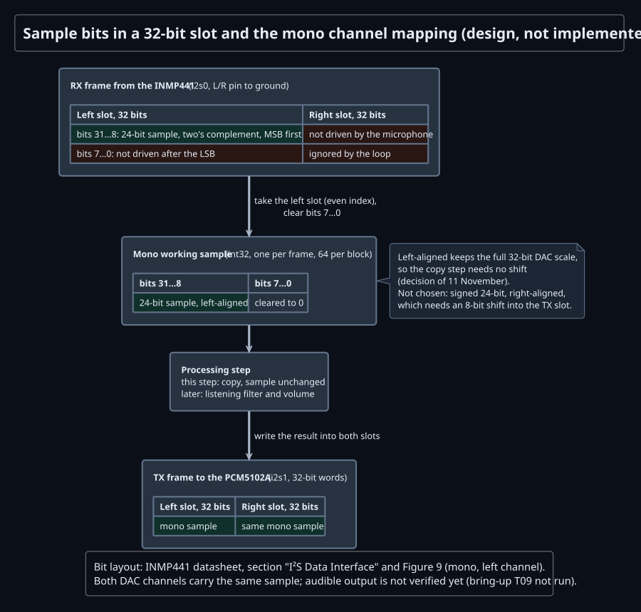
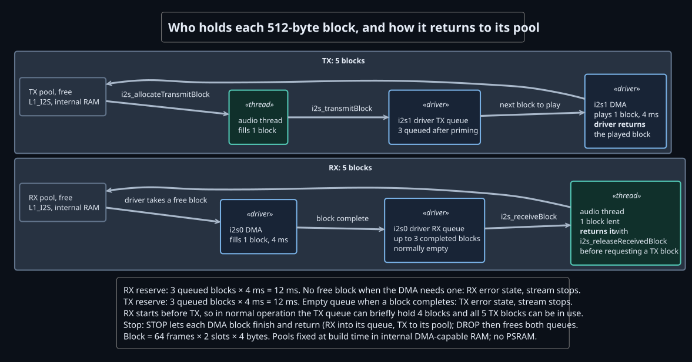
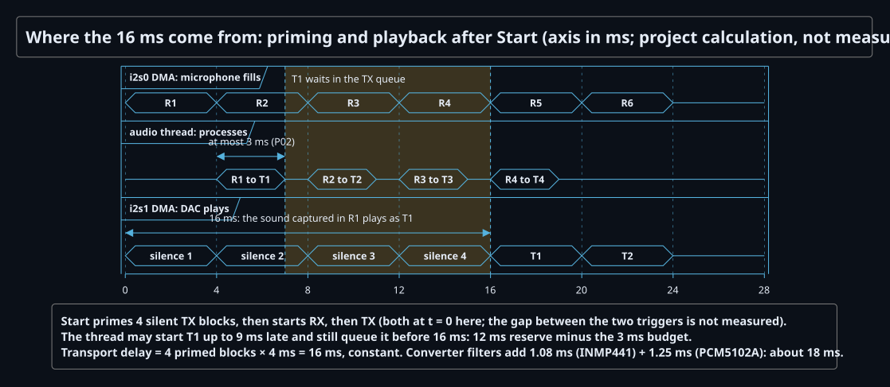

# Audio interfaces and behavior

`L1_I2S` owns both I2S links and their block pools; `L2_AUDIO` owns the block loop and reports to
`L2_CONTROL`. The [AUDIO architecture](../../architecture/AUDIO/README.md) defines these
responsibilities and the [decision record](../../planning/mvp-decisions-2026-11-10.md#first-audio-path)
the chosen values, confirmed on [13 November](../../planning/mvp-decisions-2026-11-13.md). This page
covers the first audio step: microphone to DAC with a copy step.

| View | Editable source | Answers |
| --- | --- | --- |
| Block loop | [block-loop.puml](block-loop.puml) | In which order does one block pass, where does the thread wait, where is Stop checked? |
| States | [audio-state.puml](audio-state.puml) | Which states does `L2_AUDIO` have, and which system states do they correspond to? |
| Start and Stop | [start-stop-sequence.puml](start-stop-sequence.puml) | In which order are the links primed, started and shut down? |
| Sample format | [sample-format.puml](sample-format.puml) | Where is the sample in the 32-bit slot, and how does it reach both DAC channels? |
| Buffer circulation | [buffer-circulation.puml](buffer-circulation.puml) | Who holds each block, and how does it return to its pool? |
| Priming and playback | [priming-timing.puml](priming-timing.puml) | Where do the 16 ms of transport delay come from? |
| Sample rate | [sample-rate-range.puml](sample-rate-range.puml) | Which sample rates do all three parts accept? |
| Block size | [block-size-delay.puml](block-size-delay.puml) | What does the block size cost in delay? |

## Stream configuration

Both links use the same settings, so both controllers derive the same clock dividers from the same
default clock source [1].

| Setting | Value | Reason |
| --- | --- | --- |
| Links | `i2s0` RX from the INMP441, `i2s1` TX to the PCM5102A | [Electrical interface baseline](../../spec/product-scope.md#electrical-interface-baseline) |
| Format | Zephyr `I2S_FMT_DATA_FORMAT_I2S`, the ESP32-S3 drives bit and frame clock on both links | The microphone and the DAC both take their clocks from the ESP32-S3, as configured in the bring-up firmware [2] |
| Channels, word size | 2 channels, 32-bit words | The driver accepts only two channels [1]; equal word sizes keep the dividers equal [1] |
| Sample rate | 16,000 Hz (P01) | Decision of 10 November 2026; [rationale](#sample-rate-and-block-size-rationale) |
| Block | 64 frames × 2 slots × 4 bytes = 512 bytes, 4 ms | P01, confirmed 13 November; below the 4092-byte DMA descriptor limit, so one descriptor per block [1] |
| RX pool | 5 blocks; `CONFIG_I2S_ESP32_RX_BLOCK_COUNT` = 3 | 3 completed blocks waiting, 1 in DMA, 1 lent to the audio thread |
| TX pool | 5 blocks; `CONFIG_I2S_ESP32_TX_BLOCK_COUNT` = 4 | 4 blocks primed before TX starts (1 in DMA and 3 queued afterwards), 1 being filled |
| Memory | Both pools in internal DMA-capable RAM, defined at build time | No PSRAM in this step |

## Sample-rate and block-size rationale

Device ranges come from the cited datasheets and manuals; everything marked *project calculation*
is derived by the project from those inputs and is not measured.

*Which sample rates do all three parts accept on this carrier?*

| Part | Range or limit | Source |
| --- | --- | --- |
| INMP441 | WS (frame clock) frequency 7.8–50 kHz; 64 SCK per stereo frame | [3], Table 3 (p. 5) and section "I²S Data Interface" (p. 11) |
| PCM5102A | Sampling frequency 8–384 kHz in general. On the carrier SCK is tied to ground [8], so the DAC builds its clock from BCK with its PLL. For that mode, Table 11 lists BCK for 16, 32, 44.1, 48, 96, 192 and 384 kHz at 64 fS and has no entry at 8 kHz; 32-bit words need BCK = 64 fS | [4], "Electrical Characteristics" (p. 7), Table 2 (p. 15), section 9.3.5.3 and Table 11 (p. 25) |
| ESP32-S3 I2S | Master clock = source ÷ (N + b/a), integer part N = 2…256; source 160 MHz (`PLL_F160M`, the driver default) | [5], section 28.6; [1]; [6] |
| ESP32-S3 I2S at 32-bit words | *Project calculation:* the driver sets the master clock to 256 × fS, so with the integer divider fS = 160 MHz ÷ (256 × N), about 2.44–312.5 kHz. At 16 kHz, N = 39.0625, so the fractional divider is used; the TRM notes it may add clock jitter. The fractional range was not evaluated | [1], [5], [6] |

- 16 kHz is the lowest rate that the microphone accepts and the DAC lists for its PLL mode on this
  carrier; 8 kHz is not listed for the DAC. *Project calculation from [3] and [4].*
- Taking the lowest common rate keeps data and processing per second lowest. *Project decision*
  ([10 November](../../planning/mvp-decisions-2026-11-10.md#first-audio-path)).
- A 16 kHz rate represents content up to 8 kHz [7]; the candidate filter bands end at 800 Hz
  ([P08](../system/parameters.md), a candidate, not a measured heart-sound bandwidth).
- 48 kHz with 240-frame blocks was considered and not chosen (decision of 10 November).

*What does the block size cost in delay, for the same lateness the 64-frame design allows?*

| Block | Period | Processing budget (P02 share) | Primed TX blocks n | Transport delay |
| --- | --- | --- | --- | --- |
| 32 frames | 2 ms | 1.5 ms | (n − 1) × 2 ms − 1.5 ms ≥ 9 ms → 7 | 14 ms; 2 ms less, but twice as many thread wake-ups |
| 64 frames (chosen) | 4 ms | 3 ms | 4 | 16 ms |
| 128 frames | 8 ms | 6 ms | (n − 1) × 8 ms − 6 ms ≥ 9 ms → 3 | 24 ms; below 30 ms, but 8 ms more |

All values in this table are *project calculations* from the driver's queue behavior [1]; the
block size is a project decision ([10 November](../../planning/mvp-decisions-2026-11-10.md#first-audio-path),
confirmed [13 November](../../planning/mvp-decisions-2026-11-13.md)).

## Service boundary

Proposed `L1_I2S` interface. Names avoid Zephyr's `i2s_read`, `i2s_write` and `i2s_configure`.
Every operation returns an `i2s_result`: `I2S_RESULT_OK`, `I2S_RESULT_MICROPHONE_FAILURE` or
`I2S_RESULT_OUTPUT_FAILURE`. The two failure values identify the failed link and map to the catalogue
codes `MICROPHONE_FAILURE` and `AUDIO_OUTPUT_FAILURE`. `L1_I2S` logs the driver error code; it does
not retry.

| Interface | Inputs | Outputs and ownership |
| --- | --- | --- |
| `i2s_initialize()` | One call at boot | Checks that both I2S controllers are ready and configures both links. No stream runs afterwards. It cannot tell whether the microphone or the DAC is connected: neither answers on its link, so a missing device is not detected at boot. |
| `i2s_start()` | Called while stopped | Configures both links again, primes 4 silent TX blocks, starts RX, then TX. On failure it drops both links as `i2s_abort()` does and returns the failed link. |
| `i2s_stop()` | While running, for a normal Stop | Stops both links in the [Stop sequence](#stop-sequence) and returns every pool block; no further sound. Returns the failed link if a link rejects `STOP` or blocks stay in use. Repeated calls are harmless. |
| `i2s_abort()` | After an audio fault | Triggers `DROP` on both links at once, without `STOP` or a wait; no further sound. Blocks the driver held at that moment may stay in use; the required restart clears them. Repeated calls are harmless. |
| `i2s_receiveBlock(receivedFrames)` | Pointer for the result | Waits at most the receive wait (P11) for the next completed RX block and lends it to the caller. A timeout or driver error is a microphone failure. |
| `i2s_releaseReceivedBlock(receivedFrames)` | A lent RX block | Returns it to the RX pool. |
| `i2s_allocateTransmitBlock(transmitFrames)` | Pointer for the result | Waits at most the TX-block wait (P11) for a free TX block. A timeout is an output failure. |
| `i2s_transmitBlock(transmitFrames)` | A filled TX block | Queues it for the DAC; ownership passes to the driver. On failure `L1_I2S` returns the block to the pool and reports an output failure. |
| `i2s_getPoolUse(receivePoolHighestUse, transmitBlocksInDriver)` (proposed) | Pointers for the two values | Read-only, for [monitoring](#monitoring): the RX pool's highest use since boot and the TX blocks currently held by the driver. Always `I2S_RESULT_OK`. |

## Block loop

`L2_AUDIO` runs one audio thread with one deterministic processing path: read, process, send
([decision of 11 November](../../planning/mvp-decisions-2026-11-11.md)).

*In which order does one block pass, where does the thread wait, and where is Stop checked?*

- The thread runs at the highest application thread priority; the numeric priority is an
  implementation choice measured under VT-02.
- Processing budget (P02): from the received block to the queued TX block at most 3 ms; the wait
  for the next block is not part of it. No lock is held across a block wait.
- The processing step only copies. The listening filter and volume replace it later; until the
  potentiometer is fitted, the volume is a fixed 100 %.
- The mono working buffer has 64 entries, 256 bytes, owned by the audio thread. Left-slot
  extraction follows the [sample format](#sample-format).
- The thread returns the RX block before it requests a TX block, so it never holds more than one
  block of each pool.

## States

*Which states does `L2_AUDIO` have, and which system states do they correspond to?*

The states are design names for `L2_AUDIO`. The system vocabulary comes from the
[MVP session state view](../../architecture/system/mvp-session-state.puml) and the state table of
the [system design](../system/interfaces-and-behavior.md#state-entryprocessexit).

| `L2_AUDIO` state | System state | Basis |
| --- | --- | --- |
| Initializing | Boot (session view); Playback Boot (system design) | `i2s_initialize` at boot; no stream |
| Stopped | Idle, Portal, Analysing, Sending, ReportingError | Idle is muted with no transport; sending holds the network lease with audio stopped |
| Starting | Idle until the `started` event | The system enters Listening at the `started` event, not at the Start command ([13 November](../../planning/mvp-decisions-2026-11-13.md)) |
| Running | Listening, Measuring (session view); Live (system design) | The block loop runs; Wi-Fi-only faults preserve it (P12) |
| Stopping | Listening → Idle; Measuring → Idle or Analysing | Every system Stop mutes audio |
| Fault | Muted (session view); Error, audio affected (system design) | `MICROPHONE_FAILURE`, `AUDIO_WORKER_STALL` and `AUDIO_OUTPUT_FAILURE` require a restart ([catalogue](../FEEDBACK/catalogue.md)); the device is halted and blocks every input, including Start, until restart ([13 November](../../planning/mvp-decisions-2026-11-13.md)) |

Mapping rules decided on [13 November](../../planning/mvp-decisions-2026-11-13.md):

- The system enters Listening at the `started` event, not at the Start command.
- A non-audio restart-required error during listening (`SESSION_CONTEXT_CHANGE`, `CONTROL_INPUT_FAILURE`, `HEART_RATE_WORKER_STALL` and `SETTINGS_SAVE_FAILURE`) does not stop
  `L2_AUDIO`: `L2_CONTROL` latches it silently, listening continues, and the error is shown and
  applies its clear rule after the operator stops the examination manually.
- `L2_AUDIO` in Fault never starts again: the device is halted, every input including Start is
  blocked, and only a restart leaves Fault.

## Start, Stop and faults

*In which order are the links primed, started and shut down?*

- **Boot:** `i2s_initialize`; no stream is started. Ready: Stopped. Failure: reported to
  `L2_CONTROL`.
- **Start while stopped:** `i2s_start`, then the block loop; `started` event or the start failure.
  Priming comes first because a TX `START` with an empty queue fails [1].
- **Stop:** leave the loop, `i2s_stop`; on success `stopped` event and output silent. A failed
  `i2s_stop` is an audio fault and takes the fault path below.
- **Any non-OK result in the loop:** `i2s_abort`; the thread waits for restart. Fault event with the
  failed link; `L2_CONTROL` shows the catalogue error, which requires a restart. No automatic
  stream restart ([decision of 11 November](../../planning/mvp-decisions-2026-11-11.md)).

### Stream faults

- A stream fault includes a deadline miss. If the thread falls more than three blocks (12 ms,
  processing included) behind, the driver stops the stream itself [1].
- The bring-up session showed that such a stream stays stopped until it is configured and started
  again [2].
- A stream fault stays a restart-required error under the catalogue: a Start after a fault needs a
  device restart.

### Stop sequence

Three things are recorded separately here.

**Recorded decision** ([10 November](../../planning/mvp-decisions-2026-11-10.md#first-audio-path),
point 8): normal Stop lets the block in DMA finish, then discards both queues; faults discard both
queues at once, with no wait ([13 November](../../planning/mvp-decisions-2026-11-13.md)).

**Designed mechanism for normal Stop** (source reading of the pinned driver [1]): `i2s_stop`

1. triggers `STOP` on both links: the block in DMA completes; the driver puts it into the RX queue
   or returns it to the TX pool, and queued TX blocks are not played. A link that entered the
   driver's ERROR state, for example after an RX DMA error, rejects `STOP`; `i2s_stop` then
   returns that link at once, without the wait;
2. waits 8 ms, two block periods, so the block in DMA completes on both links;
3. triggers `DROP` on both links, which returns the queued blocks;
4. checks that both pools have 0 blocks in use; blocks still in use are a failure.

| Driver behavior [1] | Consequence |
| --- | --- |
| `DROP` alone frees the queued blocks, but for the block in DMA only clears its pointer | Each Stop would lose one RX and one TX block; after a few sessions the RX pool would be too small to start. Hence `STOP` first. |

**Verification status:** source reading only. The repeated Start and Stop in the
[expected verification](#expected-verification) confirms the sequence on the target; that
confirmation is pending.

## Sample format

*Where is the sample in the 32-bit slot, and how does it reach both DAC channels?*

- The INMP441 sends each sample as 24-bit two's complement, MSB first, in a word of 32 bit clocks,
  and stops driving its data pin after the LSB [3]. With L/R tied to ground it sends on the left
  slot only [3].
- The sample therefore fills the top 24 bits of the 32-bit left slot. The microphone does not drive
  the 8 bits after the LSB, so the loop clears them.
- The bring-up firmware treated the sample the same way, shifting the slot right by 8 bits or
  scaling it by 2³¹, and its microphone test passed [2].
- The mono working sample is left-aligned with its low 8 bits cleared
  ([decision of 11 November](../../planning/mvp-decisions-2026-11-11.md)), so the copy step writes
  the DAC slot unchanged. Not chosen: signed 24-bit, right-aligned, which matches the earlier
  `AudioBlock` wording "signed 24-bit normalized into int32" but needs an 8-bit shift into the TX
  slot.
- The PCM5102A receives 32-bit words. The bring-up's DAC test only showed that the link accepts
  blocks, and its loopback test was not run [2], so audible output from these words is not
  verified yet.

## Timing and sizing

*Who holds each block, and how does it return to its pool?*

*Where do the 16 ms of transport delay come from?*

| Quantity | Derivation | Value |
| --- | --- | --- |
| Block period | 64 frames ÷ 16,000 Hz | 4 ms |
| Block size | 64 frames × 2 slots × 4 bytes; two slots because the driver accepts only stereo, 4 bytes because a 24-bit sample needs a 32-bit slot [1] | 512 bytes |
| RX pool | 3 completed blocks waiting + 1 in DMA + 1 lent to the audio thread | 5 blocks, 2,560 bytes |
| TX pool | 4 queued blocks (the primed ones, 1 of them in DMA) + 1 being filled | 5 blocks, 2,560 bytes |
| Mono working buffer | 64 samples × 4 bytes | 256 bytes |
| RX reserve | 3 waiting blocks × 4 ms | 12 ms for processing and lateness together before RX overruns |
| TX reserve | 3 queued blocks behind the one in DMA × 4 ms | 12 ms for processing and lateness together before TX runs empty; with the 3 ms budget the thread may start a block up to 9 ms late |
| Transport delay | 4 primed TX blocks × 4 ms. The first RX block fills and is processed while the primed blocks play, so neither adds delay; processing time uses up reserve instead | 16 ms, constant |
| Converter delay | Digital filters at 16 kHz: INMP441 17.2 ÷ fS [3]; PCM5102A normal-latency filter 20 ÷ fS, selected because FLT is tied to ground on the carrier ([pin map](../../testing/hardware/carrier-bringup/README.md#board-and-pin-map)) [4] | 1.08 ms + 1.25 ms; about 18 ms from sound to line output, below the P03 target of 30 ms |
| Processing budget | Three quarters of the block period (P02) | At most 3 ms per block |
| Block waits | 5 block periods (P11) | 20 ms; a normal block arrives within 4 ms |
| Internal RAM | 2,560 + 2,560 + 256 bytes | 5,376 bytes, plus thread stack and driver descriptors |

The transport delay and the reserves are *project calculations* from the driver behavior [1] and
the converter datasheets [3] [4], not measured. The time between the RX and TX start triggers is
not measured either. P03 remains judged by ear under REQ-05. The
[block-size comparison](#sample-rate-and-block-size-rationale) applies the same derivation to 32-
and 128-frame blocks.

## Monitoring

`L2_AUDIO` records these values for VT-02
([decision of 11 November](../../planning/mvp-decisions-2026-11-11.md)):

| Value | Read from | Shows |
| --- | --- | --- |
| Processed blocks, stream faults | Counters in `L2_AUDIO` | Activity and faults |
| Longest iteration time | Measured per iteration | A deadline miss before it becomes a stream fault |
| RX pool highest use | `i2s_getPoolUse` (proposed): `k_mem_slab_max_used_get`, which needs `CONFIG_MEM_SLAB_TRACE_MAX_UTILIZATION` | A deadline miss before it becomes a stream fault; only the RX pool has a fixed limit below 5 blocks |
| TX blocks in the driver, over time | `i2s_getPoolUse`: 5 − `k_mem_slab_num_free_get`, read before the thread allocates its TX block | A level that drifts over a long run shows that the two links do not run at the same rate |

The pools are private to `L1_I2S`, hence the proposed query. RX starts before TX, so the thread can
queue its TX block just before the DAC returns the played one; the TX pool can then reach 5 blocks
and the TX driver queue 4 in normal operation [1].

## Expected verification

| Scenario | Basis | Expected result |
| --- | --- | --- |
| Boot with both links ready | VT-01, REQ-01 | Stopped; no TX stream and no sound before Start |
| Boot with an I2S controller not ready or its configuration rejected, injected on the host at the driver boundary | VT-01 | Failure for that link; `L2_CONTROL` shows `MICROPHONE_FAILURE` or `AUDIO_OUTPUT_FAILURE` |
| Stop while a link is in the driver's ERROR state, injected on the host at the driver boundary | VT-01 | No `stopped` event; both links dropped; restart-required fault reported |
| Start, then Stop, 10 times in a row | REQ-01, REQ-02, VT-04 | `started` after priming and RX before TX; `stopped`, output silent; after every Stop all 5 blocks of each pool are free |
| Heart sounds after Start | REQ-02 | Audible on both channels within 2 s |
| Copy step with a known RX block | VT-03 | Both TX slots of every frame equal the left RX slot with its low 8 bits cleared; the right RX slot is ignored |
| Receive wait expires | VT-01 | Microphone failure; stream stopped; catalogue error |
| Thread more than 12 ms behind, processing included | VT-02 | Driver stops the stream; fault reported; no hang and no repeated stale audio |
| 10 min of listening under load | VT-02 | No fault; longest iteration time ≤ 3 ms; RX pool use below 5; constant TX level (no drift) |
| Tap on the chestpiece | REQ-05 | No noticeable delay |

## Sources

[1] The Zephyr Project, *ESP32 I2S driver and its Kconfig*, source revision
`357467a011cd2557a1a3f0b4be83d817c4addc9b`,
[i2s_esp32.c](https://github.com/zephyrproject-rtos/zephyr/blob/357467a011cd2557a1a3f0b4be83d817c4addc9b/drivers/i2s/i2s_esp32.c)
and
[Kconfig.esp32](https://github.com/zephyrproject-rtos/zephyr/blob/357467a011cd2557a1a3f0b4be83d817c4addc9b/drivers/i2s/Kconfig.esp32),
accessed 10 November 2026. Source reading, not a target measurement.
[Source register](../../../../thesis-material/quellen.md#zephyr_esp32_i2s_driver_357467a).

[2] Nico F., *Hardware Test Protocol — ESP32-S3 Bring-up*, session of 14 August 2026, bring-up
firmware commit `2cd6d4c818be92f0bf1e1181ef0b4cd7de7ceb14`, Zephyr
`357467a011cd2557a1a3f0b4be83d817c4addc9b`: tests T05, T07, T08 and T09 in
[TEST-PROTOCOL.md](../../../../preThesis/06-bringup-zephyr/TEST-PROTOCOL.md), wiring in
[HARDWARE.md](../../../../preThesis/06-bringup-zephyr/HARDWARE.md), sample handling in
[audio_loopback.c](../../../../preThesis/06-bringup-zephyr/src/audio_loopback.c). Own measurement
and code on archived pre-thesis firmware.
[Source register](../../../../thesis-material/quellen.md#nico_bringup_hardware_protocol_20260814).

[3] TDK InvenSense, *INMP441 Omnidirectional Microphone with Bottom Port and I²S Digital Output*,
document DS-INMP441-00, revision 1.0, 6 February 2014, Table 1 "Electrical Characteristics"
(digital filter group delay 17.2/fS, p. 4), Table 3 "Serial Data Port Timing Specifications" (WS
frequency 7.8–50 kHz, p. 5), section "I²S Data Interface" (24-bit words, 64 SCK per stereo frame,
L/R pin selects the channel, data pin tri-stated after the LSB, p. 11) and Figure 9 (mono output,
left channel, p. 12), [datasheet](https://www.farnell.com/datasheets/1824785.pdf), accessed
11 November 2026; page numbers checked 13 November 2026.
[Source register](../../../../thesis-material/quellen.md#tdk_inmp441_datasheet_2014).

[4] Texas Instruments, *PCM510xA 2.1 VRMS, 112/106/100 dB Audio Stereo DAC with PLL and 32-bit,
384 kHz PCM Interface*, SLAS859C, revised May 2015, "Electrical Characteristics" (sampling
frequency 8–384 kHz, p. 7), "Filter Characteristics–1: Normal" (delay time 20 tS, p. 9), Table 2
(32-bit words with BCK = 64 fS, p. 15), section 9.3.5.3 and Table 11 (BCK rates for PLL
operation, p. 25), [datasheet](https://www.ti.com/lit/ds/symlink/pcm5102a.pdf), accessed
11 November 2026; pages checked 13 November 2026.
[Source register](../../../../thesis-material/quellen.md#ti_pcm510xa_datasheet_2015).

[5] Espressif Systems, *ESP32-S3 Technical Reference Manual*, version 1.8, 2026, chapter 28
"I2S Controller", section 28.6 "TX/RX Clock" (pp. 1044–1046),
[manual](https://www.espressif.com/sites/default/files/documentation/esp32-s3_technical_reference_manual_en.pdf),
accessed 13 November 2026.
[Source register](../../../../thesis-material/quellen.md#espressif_esp32s3_trm_v18).

[6] Zephyr Project, *hal_espressif ESP32-S3 clock tree definitions and I2S low-level divider
limits*, revision `3d4d922a4d2994f844790ec031a584ec71240485` (the revision pinned by Zephyr
`357467a`), `I2S_CLK_SRC_DEFAULT = SOC_MOD_CLK_PLL_F160M`, accessed 13 November 2026. Source
reading, not a target measurement.
[Source register](../../../../thesis-material/quellen.md#zephyr_hal_espressif_i2s_clock_3d4d922).

[7] C. E. Shannon, "Communication in the Presence of Noise", *Proceedings of the IRE*, vol. 37,
no. 1, pp. 10–21, January 1949, DOI [10.1109/JRPROC.1949.232969](https://doi.org/10.1109/JRPROC.1949.232969).
[Source register](../../../../thesis-material/quellen.md#shannon_communication_noise_1949).

[8] Carrier [pin map](../../testing/hardware/carrier-bringup/README.md#board-and-pin-map): J4
PCM5102A with SCK, FMT, FLT and DMP to ground (PLL mode).
