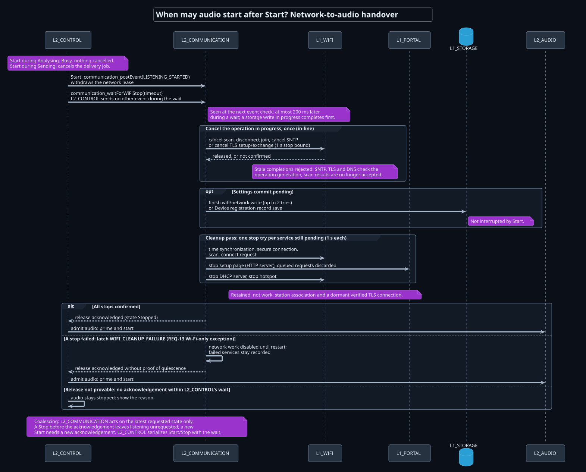

# L2_COMMUNICATION setup workflow, recovery and delivery

L2_COMMUNICATION owns setup sequencing, retry policy and result delivery under L2_CONTROL's network lease. It uses [L1_WIFI operations](../WIFI/interfaces-and-behavior.md), the [L1_STORAGE record interface](../STORAGE/interfaces-and-behavior.md) and the [L1_PORTAL request/status boundary](../PORTAL/interfaces-and-behavior.md).

## Wi-Fi setup and recovery

The [state diagram](../../architecture/COMMUNICATION/README.md#setup-state-machine),
[setup flow](../../architecture/COMMUNICATION/README.md#provisioning-flow) and
[recovery flow](../../architecture/COMMUNICATION/README.md#link-recovery) share the rules below.

### Entry, scan and recovery

L1_WIFI lists only supported networks: open networks and WPA2-PSK. It filters out WPA1, WPA2-SHA256 and WPA3/SAE scan results rather than joining them with a mismatched security type. Its scan cache keeps the 16 strongest distinct supported SSIDs, matching the scan list limit of the [P23 Wi-Fi retry and limit parameters](parameters.md). L2_COMMUNICATION passes this list to the setup page.

L2_COMMUNICATION initializes L1_STORAGE with `storage_init()` before any boot record read. If initialization fails, L2_COMMUNICATION treats the stored network as unavailable, does not use the read buffer for a join and opens setup. L2_COMMUNICATION reads settings through L1_STORAGE. At boot, L2_COMMUNICATION joins a stored network with four attempts in total, 5 s between failures. Exhausting these attempts shows an error and waits for a 2 s button hold in Idle. Without credentials, or on a 2 s hold in Idle, L2_COMMUNICATION scans and caches nearby networks first, then opens the hotspot and serves one HTML document. L2_COMMUNICATION rescans on an explicit request or after a failed portal join. It keeps the hotspot and HTTP server open during these rescans and publishes the cache only after the scan finishes. Scanning has four attempts in total, 5 s between failures. After an exhausted scan or a failed hotspot start, the operator starts setup again with a 2 s button hold in Idle. Link loss triggers four reconnect attempts, 5 s apart. Exhausting link-loss reconnect attempts starts setup automatically in Idle. L2_COMMUNICATION defers all active recovery during listening.

The [L1_PORTAL interface](../PORTAL/interfaces-and-behavior.md) queues typed requests for L2_COMMUNICATION and publishes its status. The hotspot is open. The operator's phone, or any other device with Wi-Fi and a browser, joins it manually and opens the setup page without pairing with the stethoscope. Its name is `Stetho-AABBCCDDEEFF`, using all six station MAC bytes in upper-case hexadecimal so devices in one room stay distinguishable.

### Join, persistence and result closure

One portal join attempt waits for the selected network's address. A stale existing link does not count as a successful new join. On failure, L2_COMMUNICATION shows the cause, rescans and returns to network selection. On success, L2_COMMUNICATION saves the network under the `wifi/network` key in L1_STORAGE with `storage_write()` and retries saving once on failure. A failed save preserves the previous valid record. L2_COMMUNICATION shows the success status or save warning for 10 s together with the station IPv4 address from `wifi_getAddress()`. Before teardown on every setup exit, including result or save-warning completion and Start, L2_COMMUNICATION publishes the Closing status. Only Cancel, inactivity and scan failure add the 2 s closing-notice delay. L2_COMMUNICATION then closes the hotspot and HTTP server while keeping the station connection, including when credentials were not saved. At boot, L2_COMMUNICATION reads the `wifi/network` record with `storage_read()` and validates it with `wifi_isValidNetwork()`.

### Cancellation and inactivity

The setup page offers Back and Cancel only until Connect is submitted ([L1_PORTAL](../PORTAL/interfaces-and-behavior.md)). Setup Cancel ends setup. Connect through save and automatic closure cannot be cancelled by the operator. The inactivity timeout is 5 min; selection, password input and Rescan reset it, status polling does not, and operations pause it. L2_COMMUNICATION sends a 2 s closing notice before teardown; Cancel and timeout do not add the 10 s result display.

L2_COMMUNICATION retains an established station connection; otherwise it cancels active attempts and releases Wi-Fi services. Software errors that prevent continuing setup log and show the cause, clean up and return to offline operation. The operator can start the Wi-Fi setup workflow again by holding the button for 2 s in Idle.

### Listening priority and safe teardown

*When may audio start after Start?* Source: [puml/network-audio-handover.puml](puml/network-audio-handover.puml). The [L2_COMMUNICATION lifecycle](../../architecture/COMMUNICATION/README.md#communication-lifecycle) places this handover between Idle network work and listening.

Cancellation is serialized against join completion. The stop bounds are the [P23 cleanup limits](parameters.md#cleanup-limits-p23). L2_COMMUNICATION checks for control events every 200 ms while waiting. Setup, reconnect and delivery work are prohibited during listening.

### Specified failures and interrupted boot

If the network list cannot be refreshed while the setup page is open, the device reports SCAN_FAILURE, shows Closing and ends setup. An existing Wi-Fi connection stays up. Setup restarts with a new 2 s button hold in Idle. The IPv4 address event confirms the join, so the network is saved before the address text is read for the page. If that text cannot be read, the join still counts and the page shows no address. An unreadable or invalid stored record is cleared from working memory, never used for a join, and opens initial setup; the flash content is preserved for diagnosis until a valid save. A `portal_start()` failure independently reports HOTSPOT_START_FAILURE with the HTTP cause, tears down any partially started services and waits for the manual setup hold.

Start interrupts a boot join by cancelling its active attempt. On return to Idle, L2_COMMUNICATION resumes the remaining boot attempts after the normal retry gap. The interrupted issued attempt counts toward the four-attempt boot budget; cancellation before issuing an attempt consumes none. Boot exhaustion remains JOIN_FAILURE with manual setup; it never becomes link-loss recovery or automatic setup.

An interrupted or timed-out scan or join is cancelled once when it ends. Cleanup then tries each stop that is still pending once, in the order of the [P23 cleanup limits](parameters.md#cleanup-limits-p23): time synchronization, secure connection, scan, connect request, setup page (HTTP), DHCP and hotspot. If all stops succeed, audio is released normally. If any stop fails, L2_COMMUNICATION latches `WIFI_CLEANUP_FAILURE` (cleared only by restart; indication follows the [feedback catalogue](../FEEDBACK/catalogue.md)), disables further Wi-Fi work until restart and releases audio under [REQ-13](../../requirements/system-requirements.md#req-13)'s Wi-Fi-only exception. L2_COMMUNICATION records the failed stop operations and reports the cleanup fault to L2_CONTROL through the feedback event boundary.

## Delivery, clock and configuration

The identifier system of a completed measurement is `urn:stethoscope:measurement`. Its value is `<device-id>:<measurement-end-UTC>`: the persisted server Device id, a colon, and the immutable interval end formatted as `YYYY-MM-DDTHH:mm:ss.SSSZ`. L2_COMMUNICATION freezes both at the points of [result provenance](../cross-module.md#result-provenance) (see the [SNTP mapping](time-synchronization.md#clock-mapping-and-native-behavior)) and does not regenerate the end time or identity on retry. One device must not finalize two measurements with the same end timestamp. L2_COMMUNICATION sends `POST /Observation`, `Content-Type: application/fhir+json`, with `identifier: [{"system":"urn:stethoscope:measurement","value":"<value>"}]` in the body and an `If-None-Exist: identifier=<system>|<value>` header. It percent-encodes each search value using UTF-8 URI query encoding before constructing the header; the separator `|` separates system and value. For example, the logical value `device-42:2026-10-23T12:00:00.000Z` is encoded as `device-42%3A2026-10-23T12%3A00%3A00.000Z` and the system as `urn%3Astethoscope%3Ameasurement`, which gives `If-None-Exist: identifier=urn%3Astethoscope%3Ameasurement|device-42%3A2026-10-23T12%3A00%3A00.000Z`. L2_COMMUNICATION never updates an Observation. The server assigns the resource ID. `201` (created) or `200` (one existing match) confirms success. After an uncertain transport response, including a lost receipt after a committed write, L2_COMMUNICATION retries with the identical body and conditional-create identity under [P13](parameters.md) while an attempt and time budget remain. P13 classifies retryable and terminal outcomes. A visible delivery failure releases the job only on a terminal outcome or exhausted attempt/deadline budget; there is no unconditional-create fallback. FHIR conditional create defines these semantics [1].

The device never selects or adds a patient ID. It serializes `Observation.subject` only from the patient reference supplied with a server-requested examination, and otherwise omits `subject`. [Examination request context](server-communication.md#examination-request-boundary) is consumed and frozen on accepted local measurement Start and is never automatically reused after cancellation or failure. A `Device.patient` lookup is not used as a substitute. One delivery job is granted after finalization when Wi-Fi is configured and delivery prerequisites hold; when Wi-Fi is configured and prerequisites fail, L2_CONTROL latches `DELIVERY_NOT_POSSIBLE` at once. P13 bounds delivery attempts.

L2_COMMUNICATION maps the monotonic measurement interval to UTC from a clock anchor at most 12.5 hours from the measurement end ([SNTP mapping](time-synchronization.md#clock-mapping-and-native-behavior)). Delivery uses measurement time rather than send time, and a result without a qualifying anchor is not sent or rewritten. FHIR `effectiveDateTime` carries the end of the aggregate interval, `meta.profile` is omitted, and `valueQuantity` uses the result's declared decimal precision. The immutable local result retains the Device id, point, value, interval and analysis settings.

L2_COMMUNICATION and L1_WIFI verify the server profile's public server certificate, endpoint identity and validity against the clock set by the SNTP exchange that opens each connection setup under the [TLS design](secure-transport.md), and enforce bounded status and body parsing. A missing retained connection permits reconnect within P13, whereas a missing or invalid server profile image fails prerequisites. `201 Created` or `200` (existing conditional create) is the receipt and marks the result Sent without readback.
An uncertain response is retried within the same bounded job. A single matching identifier returns the existing resource, and multiple matches fail with 412. Configuration, authentication and server failures latch `DELIVERY_FAILURE` after the last attempt. A job that ends without a qualifying clock anchor sends nothing and latches `SERVER_CONNECTION_FAILURE` instead ([P13](parameters.md)).
The time source is unauthenticated SNTP under the [SNTP design](time-synchronization.md); RFC 4330 describes its security limitations [2, section 11].

Active network work and live listening use an exclusive L2_CONTROL lease. An established station association stays active during listening, while setup, reconnect and delivery jobs do not run. Start during Wi-Fi setup requests safe teardown before audio, and L2_CONTROL stops audio before granting the network lease. Start during analysis is rejected Busy without cancellation or queuing. Start during sending cancels the delivery job ([state rules](../cross-module.md#state-entryprocessexit)). A fresh Start after release primes and starts audio.
If release cannot be confirmed, audio remains stopped and the device indicates the cause. As an exception under [REQ-13](../../requirements/system-requirements.md#req-13), a failed network-service stop or SNTP cancellation follows [P23](parameters.md): L2_COMMUNICATION latches `WIFI_CLEANUP_FAILURE`, disables network work until restart and releases audio.

Start cancels pending synchronization before audio, and time or server-connection failures preserve offline listening. Time synchronization, secure server transport and Device registration run independently of Wi-Fi setup completion.

## Sources

[1] Health Level Seven International, *FHIR R4 RESTful API*, version 4.0.1, 2019, Conditional create, <https://hl7.org/fhir/R4/http.html#ccreate>, accessed 23 October 2026.

[2] David L. Mills, *Simple Network Time Protocol (SNTP) Version 4 for IPv4, IPv6 and OSI*, IETF RFC 4330, January 2006, section 11, DOI: 10.17487/RFC4330, <https://www.rfc-editor.org/rfc/rfc4330#section-11>, accessed 24 October 2026.
