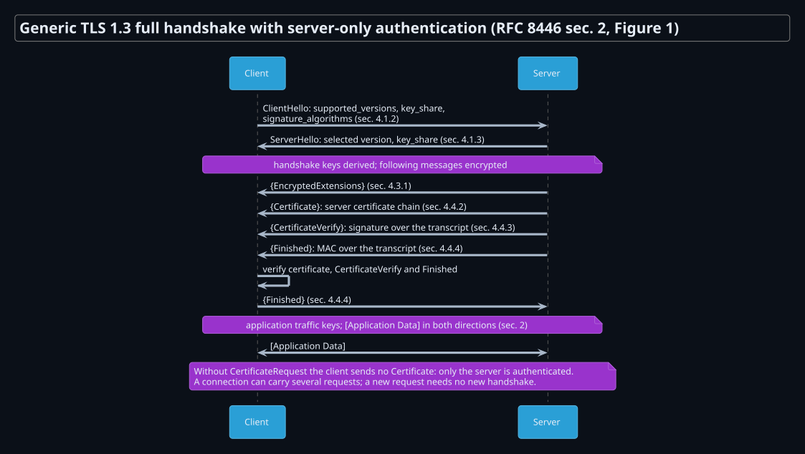
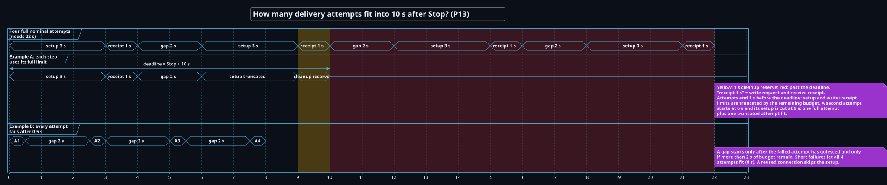

# TLS preparation and connection reuse

## Basis

This design refines the [TLS architecture](../../architecture/COMMUNICATION/secure-transport.md) and the [system design](../system/interfaces-and-behavior.md#delivery-clock-and-configuration). It depends on the [SNTP design](time-synchronization.md). Covered requirements are REQ-02, REQ-09, REQ-10, REQ-11, REQ-13 and REQ-14.

## TLS 1.3 handshake (generic protocol)

*What does a TLS 1.3 handshake exchange before application data flows?* Source: [puml/tls13-handshake.puml](puml/tls13-handshake.puml). The diagram shows the protocol as RFC 8446 defines it [1].

## Trust and server profile inputs

Each device talks to exactly one server. Its HTTPS endpoint (hostname or IP, port and base path), the PEM public server certificate and the server keep-alive timeout travel together in a server profile image, separate from the firmware. A separate flash command writes that image to the server profile partition of the [flash layout](../STORAGE/interfaces-and-behavior.md#flash-layout); a firmware update leaves it unchanged. Boot validates the image once (format version, lengths, CRC-32 and certificate parsing). A missing or invalid image leaves secure transport unavailable with a configuration cause; there is no fallback endpoint or certificate. The image never contains the server private key or a keystore. Network or portal enrollment, a project CA, older TLS versions and plain-HTTP fallback are not supported.

Whoever can flash the device can change its server; physical access is the trust assumption. The CRC detects corruption, not tampering.

L1_WIFI trusts the configured self-signed server certificate directly as its sole trust anchor. Every connection requires the configured endpoint identity, a valid certificate period against the prepared UTC clock and successful TLS peer verification. L1_WIFI never fetches or trusts a certificate from an unverified connection. DNS resolution determines only the destination IP address and never changes the configured reference identity. Certificate identity verification requires a matching DNS or IP Subject Alternative Name (SAN) without legacy Common Name fallback [2,3]. L1_WIFI enforces validity, peer verification and SAN identity even for the directly trusted certificate. Changing the server or its certificate rewrites the server profile image without requiring a firmware update.

No client certificate or device private key is configured. TLS authenticates the server, not the device. FHIR Device registration is separate application state; successful TLS does not prove authorization to create Device or Observation resources. If the deployed server requires client authentication or other credentials, L1_WIFI reports the cause rather than weakening verification. Application authorization and registration behavior are defined in the [server-communication design](server-communication.md).

TLS 1.3 permits application traffic after the handshake and does not require a new handshake for each request [2]. L1_WIFI holds the verified connection for reuse, and L2_COMMUNICATION treats remote or network idle closure as ordinary transport loss. No negotiated session-resumption or 0-RTT (zero round-trip early data) mechanism is required by this design; reconnect may use a full handshake.

## Ownership and service contracts

L2_CONTROL grants the exclusive network lease. L2_COMMUNICATION owns preparation policy, monotonic deadlines, readiness, retry scheduling and failure episodes. L1_WIFI owns the DNS, TCP and TLS 1.3 connection context and server verification. FHIR communication uses the verified transport and cannot select an insecure mode.

| Operation | Contract |
| --- | --- |
| `wifi_configureSecureServer` | At boot, accept the base URL and the PEM certificate of the server profile. Parse both, require a Subject Alternative Name that matches the host and make the certificate the only trust anchor. Return the certificate validity on success, or a cause for an unusable URL or certificate; without success no connection can be started. |
| `wifi_startSecureConnection` | Under the lease, accept the caller deadline and use the server configured at boot; at most one operation/context. Start DNS, TCP and TLS 1.3 with mandatory peer verification. Return accepted, busy or a cause; no internal workflow retries. |
| `wifi_waitForSecureConnection` | Wait at most the caller interval. Return pending or one terminal result with its cause. Completion quiesces operation callbacks. Short waits never restart the deadline. |
| `wifi_cancelSecureConnection` | Cancel pending resolution/connect/handshake, close the pending context and quiesce callbacks. Idempotent when inactive; use the one-second per-service stop bound of the Wi-Fi cleanup limits in [P23](parameters.md). Do not acknowledge release without proof. |
| `wifi_closeSecureConnection` | Invalidate and close a retained context under the lease, with the same stop bound. No reconnect, HTTP request or workflow retry. |

Operation generations reject late results after cancellation, configuration change or prerequisite loss. A terminal result contains a bounded cause category (configuration, resolution, TCP, timeout, TLS, trust/name/validity or cancelled) and carries no secrets or patient context. No new context may replace one whose release is unproven. Cancellation must release connection resources within the stop bound rather than force-aborting a blocked worker.

L2_COMMUNICATION tracks station-address readiness, transport verification and Device registration independently. Transport verification means the most recent handshake verified the server under the current endpoint and trust configuration and the clock applied by the SNTP exchange of the same setup; it does not require an open socket. A retained socket can still be closed by the peer or network before the next request. Idle generates no keep-alive traffic and runs no reconnect loop; a connection closed by the server while Idle is replaced on the next use. Binding the connection to the endpoint and trust configuration prevents reuse with another server. Registration persistence and invalidation are defined in the [server-communication design](server-communication.md).

## Preparation, listening and recovery

1. While Idle and holding the lease, require a station address and a valid server profile image. Boot has no retained connection. Missing prerequisites defer preparation without consuming an attempt or reporting a TLS handshake failure.
2. Start one monotonic ten-second deadline before the [SNTP exchange](time-synchronization.md#flow-and-scheduling) that opens every setup. SNTP, resolution, TCP setup, handshake and verification share that budget. Publish a verified connection only after every check succeeds. Cleanup has its separate P23 bound.
3. On failed preparation, mark transport unavailable, release resources and schedule another preparation attempt no earlier than 60 seconds after failure completion. Recovery continues without a total attempt cap while Idle and prerequisites permit. No catch-up bursts or hidden lower-level retries apply. Invalid certificate/configuration attempts remain unavailable and never trigger an insecure fallback.
4. Start preempts preparation: cancel and establish quiescence before audio. An interrupted issued attempt observes the same 60-second gap; cancellation before issuance consumes no attempt. Start cancellation alone is not an error. Failed cleanup follows the existing `WIFI_CLEANUP_FAILURE` restart policy, not ordinary TLS recovery.
5. During listening, L1_WIFI holds an already verified, dormant connection if possible. L2_COMMUNICATION issues no application requests, heartbeats, proactive reconnects or active liveness probes. Optional TCP keepalive probes are disabled. If background TLS handling requires application work, it is deferred until the lease returns or the connection is invalidated.
6. After listening, reuse the retained context only if endpoint/trust configuration and peer-validity checks still hold, for a delivery the clock anchor of its handshake still qualifies for the measurement end under the [mapping limit](time-synchronization.md#clock-mapping-and-native-behavior) and it has been idle for less than the device keep-alive timeout. Before the first request, poll the socket without blocking; a pending close (FIN, RST or `close_notify`) invalidates it without consuming an attempt. Closure/reset discovered on use still invalidates it.
7. L2_COMMUNICATION closes a retained context whose idle time reaches the device keep-alive timeout under the lease while Idle, or marks it logically invalid during listening. L1_WIFI holds the context; L2_COMMUNICATION decides on reuse and closure. The device keep-alive timeout equals the server keep-alive timeout from the server profile image minus 5 seconds.
8. Idle recovery uses the preparation policy; active delivery uses [P13](../system/parameters.md) below.

Before every new application request, check the retained peer's validity interval against the current clock. Configuration change, certificate expiry or a clock correction that makes validity fail immediately removes transport eligibility. During listening this is logical invalidation only; close under the lease afterward. A new setup, starting with its SNTP exchange, must verify the server before further requests. A clock correction that remains within the peer-validity interval does not itself require reconnection.

## Delivery budget boundary

*How many delivery attempts fit into 10 s after Stop?* Source: [puml/delivery-budget.puml](puml/delivery-budget.puml). The examples assume submission at Stop.

Reconnection is the expected delivery path; reuse is an optimisation. P13 keeps one ten-second deadline from Stop, at most four attempts and two-second gaps after transient failure. Within an attempt, connection setup (SNTP, DNS, TCP, TLS and verification) has a three-second limit and write plus receipt have a one-second limit, both capped by the remaining global time. A failed connection setup counts as a failed attempt. Delivery connection setup starts when L2_CONTROL submits the finalized job rather than at Stop. The deadline still runs from Stop, so finalization time comes out of the same budget. No setup starts when no job is granted (Stop before 15 s, Wi-Fi unconfigured or failed delivery prerequisites), and an eligible retained verified connection is reused without new setup. Delivery never uses the ten-second Idle preparation allowance. A Start during Sending cancels the delivery job: any connection setup or exchange in flight is cancelled, any retry gap ends at once and no further attempt starts. The cancelled job ends with `DELIVERY_FAILURE`, or with `SERVER_CONNECTION_FAILURE` when no qualifying clock anchor froze its UTC end, and the result is lost. A failed cancellation follows `WIFI_CLEANUP_FAILURE` under P23.

A usable retained connection is preferred but is not a mandatory delivery prerequisite; transport loss alone allows a bounded reconnect if the other delivery prerequisites hold. A missing or invalid server profile image latches `DELIVERY_NOT_POSSIBLE` before issuance. A certificate, name or validity failure discovered during an issued attempt is a terminal `DELIVERY_FAILURE`. Transient loss, including a failed SNTP exchange, follows P13 retry rules. A result that has no qualifying clock anchor when P13 ends latches `SERVER_CONNECTION_FAILURE` under the SNTP design. Delivery reconnects follow P13 rather than the Idle 60-second recovery gap. The frozen payload, identity and timestamp remain unchanged, and undelivered results are not queued. Registration eligibility is defined in the [server-communication design](server-communication.md).

## Failure indication

Failed TLS preparation latches `SERVER_CONNECTION_FAILURE`, preserving standalone listening. Acknowledgement clears only its indication: it neither creates transport readiness nor triggers a retry. Recovery continues independently. Success restores readiness but does not acknowledge an existing indication. Do not re-latch on every failed retry after acknowledgement in the same unavailable episode; successful recovery followed by a new preparation failure begins a new episode. Passive loss alone does not change transport verification; a subsequent failed reconnection or preparation raises the indication. A failed SNTP exchange is a failed preparation and raises this indication; the serial log names the time cause. There is no separate time-synchronization error. Issued delivery failures use the existing delivery indication.

## Parameters

| ID | Value / meaning |
| --- | --- |
| P26-VERSION | TLS 1.3 only; mandatory verification; no older TLS or HTTP fallback |
| P26-TRUST | One endpoint plus PEM public server certificate in the separate server profile image; no client certificate/key or network enrollment |
| P26-ATTEMPT | Ten seconds including SNTP/DNS/TCP/TLS/verification during Idle preparation; separate P23 one-second per-service cleanup bound |
| P26-RETRY | 60 seconds after failed/interrupted issued preparation completes; ongoing recovery while Idle |
| P26-REUSE | Retain a dormant verified context; no application heartbeat or proactive reconnect during listening; recheck time, configuration, peer validity, idle age and a non-blocking close poll before reuse |
| P26-KEEPALIVE | Device keep-alive timeout = server keep-alive minus 5 seconds, server value from the server profile image |
| P26-DELIVERY | P13 remains authoritative: per attempt three seconds connection setup including SNTP plus one second write and receipt, ten seconds total from Stop; connection setup starts at job submission |

## Design inputs

- A deployment needs a server certificate whose Subject Alternative Name covers the device-facing endpoint.
- Public SNTP is not authenticated; certificate time checks do not turn that clock into an authenticated time source.

## Sources

[1] Eric Rescorla, *The Transport Layer Security (TLS) Protocol Version 1.3*, IETF RFC 8446, August 2018, section 2 (Figure 1) and sections 4.1.2, 4.1.3, 4.3.1, 4.4.2, 4.4.3 and 4.4.4, DOI [10.17487/RFC8446](https://doi.org/10.17487/RFC8446), accessed 13 November 2026.

[2] Eric Rescorla, *The Transport Layer Security (TLS) Protocol Version 1.3*, IETF RFC 8446, August 2018, sections 2, 4.3.2, 4.4.2 and 4.6, DOI [10.17487/RFC8446](https://doi.org/10.17487/RFC8446), accessed 29 October 2026.

[3] Peter Saint-Andre and Rich Salz, *Service Identity in TLS*, IETF RFC 9525, November 2023, sections 4 and 6, DOI [10.17487/RFC9525](https://doi.org/10.17487/RFC9525), accessed 29 October 2026.
