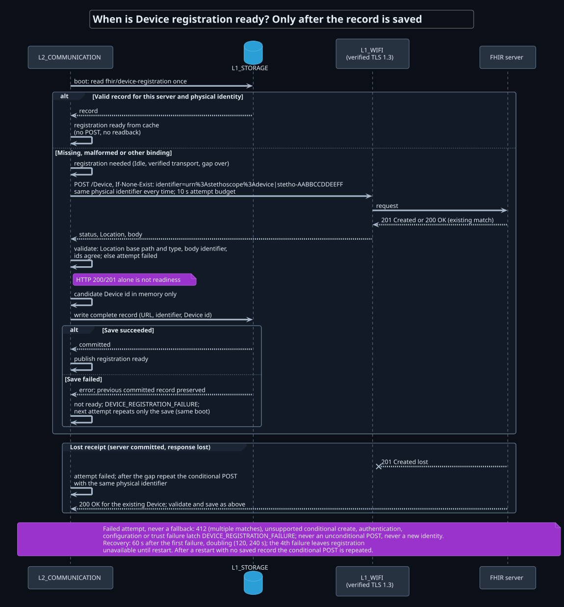
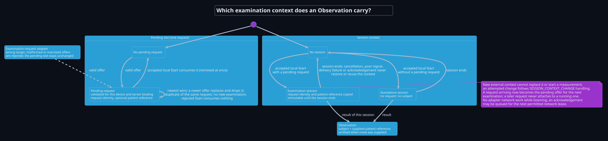
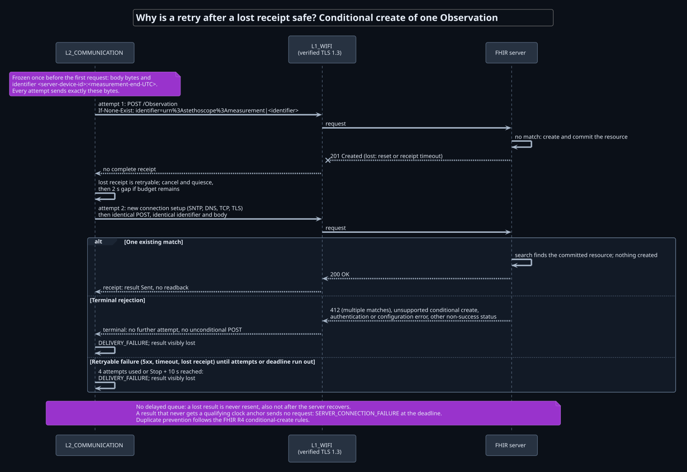

# Device registration, FHIR messages and examination context

## Basis

This design refines the [server-communication architecture](../../architecture/COMMUNICATION/server-communication.md) and the [system design](../system/interfaces-and-behavior.md#delivery-clock-and-configuration). It depends on the [SNTP design](time-synchronization.md) and the [TLS design](secure-transport.md).

Server communication uses persistent server-bound Device registration, conditional recovery, a full-MAC-derived physical identity and hotspot name, registration readiness only after flash save, ten-second registration attempts with an exponential Idle recovery gap (60 seconds doubling up to four failed attempts), and connection reuse against one server defined by the server profile. At most one pending examination request is held under a newest-request-wins rule, consumed and frozen at local Start, with no automatic patient-context reuse after cancellation or failure and no subject field on standalone measurements. Observations use FHIR R4 JSON without profile declarations, and poor-signal Observations carry `dataAbsentReason=error` without a numeric value. Covered requirements are [REQ-02](../../requirements/system-requirements.md#req-02), [REQ-07](../../requirements/system-requirements.md#req-07), [REQ-08](../../requirements/system-requirements.md#req-08), [REQ-09](../../requirements/system-requirements.md#req-09), [REQ-10](../../requirements/system-requirements.md#req-10), [REQ-11](../../requirements/system-requirements.md#req-11), [REQ-12](../../requirements/system-requirements.md#req-12), [REQ-13](../../requirements/system-requirements.md#req-13), [REQ-14](../../requirements/system-requirements.md#req-14) and [REQ-15](../../requirements/system-requirements.md#req-15).

## Responsibilities and interfaces

| Owner | Responsibility |
| --- | --- |
| L2_CONTROL | Grant and revoke the network lease; accept local Start; consume and freeze examination context; finalize results and admit one delivery job. A server request never starts audio. |
| L2_COMMUNICATION | Prepare registration, bind and cache identity, own deadlines, retries and failure episodes, invoke serialization, and send the frozen job through the verified transport. |
| L1_FHIR | Pure C bounded serialization and response parsing. No Wi-Fi, clocks, settings access, automatic registration, retries or mutable global examination state. |
| L1_WIFI | Provide stable physical identity and the verified transport, DNS/TCP/TLS/HTTP resource lifecycle, bounded completion and cancellation. A new socket does not imply a new Device registration. |
| L1_STORAGE | Read/write the complete named registration record. No server policy or retry decisions. |
| Examination-request adapter | Supply validated, device-addressed examination context and consumption acknowledgement. |

`fhir_buildDeviceRegistration` and `fhir_buildObservation` accept immutable input and a caller buffer with capacity, and return success with byte length or an error cause without performing network work. `fhir_parseDeviceRegistration` accepts bounded status, headers, body and the expected server binding, and returns a validated server Device id or an error cause. None of these functions returns truncated JSON, silently truncates an identifier or falls back to an unconditional POST. The L1_WIFI HTTP service accepts the method, configured relative resource path, headers, frozen bytes and caller deadline; waiting does not reset deadlines or retry. Its cancellation contract quiesces callbacks and releases resources before audio within the separate one-second per-service stop bound of the Wi-Fi cleanup limits in [P23](parameters.md).

## Physical identity and server binding

The hotspot name is `Stetho-AABBCCDDEEFF`, formed from all six factory station MAC bytes in uppercase hexadecimal. Device registration uses `stetho-AABBCCDDEEFF`: the same six factory station MAC bytes with no separators and the lowercase project prefix. L1_WIFI reads the stable factory station identity independently of any runtime MAC override or randomization. A failed identity read makes registration unavailable; all zeros or a truncated hotspot suffix are never substituted. This identifier identifies the physical device and does not authenticate it.

Use `Device.identifier.system = urn:stethoscope:device` and the physical identifier as its value. Keep this distinct from the logical `Device.id` that the HAPI FHIR server assigns [1,2]. Bind the saved logical id to the complete HTTPS FHIR base URL of the server profile, including base path. The device has exactly one server, taken from the [server profile image](secure-transport.md#trust-and-server-profile-inputs). When the image is built, lowercase scheme/host, make the port explicit and remove the trailing slash; reject userinfo, query and fragment. Use the same canonical string everywhere. Host/path aliases and a changed base URL require conditional registration for that binding; DNS destination changes, Wi-Fi/SSID/password changes, reconnects and certificate renewal alone do not. A one-slot record is sufficient: returning to a previous server conditionally recovers its resource instead of requiring a multi-server registry.

## Registration record

L2_COMMUNICATION persists the registration through the L1_STORAGE whole-record interface under the key `fhir/device-registration`. Version 1 encoding is 343 bytes: one version byte with value 1, 257 bytes for the canonical base URL, 20 bytes for the physical identifier, and 65 bytes for the server Device id, in that order. Strings are stored as NUL-terminated, zero-padded UTF-8/ASCII byte arrays rather than a native C struct with compiler-dependent padding. Decoding rejects overflow, missing terminators, unsupported versions, mismatched physical identities and malformed fields. Server Device ids match FHIR R4 `id`: 1–64 ASCII letters, digits, hyphen or full stop [2]. The record contains no patient reference, request context, credentials or certificate.

At boot, L2_COMMUNICATION reads and validates the record once. A matching record supplies cached registration readiness without a registration POST or per-measurement readback. A missing, malformed or mismatched record triggers conditional registration. A storage read failure leaves registration unavailable and raises the registration failure cause. Saving a new record preserves the prior committed record on write failure under the L1_STORAGE contract.

## Registration flow and recovery



*When is Device registration ready?* Source: [puml/registration-persistence.puml](puml/registration-persistence.puml). An HTTP 200 or 201 alone never makes registration ready; only the committed record does.

1. While Idle, require station address and verified TLS, including its SNTP exchange, under the separate designs. These are prerequisites, not registration substeps repeated for every message.
2. With no eligible saved registration, acquire L2_CONTROL's network lease and start one monotonic ten-second attempt. Reuse verified TLS where possible. Any required transport recovery, conditional POST, response parsing and flash commit share the remaining attempt budget. Do not invoke an independent ten-second TLS preparation inside it.
3. Send `POST /Device`, `Content-Type: application/fhir+json`, `Prefer: return=representation`, and `If-None-Exist: identifier=urn%3Astethoscope%3Adevice|stetho-AABBCCDDEEFF` for the example identity. Body:

   ```json
   {"resourceType":"Device","identifier":[{"system":"urn:stethoscope:device","value":"stetho-AABBCCDDEEFF"}],"status":"active"}
   ```

   The create body omits any logical resource id, manufacturer or model fields and never creates a Patient. FHIR conditional create returns HTTP 201 for a new resource, HTTP 200 for one existing match and HTTP 412 for multiple matches [3].
4. On HTTP 201 or 200, L1_FHIR validates the response:
   - L1_FHIR extracts a valid logical Device id from the Device representation, from a Location header of the form `https://<authority><base path>/Device/<id>[/_history/<version>]`, or from both.
   - The scheme compares case-insensitively and the base path from the server profile's base URL compares exactly. The authority is not compared because a FHIR server may write its configured server address into Location regardless of the host name or address the client used, and TLS already authenticates the responding server; the authority must only be nonempty and free of `?` and `#`.
   - If both Location and the representation supply an id, they must agree. Parsing rejects any other scheme, base path or resource type, malformed or truncated responses and missing identities. Any `/_history/<version>` suffix is parsed as version metadata rather than part of the logical id. When the representation includes identifiers, they must contain the requested physical identifier.
5. Persistence follows the diagram: the complete record is committed before readiness is published. A new server binding does not become ready using the old server's id.
6. On a failed or interrupted issued registration attempt, retry no earlier than the recovery gap after completion while Idle and prerequisites permit. The gap is 60 seconds after the first failure and doubles with every further failure (60, 120, 240 seconds). The fourth failed attempt makes registration unavailable until restart, as a failed identity or record read does. Interrupted attempts wait for the current gap but do not count, and missing prerequisites consume no attempt. Start cancels network preparation before audio; a pending settings commit must complete under its remaining bound before release. Late generations cannot save or publish registration for another binding. L1_FHIR, L1_WIFI and L1_STORAGE add no workflow retries.

Ambiguous multiple matches, unsupported conditional creation, authentication/configuration failure and invalid trust never trigger unconditional creation. Latch `DEVICE_REGISTRATION_FAILURE`, retain bounded/redacted cause information, and use the registration recovery of step 6 without per-retry alerts after acknowledgement. Acknowledgement clears only the indication, not readiness or retry scheduling; success restores readiness but does not acknowledge an existing latch. Registration-only faults preserve standalone listening. Failure to prove resource release follows existing cleanup/restart rules.

If an authoritative read or server diagnostic specifically establishes that the saved Device is absent, L2_COMMUNICATION invalidates cached readiness and runs conditional registration again while Idle. A generic HTTP 404 from an Observation endpoint does not establish that a referenced Device is missing. L2_COMMUNICATION performs no per-message existence query and no background existence polling. Reconciliation never changes a frozen result's Device id and never resends a previously failed result.

## Examination request boundary



*Which examination context does an Observation carry?* Source: [puml/examination-request-lifecycle.puml](puml/examination-request-lifecycle.puml). The pending slot and the session context are separate: only an accepted local Start moves a request from one to the other.

The adapter contract prevents consumed-request redelivery from creating a new request, including after reconnect or restart. Each new explicit examination carries its own logical identity. Local pending and session context is not persisted in the registration record.

## Observation construction and delivery

L1_FHIR serializes resources in C using a bounded JSON writer with proper string escaping, finite-number checks, locale-independent numeric formatting and checked buffer lengths. The Observation takes these fields from the PulsOxy project of NewTec GmbH: the vital-signs category, the LOINC code, the UCUM value quantity, the effective time and the Device reference [4]. Identifiers, profiles, the subject, the meaning of the timestamp, the poor-signal encoding and the Device registration differ from that project. L2_COMMUNICATION serializes each Observation once after finalization and admission and retains the identical byte sequence for all retries. Device registration and Observation serialization are separate operations.

| Field | Valid heart-rate result |
| --- | --- |
| `resourceType`, `status` | `Observation`, `final` |
| `identifier` | Existing `urn:stethoscope:measurement` plus frozen `<server-device-id>:<measurement-end-UTC>`; retain the shared uniqueness rule |
| `category` | Coding system `http://terminology.hl7.org/CodeSystem/observation-category`, code `vital-signs` |
| `code` | Coding system `http://loinc.org`, code `8867-4` (heart rate), per the existing baseline [5] |
| `effectiveDateTime` | Frozen measurement-end UTC, formatted `YYYY-MM-DDTHH:mm:ss.SSSZ`; never sampled during serialization/retry |
| `device.reference` | `Device/<frozen-server-device-id>` |
| `subject.reference` | Exact validated patient reference supplied by the attached examination; omit the entire subject when absent. No Patient lookup, creation or replacement. |
| `valueQuantity` | Frozen valid BPM numeric value using the result's declared precision; `unit` and `code` are `/min`, `system` is `http://unitsofmeasure.org`. Never invent a rounding/precision policy here. |
| `meta.profile` | Omitted. |

FHIR R4 Observation fields are defined in [6]. The immutable local result retains interval, analysis configuration, request identity and measurement point. Observation payloads omit extension URLs, body-site codes and `Observation.basedOn`.

Stopping before 15 seconds sends nothing ([REQ-07](../../requirements/system-requirements.md#req-07)). Poor-signal reporting satisfies [REQ-08](../../requirements/system-requirements.md#req-08) without a numeric value. A poor-signal Observation uses the same identity, code, time, device and optional subject, omits `valueQuantity`, and adds `dataAbsentReason.coding = [{"system":"http://terminology.hl7.org/CodeSystem/data-absent-reason","code":"error"}]` [7]. It never encodes NaN, zero BPM or the string "error" as a numeric value. Poor-signal Observations follow the same conditional delivery and receipt rules as valid heart-rate Observations.



*Why is a retry after a lost receipt safe?* Source: [puml/conditional-create-retry.puml](puml/conditional-create-retry.puml). `If-None-Exist` carries the frozen measurement identifier, so the server answers a repeated request with the existing resource; duplicate prevention follows the FHIR R4 conditional-create rules [3].

Attempts, budgets and gaps are those of the delivery timeout and retry parameter [P13](../system/parameters.md), as refined by the [delivery budget boundary](secure-transport.md#delivery-budget-boundary). Delivery never creates a Device first: missing registration after finalization is immediately `DELIVERY_NOT_POSSIBLE` when Wi-Fi is configured.

Reuse the verified HTTP connection sequentially when eligible under the [TLS design](secure-transport.md). Drain a bounded HTTP response completely before reuse or close the connection; never interpret leftover response bytes as the next response. Once a complete successful receipt is established, oversized optional response content need not revoke Sent: close instead of reusing it. Device-registration responses still require a validated id. Incomplete/malformed headers are not receipt.

## Parameters

| ID | Contract |
| --- | --- |
| P27-IDENTITY | Full factory station MAC, `stetho-` plus 12 uppercase hex digits; identifier system `urn:stethoscope:device` |
| P27-RECORD | `fhir/device-registration`, version 1, 343 bytes as specified above; canonical base URL at most 256 bytes, server id at most 64 bytes |
| P27-REGISTRATION | Ten seconds including conditional request, parsing and flash save; separate existing cleanup bound; recovery gap 60 seconds after the first failed or an interrupted issued attempt, doubling with each further failure; at most 4 failed attempts, then unavailable until restart |
| P27-REQUEST | At most one pending request; a newer request replaces it, also while a session context is frozen; consumed on accepted measurement Start; no automatic reapplication |
| P27-BUFFERS | 2048-byte outgoing JSON capacity, 4096-byte registration-response body capacity and 4096-byte aggregate response-header capacity; overflow is rejected without truncation |
| P27-DELIVERY | Existing P13 deadlines, receipt, conditional identity, retry classifications and no delayed queue |

The deployment prerequisites for TLS and the server certificate are in the [TLS design](secure-transport.md#design-inputs).

## Sources

[1] Health Level Seven International, *FHIR R4 Device*, version 4.0.1, 2019, <https://hl7.org/fhir/R4/device.html>, accessed 29 October 2026.

[2] Health Level Seven International, *FHIR R4 Data Types*, version 4.0.1, 2019, Identifier and id definitions, <https://hl7.org/fhir/R4/datatypes.html>, accessed 29 October 2026.

[3] Health Level Seven International, *FHIR R4 RESTful API*, version 4.0.1, 2019, Conditional create, <https://hl7.org/fhir/R4/http.html#ccreate>, accessed 29 October 2026.

[4] NewTec GmbH, *PulsOxy InitState, MeasuringState and FhirResourceFactory*, PulsOxy project, revision `e38b98fc8b881af01e23a8f4935567e73d00de28`, 2026, [InitState.cpp](../../references/newtec-pulsoxy/lib/App_PulsOxy/src/InitState.cpp), [MeasuringState.cpp](../../references/newtec-pulsoxy/lib/App_PulsOxy/src/MeasuringState.cpp), [FhirResourceFactory.cpp](../../references/newtec-pulsoxy/lib/FhirService/src/FhirResourceFactory.cpp), reproduced in this repository under [references/newtec-pulsoxy](../../references/newtec-pulsoxy/README.md), accessed 25 November 2026.

[5] Health Level Seven International, *FHIR R4 Vital Signs*, version 4.0.1, 2019, <https://hl7.org/fhir/R4/vitalsigns.html>, accessed 29 October 2026.

[6] Health Level Seven International, *FHIR R4 Observation*, version 4.0.1, 2019, <https://hl7.org/fhir/R4/observation.html>, accessed 29 October 2026.

[7] Health Level Seven International, *FHIR R4 DataAbsentReason code system*, version 4.0.1, 2019, <https://hl7.org/fhir/R4/codesystem-data-absent-reason.html>, accessed 29 October 2026.
