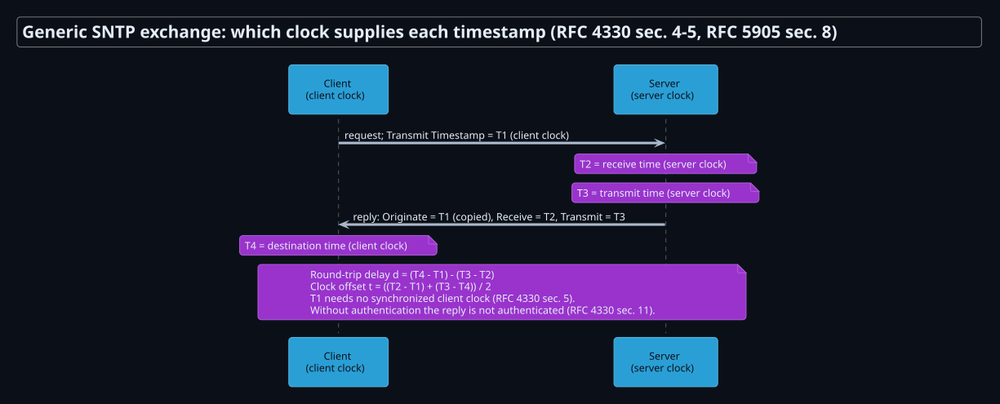
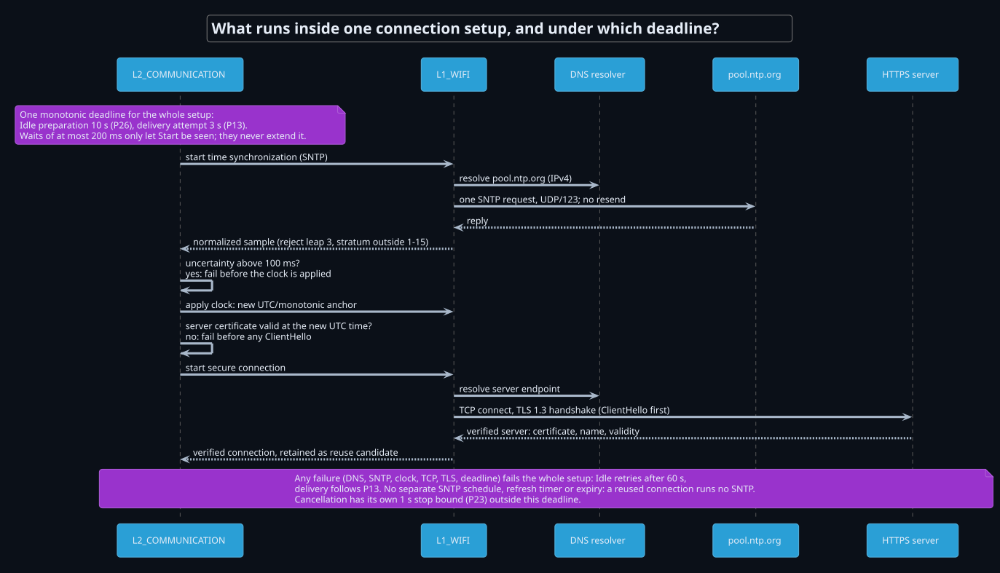
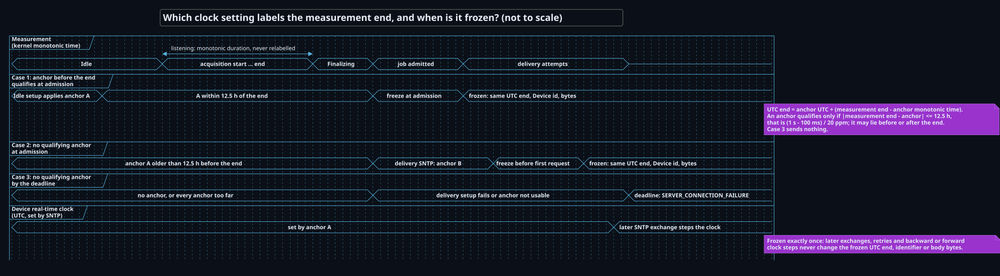

# SNTP synchronization and clock readiness

## Basis

SNTP synchronization refines the [SNTP architecture](../../architecture/COMMUNICATION/time-ownership.md) and the [delivery design](interfaces-and-behavior.md#delivery-clock-and-configuration). Covered requirements are [REQ-02](../../requirements/system-requirements.md#req-02), [REQ-09](../../requirements/system-requirements.md#req-09), [REQ-10](../../requirements/system-requirements.md#req-10), [REQ-11](../../requirements/system-requirements.md#req-11), [REQ-13](../../requirements/system-requirements.md#req-13) and [REQ-14](../../requirements/system-requirements.md#req-14).

## SNTP exchange (generic protocol)

*Which clock supplies each SNTP timestamp?* Source: [puml/sntp-exchange.puml](puml/sntp-exchange.puml). The diagram shows the protocol as the standards define it [1, section 5; 2, section 8]. RFC 5905 obsoletes RFC 4330 and keeps SNTP as an interoperable subset of NTPv4 [2, section 14]. The device uses Zephyr's uncertainty estimate instead of its own offset calculation.

## Ownership and interfaces

L2_CONTROL grants the exclusive network lease. L2_COMMUNICATION owns deadlines, readiness and scheduling. L1_WIFI owns DNS and SNTP resources, native-result normalization and platform clock access. Callbacks publish results without applying the clock, changing controller state or retrying.

L1_WIFI provides the following command/wait interfaces for L2_COMMUNICATION:

| Operation | Contract |
| --- | --- |
| `wifi_startTimeSynchronization` | Accept a hostname and at most one pending operation; return accepted, busy or a cause. Resolve IPv4 through the station's DNS configuration and issue one UDP/123 SNTP request. No resend, alternate-server loop or clock mutation. |
| `wifi_waitForTimeSynchronization` | Accept a caller wait interval and result destination; return pending, a normalized sample, or terminal failure. Completion means operation resources/callbacks are quiesced. Waiting does not issue another request. |
| `wifi_cancelTimeSynchronization` | Cancel DNS, detach/close the socket and quiesce callbacks. Idempotent when inactive; reuse the one-second per-service stop bound of the Wi-Fi cleanup limits in [P23](parameters.md). Return failure rather than falsely acknowledging release. |
| `wifi_applyTimeSynchronization` | Under the lease, advance a successful sample by elapsed monotonic time, set Zephyr real time and return the applied UTC/monotonic anchor. On failure publish no ready anchor. No network work or retry. |

A normalized sample contains Unix UTC seconds plus fractional nanoseconds, an independently sampled receive-time kernel monotonic timestamp in microseconds, and Zephyr's estimated uncertainty in microseconds. An applied anchor is the reference point for later time conversion: it contains the UTC time and kernel monotonic time at which the clock was applied, together with the uncertainty estimate. The caller owns copied values, and no native `sntp_time` fields cross the L1_WIFI boundary. L2_COMMUNICATION keeps uncertainty in microseconds internally and rounds upward when displaying milliseconds.

Each accepted operation produces one terminal result. Cancellation invalidates its generation; late DNS/socket callbacks cannot publish a sample for a newer operation or access a released context. An operation is not replaced until completion or cancellation establishes quiescence.

## Flow and scheduling

*What runs inside one connection setup, and under which deadline?* Source: [puml/connection-setup.puml](puml/connection-setup.puml).

1. Boot starts without a valid anchor. A persisted timestamp does not establish freshness; offline listening remains available.
2. Every TLS connection setup under the [TLS design](secure-transport.md) begins with one SNTP exchange, so that only the server DNS lookup and TCP connection lie between the applied clock and the ClientHello, the first message of the TLS handshake. This applies to the Idle preparation and every delivery reconnect. Reusing an open verified connection sends no ClientHello and runs no SNTP. There is no separate SNTP schedule, refresh timer or internet/HTTP probe. An exchange needs usable DNS and a reachable UDP port 123 to `pool.ntp.org`; Wi-Fi association alone does not supply time. The reply is not authenticated [1, section 11].
3. The exchange shares the deadline of the connection setup that contains it: the ten-second Idle preparation of the [P26 TLS parameters](secure-transport.md#parameters), or the three-second connection-setup budget of a delivery attempt under the delivery timeout and retry parameter [P13](parameters.md). DNS, request, response, normalization and clock application share the remaining budget; short waits never reset it. Cancellation cleanup has the separate P23 stop bound.
4. Accept only a current-generation result while holding the lease; apply the clock, then continue with the TCP connection and ClientHello. Clock-set failure, DNS failure, timeout or a rejected response fails that connection setup. Recovery follows the setup's owner: 60-second Idle recovery under P26, or P13 retries during delivery. No SNTP-specific retry, gap or attempt cap applies.

Start cancels DNS or exchange work before audio begins. L2_COMMUNICATION ignores a completion racing with Start unless it was accepted and applied before L2_CONTROL withdrew the lease. Cancellation is not a failure.

A failed cancellation is a resource-release fault rather than unavailable time. Under the P23 Wi-Fi cleanup policy and [REQ-13](../../requirements/system-requirements.md#req-13), L2_COMMUNICATION latches `WIFI_CLEANUP_FAILURE`, disables network work until restart, records the failed operation and releases audio. Cancellation must release resources within the stop bound rather than relying on a blocking helper or force-aborting a worker.

## Clock mapping and native behavior

L1_WIFI retains Zephyr's SNTP exchange-uncertainty estimate [3]. That estimate covers the SNTP exchange and server dispersion only, while subsequent clock drift is bounded by the mapping limit [P25-MAPPING](#parameters), calculated from a crystal tolerance of ±10 ppm with safety factor 2 and a 1 s maximum deviation.

L1_WIFI sets Zephyr's real-time software clock; no battery-backed RTC is assumed. It advances the receive-time estimate by elapsed kernel monotonic time before applying it. The applied UTC/monotonic anchor is kept, and the measurement end is recorded in monotonic time. Corrections occur outside listening and may step real time without changing duration or rewriting a frozen result.

*Which clock setting labels the measurement end, and when is it frozen?* Source: [puml/clock-mapping.puml](puml/clock-mapping.puml).

- **Limit derivation.** 12.5 hours is (1 s − 100 ms) / 20 ppm, combining a 1 second maximum deviation, a 100 ms SNTP uncertainty budget and a 20 ppm drift budget (crystal datasheet tolerance ±10 ppm × safety factor 2). An exchange reporting more than 100 ms uncertainty exceeds the budget and fails like any other exchange.
- **Deviation basis.** The 1 second maximum deviation follows the Consistent Time profile of IHE (Integrating the Healthcare Enterprise), which requires a median error of less than one second and names SNTP sufficient for it [4]; FHIR, the HAPI FHIR server and TLS set no tighter limit.
- **Uniqueness.** The measurement uniqueness rule remains mandatory, and L2_COMMUNICATION never alters or invents a timestamp to avoid a collision.

A result without a qualifying anchor by the end of the P13 budget is not sent and latches `SERVER_CONNECTION_FAILURE`. Results are not queued for delayed delivery. A retained connection is reused for delivery only while the anchor of its handshake qualifies; otherwise delivery opens a new setup with a fresh exchange.

L1_WIFI converts the Zephyr SNTP response fields into Unix UTC seconds and fractional nanoseconds according to the unit convention of the Zephyr SNTP uncertainty path [3], and samples kernel monotonic time independently for the receive timestamp rather than deriving monotonic time from native SNTP fields.

L1_WIFI inspects the received SNTP packet before normalization and rejects any response from an unsynchronized server: a leap indicator of 3 (alarm condition, clock not synchronized) or a stratum outside 1–15 (0 is kiss-o'-death or unspecified, 16–255 reserved) [1]. A rejected response fails the containing connection setup like any other failed exchange, regardless of the reported uncertainty.

## Failure indication and acknowledgement

There is no separate time-synchronization error. A failed exchange is a failed secure connection setup and follows the [TLS failure indication](secure-transport.md#failure-indication): `SERVER_CONNECTION_FAILURE` ([feedback catalogue](../FEEDBACK/catalogue.md)), with offline Start/listening preserved. The same code marks a result that cannot be sent for lack of a qualifying anchor. Diagnostics name the time cause, anchor age and estimate, never credentials or patient context. During listening, the device runs no SNTP exchange and shows no time indication.

## Parameters

| ID | Value / meaning |
| --- | --- |
| P25-SERVER | `pool.ntp.org`, IPv4 DNS and SNTP over UDP/123 |
| P25-PLACEMENT | One exchange directly before every ClientHello; none for a reused connection; no separate schedule |
| P25-BUDGET | Shares the containing setup deadline (P26 Idle preparation or P13 connection setup); separate P23 one-second per-service cancellation bound |
| P25-MAPPING | Anchor qualifies within 12.5 hours of the measurement end: (1 s − 100 ms) / 20 ppm |
| P25-UNCERTAINTY-BUDGET | 100 ms; a larger reported uncertainty fails the exchange |
| P25-MAXIMUM-DEVIATION | 1 s, after the IHE Consistent Time profile |
| P25-DRIFT | Datasheet ±10 ppm × safety factor 2 = 20 ppm |
| P25-UNCERTAINTY | Zephyr SNTP uncertainty estimate; `CONFIG_SNTP_UNCERTAINTY` must be enabled, because Zephyr reports no uncertainty without it and the 100 ms budget cannot be applied [3]; stored in microseconds internally and rounded upward when displaying milliseconds |

## Sources

[1] David L. Mills, *Simple Network Time Protocol (SNTP) Version 4 for IPv4, IPv6 and OSI*, IETF RFC 4330, January 2006, sections 4, 5 and 11, DOI: 10.17487/RFC4330, <https://www.rfc-editor.org/rfc/rfc4330>, accessed 24 October 2026.

[2] David L. Mills, Jim Martin (editor), Jack Burbank and William Kasch, *Network Time Protocol Version 4: Protocol and Algorithms Specification*, IETF RFC 5905, June 2010, sections 8 and 14, DOI: 10.17487/RFC5905, <https://www.rfc-editor.org/rfc/rfc5905>, accessed 13 November 2026.

[3] The Zephyr Project, *SNTP API, Kconfig, implementation and DNS resolver API*, Zephyr source repository revision `357467a011cd2557a1a3f0b4be83d817c4addc9b`; [SNTP header](https://github.com/zephyrproject-rtos/zephyr/blob/357467a011cd2557a1a3f0b4be83d817c4addc9b/include/zephyr/net/sntp.h), [Kconfig](https://github.com/zephyrproject-rtos/zephyr/blob/357467a011cd2557a1a3f0b4be83d817c4addc9b/subsys/net/lib/sntp/Kconfig), [parser](https://github.com/zephyrproject-rtos/zephyr/blob/357467a011cd2557a1a3f0b4be83d817c4addc9b/subsys/net/lib/sntp/sntp.c), [helper](https://github.com/zephyrproject-rtos/zephyr/blob/357467a011cd2557a1a3f0b4be83d817c4addc9b/subsys/net/lib/sntp/sntp_simple.c), [DNS header](https://github.com/zephyrproject-rtos/zephyr/blob/357467a011cd2557a1a3f0b4be83d817c4addc9b/include/zephyr/net/dns_resolve.h), accessed 28 October 2026.

[4] IHE International, *IHE IT Infrastructure (ITI) Technical Framework, Volume 1, section 7 Consistent Time (CT)* and *Volume 2, section 3.1.4.1.2 Maintain Time [ITI-1]*, Revision 20.0, Final Text, 4 August 2023, <https://profiles.ihe.net/ITI/TF/Volume1/ch-7.html> and <https://profiles.ihe.net/ITI/TF/Volume2/ITI-1.html>, accessed 2 November 2026.
