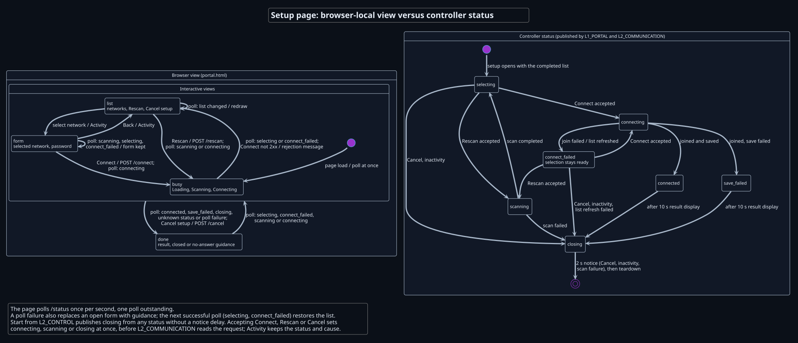

# Portal interfaces and behavior

`L1_PORTAL` serves the setup page as a single HTML document with changing views over an HTTP (Hypertext Transfer Protocol) server. The page runs in the browser, maintains list, form, busy and completed views, polls status once per second, posts URL-encoded form data and escapes network text before display. A rejected form returns to selection. Lost status responses show closure guidance while polling continues, so reconnection can recover. `L1_PORTAL` does not operate the radio or save credentials. `L2_COMMUNICATION` reads typed requests, performs the Wi-Fi workflow and publishes page data through the operations defined in [Requests and published state](#requests-and-published-state).

## Page entry and network selection

The hotspot is open. A client device joins the hotspot manually, and a QR code supplied on the device enclosure or setup card opens `http://192.168.4.1/` (the fixed hotspot address on HTTP port 80). Manual rejoin is accepted. The page hides the password field when an open network is selected. The HTTP handler queues typed requests (Connect, Rescan, Cancel, activity) for `L2_COMMUNICATION`, which reads them with `portal_waitForRequest()` outside the `L2_CONTROL` and `L2_AUDIO` threads. The browser polls status separately.

[Portal parameters](parameters.md) specify the entry, activity and HTTP limits (P21-PORTAL, P24).

## Requests and published state

| Interface | Input or output | Contract |
| --- | --- | --- |
| `portal_start()` | Start request | Start on the hotspot address after `L1_WIFI` has opened the hotspot. |
| `portal_stop()` | Stop request | Reject new requests and wipe unread passwords and form storage. Wait at most P24 for confirmation that the HTTP server and its sockets have stopped. An in-progress shutdown notification does not count as confirmation; a timeout or failure prevents normal teardown acknowledgement. |
| `portal_setNetworks()` | Scan entries and count | Publish the completed list for selection. |
| `portal_setStatus()` | Status and error cause | Show scanning, selection, connecting, failed join, connected, failed save or closing. |
| `portal_setAddress()` | Station IPv4 address or empty text | Show the address supplied by `L2_COMMUNICATION` after the selected network joins. |
| `portal_waitForRequest()` | Caller-owned request and bounded wait | Return Connect, Rescan, Cancel or Activity; clear the request password after use. |

Status polls are not queued requests. Activity requests follow P24 while the user selects or types. Requests are accepted while selection is active; the page ignores user cancellation from Connect through save and automatic closure.

## Form navigation and setup exit

The [shared cancellation and inactivity rule](../COMMUNICATION/interfaces-and-behavior.md#cancellation-and-inactivity)
owns form Back, setup Cancel and timer behavior. `L2_COMMUNICATION` publishes `PORTAL_STATUS_CLOSING` before teardown on every setup exit, including result/save-warning completion and Start. Only Cancel, inactivity and scan failure add the 2 s closing-notice delay; Start has no added notice delay.

Malformed requests, invalid network or passphrase fields and malformed URL encoding return HTTP 400. An oversized body returns HTTP 413. Unknown paths return HTTP 404, and unsupported methods on a known resource return HTTP 405. Rescan after a failed portal join is accepted while the hotspot and HTTP server remain open, even before the replacement scan list is published. Connect returns HTTP 409 while that rescan is running and until a completed list permits selection. Other requests outside selection, a concurrent `/connect` while another form is being received, or a second client trying to submit that form return HTTP 409. Form fragments remain bound to the client that started them until completion or abort, without fragment mixing. A full typed request queue returns HTTP 503 with `Retry-After: 1` without changing published state, so retries do not immediately saturate the bounded queue. A second HTTP connection can poll status without acquiring ownership of an active form. P24 defines rate, queue and inactivity limits. On `portal_start()`, `L1_PORTAL` resets the form, queued requests, station address and errors, retains the already-published completed scan list and sets the state to selection.

These response meanings follow Roy T. Fielding, Mark Nottingham and Julian Reschke,
*HTTP Semantics*, IETF RFC 9110, June 2022, §§10.2.3, 15.5.1, 15.5.5, 15.5.6,
15.5.10, 15.5.14 and 15.6.4, DOI 10.17487/RFC9110,
https://www.rfc-editor.org/rfc/rfc9110.html (accessed 24 October 2026).

The setup portal runs over plain HTTP on an open hotspot. [L2_COMMUNICATION](../COMMUNICATION/interfaces-and-behavior.md) owns setup, retry, save and teardown policy; `L1_PORTAL` displays its published snapshot.

## Page behavior design

The page maintains four local views: network list, selected-network form, busy progress and completed/closed guidance. The controller's published status is authoritative; local form state preserves an unfinished password while status is polled.



*Which local view does the page show for each controller status?* Editable source: [puml/page-state.puml](puml/page-state.puml). The table states what each view shows.

| Trigger | Required page behavior |
| --- | --- |
| Entry | Show Loading, immediately request status, then request it again P24 after each response/failure completes. Only one poll is outstanding. |
| Selecting / changed list | Show the completed network list with a password marker for protected entries, Rescan and Cancel setup. Replace the list when it changes; do not destroy an active form. |
| Network selection | Open the form for that network. Show a masked password field only for a protected network, plus Connect and Back. Back returns to the list without submitting. Selection, Back and typing send throttled Activity. |
| Connect | Replace the form with busy progress; POST URL-encoded `network` and `password` fields (empty password for open networks). Treat acceptance as queued work, never as successful association or save. A non-success HTTP response returns to selection with a request-rejection message. Polling supplies the eventual connection/save result. |
| Scanning | Show busy scanning unless a local form is already in progress. Rescan sends its command and shows scanning; a completed controller list permits selection again. |
| Connecting | Show busy progress and no form/cancel controls while join/save is in progress. |
| Failed join | Return from busy/completed to selection with the published cause; refresh a displayed list when its snapshot changes. Keep a local form intact until its submit or Back. |
| Connected | Show saved success and the station address with guidance that the setup hotspot closes and the page can be closed. |
| Failed save | Show that connection succeeded, credentials were not saved and will be lost at restart; include cause and station address. |
| Cancel / closing / other terminal status | Cancel shows Closing immediately and posts the command; controller closing or an unrecognized terminal state shows closed guidance and any cause. |
| Poll or JSON failure | Show “No answer from the device. If its hotspot is gone, setup has ended.” unless completed guidance is already visible. Continue polling so restored connectivity can replace the message. |

Polls do not reset setup inactivity. Activity is rate-limited according to P24; controller operations pause the timer. A browser can lose the hotspot during channel changes, so completed guidance must remain useful without another response. POST transport failures and command rejection rely on later polls for reconciliation; the page does not retry a connection submission automatically.

Treat all network names, error causes and station addresses as untrusted display text. Escape `&`, `<`, `>`, apostrophe and double quote before inserting text into HTML. Encode form values with URL-encoded form rules, separately from HTML escaping. Never include submitted passwords in the status response or visible messages. The password marker is a boolean, not a credential.

## HTTP endpoints

All paths are relative to the hotspot HTTP origin. `202` means enqueued; results arrive through `/status`. Command bodies are empty; connect uses a URL-encoded body. Unknown paths return `404`, unsupported methods on registered resources `405`.

| Path | Method | Fields | Responses |
| --- | --- | --- | --- |
| `/` | GET | None | `200`, `text/html`, the single page. |
| `/status` | GET | None | `200`, `application/json`, snapshot below; does not consume a queue slot or reset inactivity. |
| `/connect` | POST | `network` and `password` required, empty password for open network | `202` queued; `400` missing/invalid fields, malformed encoding, unsupported or unlisted network/passphrase; `413` body over P24; `409` wrong state/list unavailable/another active form owner; `503` full queue with `Retry-After: 1`. |
| `/rescan` | POST | None | `202` queued; accepted after a failed join even before the replacement list is ready; `409` other wrong states; `503` full queue with `Retry-After: 1`. |
| `/cancel` | POST | None | `202` queued in selection/ready failed-join state; `409` outside that state; `503` full queue with `Retry-After: 1`. |
| `/activity` | POST | None | `202` queued in selection/ready failed-join state without replacing its status/cause; `409` otherwise; `503` full queue with `Retry-After: 1`. |

The active connect form belongs to its initiating HTTP client until completion or abort. Another client cannot append fragments. A separate status connection acquires no form ownership. Commands do not report operation success in their HTTP response.

## Status response format

```json
{
  "status": "selecting",
  "cause": "",
  "address": "",
  "networks": [{"name": "Example network", "password": true}]
}
```

| Field | Type and meaning |
| --- | --- |
| `status` | String: `scanning`, `selecting`, `connecting`, `connect_failed`, `connected`, `save_failed` or `closing`. |
| `cause` | Human-readable string describing the controller error; empty if none. Never a secret. |
| `address` | Station IPv4 text supplied by `L2_COMMUNICATION` after a successful selected-network join; otherwise empty. It is distinct from the fixed hotspot address. |
| `networks` | Completed scan-cache array, bounded by P23-WIFI. Each item has a `name` string (SSID) and `password` boolean indicating whether input is required. No passphrase is returned. |

Publish a coherent status/cause/address/list snapshot under the `L1_PORTAL` data boundary. Escape quotes and backslashes for JSON and replace raw control bytes with `?`; HTML text escaping remains necessary after JSON parsing. A poll can show the previous completed list while scanning; Connect admission also requires the controller's selection-ready condition, not merely a nonempty array.
