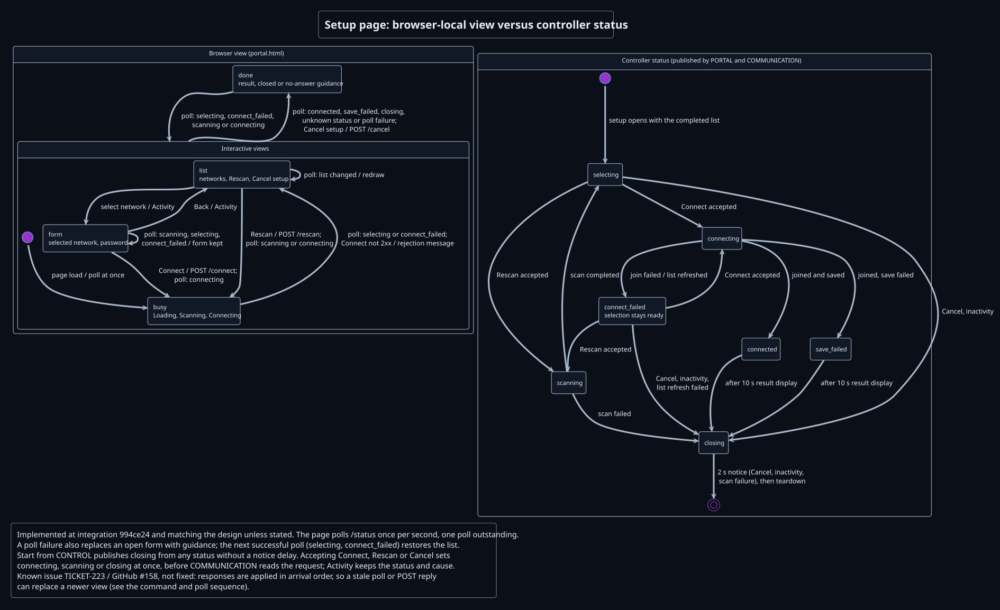
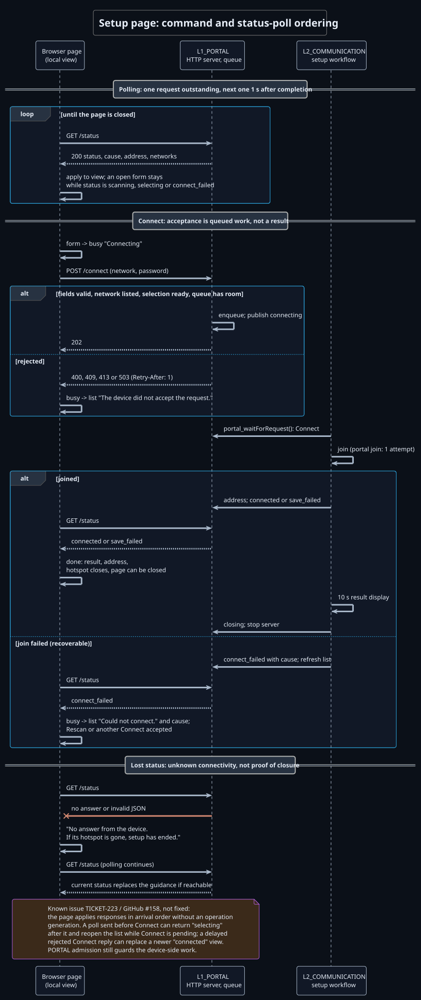

# Portal interfaces and behavior

`L1_PORTAL` wraps the HTTP (Hypertext Transfer Protocol) server and one HTML document with changing views, embedded at build time. It does not operate the radio or save credentials. L2_COMMUNICATION reads typed requests, performs the Wi-Fi workflow and publishes page data through the operations defined in [Requests and published state](#requests-and-published-state). [Page behavior design](#page-behavior-design) shows how the page's local views follow that published status.

## Page entry and network selection

The hotspot is open. The phone joins it manually, then a QR code supplied on the device enclosure/setup card opens `http://192.168.4.1/` (the fixed WIFI_HOTSPOT_ADDRESS with HTTP port 80);
manual rejoin is accepted. Hide the password field for open selected networks. The
HTTP handler queues typed requests (Connect, Rescan, Cancel, activity) for
COMMUNICATION, which reads them with `portal_waitForRequest()`, outside controller/audio
threads; the browser polls status.

Project decisions: the fixed hotspot address `192.168.4.1`, HTTP port 80, enclosure/setup-card QR URL, manual phone join/rejoin and typed-request/status-poll flow define this project contract. Verification status: phone entry/rejoin, QR availability and real HTTP/radio integration require an identified device/firmware run; they are not verified by this design record. See P21-PORTAL/P24 in the [portal parameters](parameters.md).

## Requests and published state

| Interface | Input or output | Contract |
| --- | --- | --- |
| `portal_start()` | Start request | Start on the hotspot address after WIFI has opened the hotspot. |
| `portal_stop()` | Stop request | Reject new requests, wipe unread passwords and form storage; wait at most P24 for HTTP server completion evidence confirming sockets/server actually stopped. A shutdown-in-progress -EALREADY is not confirmation; timeout/failure prevents normal teardown acknowledgement. |
| `portal_setNetworks()` | Scan entries and count | Publish the completed list for selection. |
| `portal_setStatus()` | Status and error cause | Show scanning, selection, connecting, failed join, connected, failed save or closing. |
| `portal_setAddress()` | Station IPv4 address or empty text | Show the address supplied by COMMUNICATION after the selected network joins. |
| `portal_waitForRequest()` | Caller-owned request and bounded wait | Return Connect, Rescan, Cancel or Activity; clear the request password after use. |

Status polls are not queued requests. Activity requests follow P24 while the user selects or types. Requests are accepted while selection is active; the page ignores user cancellation from Connect through save and automatic closure.

## Form navigation and setup exit

The [shared cancellation and inactivity rule](../COMMUNICATION/interfaces-and-behavior.md#cancellation-and-inactivity)
owns form Back, setup Cancel and timer behavior. COMMUNICATION publishes `PORTAL_STATUS_CLOSING` before teardown on every setup exit, including result/save-warning completion and Start. Only Cancel, inactivity and scan failure add the 2 s closing-notice delay; Start has no added notice delay.

Malformed requests, invalid network/passphrase fields and malformed URL encoding
return HTTP 400. An oversized body returns 413. The Zephyr HTTP router returns 404
for an unknown path and 405 for an unsupported method on a known resource. Rescan after a failed portal join is accepted while the
AP/server remain open, even before the replacement scan list is published. Connect
returns 409 while that rescan is running and until a completed list permits selection.
Other requests outside selection, a concurrent /connect while another form is being received, or a second
client trying to submit that form returns 409. Form fragments remain bound to the
client that started them until completion/abort; no fragment mixing. A full typed
request queue returns 503 with `Retry-After: 1`, without changing published state;
the one-second retry interval avoids immediate retry pressure on the bounded queue. A second HTTP connection
can poll status; it acquires no ownership of an active form. P24 defines rate,
queue and inactivity limits. Reset form, queued requests, address and errors at start;
retain the already-published completed scan list and select it.

These response meanings follow Roy T. Fielding, Mark Nottingham and Julian Reschke,
*HTTP Semantics*, IETF RFC 9110, June 2022, §§10.2.3, 15.5.1, 15.5.5, 15.5.6,
15.5.10, 15.5.14 and 15.6.4, DOI 10.17487/RFC9110,
https://www.rfc-editor.org/rfc/rfc9110.html (accessed 24 October 2026).

The open-hotspot transport is an accepted MVP limitation; the [dated risk acceptance](../../planning/security-risk-acceptance.md) and TICKET-198/199 follow-up are retained in project records. It adds no requirement. [COMMUNICATION](../COMMUNICATION/interfaces-and-behavior.md) owns setup, retry, save and teardown policy; PORTAL displays its published snapshot.

## Page behavior design

The controller's published status is authoritative. The page keeps four local views (network list, selected-network form, busy progress, completed/closed guidance) so that an unfinished password survives status polling.



*Which local view does the page show for each controller status, and what keeps an open form intact?* Editable source: [page-state.puml](page-state.puml).



*In which order do commands, their HTTP replies and status polls take effect?* Editable source: [command-poll-sequence.puml](command-poll-sequence.puml).

Page rules shown in the views, kept here as the reference list:

- **Polling.** Show Loading, request status at once, then again P24 after each response or failure completes; only one poll is outstanding. Polls do not reset setup inactivity.
- **List.** The completed list with a password marker for protected entries, Rescan and Cancel setup. Replace the list when it changes; never destroy an active form.
- **Form.** Selecting a network opens its form: a masked password field only for a protected network, plus Connect and Back. Back returns to the list without submitting. Selection, Back and typing send Activity, rate-limited according to P24; controller operations pause the inactivity timer.
- **Connect.** Replace the form with busy progress and POST URL-encoded `network` and `password` (empty for open networks). Acceptance is queued work, never association or save. A non-success response returns to selection with a request-rejection message. Later polls supply the result; the page never retries a connection submission automatically, and POST transport failures and rejections rely on later polls for reconciliation.
- **Scanning and connecting.** Scanning shows busy progress unless a local form is open; Rescan sends its command and shows scanning. Connecting shows busy progress without form or cancel controls.
- **Failed join (`connect_failed`).** Recoverable: return from busy or completed guidance to selection with the published cause; refresh a displayed list when it changes; keep an open form until its submit or Back. Rescan or another Connect is accepted.
- **Results.** Connected shows saved success, the station address and guidance that the setup hotspot closes and the page can be closed. Failed save shows that the connection succeeded, the credentials were not saved and are lost at restart, with cause and station address. A browser can lose the hotspot during channel changes, so this guidance must stay useful without another response.
- **Closing.** Cancel shows Closing at once and posts the command. Controller closing or an unrecognized status shows closed guidance and any cause.
- **Lost status.** A failed poll or invalid JSON shows "No answer from the device. If its hotspot is gone, setup has ended." unless completed guidance is visible; this also replaces an open form. Polling continues, so restored connectivity replaces the message. The observation does not prove that the controller closed.
- **Known issue [TICKET-223](https://nfrie.atlassian.net/browse/TICKET-223) / [GitHub #158](https://github.com/DemonicPsychoII/DigitalStethoscope/issues/158), not fixed.** Responses are applied in arrival order without an operation generation, so a poll sent before Connect can reopen the list while Connect is pending, and a delayed rejected Connect reply can replace a newer connected view. PORTAL admission still guards the device-side work; hotspot closure can prevent a later poll from correcting the view.

Treat all network names, error causes and station addresses as untrusted display text. Escape `&`, `<`, `>`, apostrophe and double quote before inserting text into HTML. Encode form values with URL-encoded form rules, separately from HTML escaping. Never include submitted passwords in the status response or visible messages. The password marker is a boolean, not a credential.

## HTTP endpoints

All paths are relative to the hotspot HTTP origin. `202` means enqueued; results arrive through `/status`. Command bodies are empty; connect uses a URL-encoded body. Unknown paths return `404`, unsupported methods on registered resources `405`.

| Path | Method | Fields | Responses |
| --- | --- | --- | --- |
| `/` | GET | None | `200`, `text/html`, the single page. |
| `/status` | GET | None | `200`, `application/json`, snapshot below; does not consume a queue slot or reset inactivity. |
| `/connect` | POST | `network` and `password` required, empty password for open network | `202` queued; `400` missing/invalid fields, malformed encoding, unsupported or unlisted network/passphrase; `413` body over P24; `409` wrong state/list unavailable/another active form owner; `503` full queue with `Retry-After: 1`. |
| `/rescan` | POST | None | `202` queued; accepted after a failed join even before the replacement list is ready; `409` other wrong states; `503` full queue with `Retry-After: 1`. |
| `/cancel` | POST | None | `202` queued in selection/ready failed-join state; `409` outside that state; `503` full queue with `Retry-After: 1`. |
| `/activity` | POST | None | `202` queued in selection/ready failed-join state without replacing its status/cause; `409` otherwise; `503` full queue with `Retry-After: 1`. |

The active connect form belongs to its initiating HTTP client until completion or abort. Another client cannot append fragments. A separate status connection acquires no form ownership. Commands do not report operation success in their HTTP response.

## Status response format

```json
{
  "status": "selecting",
  "cause": "",
  "address": "",
  "networks": [{"name": "Example network", "password": true}]
}
```

| Field | Type and meaning |
| --- | --- |
| `status` | String: `scanning`, `selecting`, `connecting`, `connect_failed`, `connected`, `save_failed` or `closing`. |
| `cause` | Human-readable string describing the controller error; empty if none. Never a secret. |
| `address` | Station IPv4 text supplied by COMMUNICATION after a successful selected-network join; otherwise empty. It is distinct from the fixed hotspot address. |
| `networks` | Completed scan-cache array, bounded by P23-WIFI. Each item has a `name` string (SSID) and `password` boolean indicating whether input is required. No passphrase is returned. |


Publish a coherent status/cause/address/list snapshot under the PORTAL data boundary. Escape quotes and backslashes for JSON and replace raw control bytes with `?`; HTML text escaping remains necessary after JSON parsing. A poll can show the previous completed list while scanning; Connect admission also requires the controller's selection-ready condition, not merely a nonempty array.
