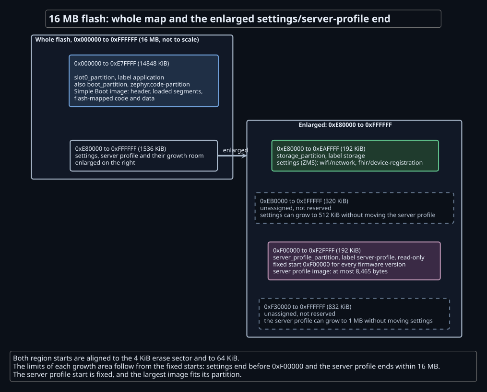

# STORAGE record interface

`L1_STORAGE` adapts Zephyr settings and the flash backend. The application initializes `L1_STORAGE` once with `storage_init()` before any record access. Callers own their buffers. `L1_STORAGE` neither joins networks nor chooses retries.

| Operation | Input | Outcome |
| --- | --- | --- |
| `storage_init()` | None | 0 after settings/backend initialization; negative error otherwise. |
| `storage_read(name, data, size)` | Named record, writable caller buffer, exact expected byte count | 0 and a complete record; `-ENOENT` if missing; `-EINVAL` for a stored-size mismatch; negative backend error otherwise. Callers never use the output as credentials after a failure. |
| `storage_write(name, data, size)` | Named complete record and readable caller buffer | 0 after a whole-record commit; negative error otherwise. The previous valid record survives an unsuccessful write. |

The `wifi/network` record contains the complete 98-byte `wifi_network` record defined by the [L1_WIFI network-record contract](../WIFI/interfaces-and-behavior.md#network-record), including both fixed-size arrays. `L2_COMMUNICATION` reads it at boot, validates it using `wifi_isValidNetwork()`, and commits it only after the selected network has an address. `L2_COMMUNICATION` owns the save retry and requires preservation of the old record on failure. `L1_STORAGE` does not authenticate or encrypt this record. Callers and `L1_STORAGE` keep network names and passphrases out of logs and clear transient copies after use. The separate `fhir/device-registration` record follows the versioned, whole-record [registration contract](../COMMUNICATION/server-communication.md#registration-record). `L2_COMMUNICATION` validates physical identity and server binding and publishes readiness only after successful commit. Failed registration-record access follows the registration-only failure policy; generic device settings faults remain handled separately.

## Flash layout

The ESP32-S3-WROOM-1-N16R8 provides 16 MB of flash; the layout below defines `flash0` across all 16 MB and replaces the board's default 4 MB partition table [1]. The application boots a single image with Espressif Simple Boot without MCUboot, so over-the-air (OTA) updates and slot management are not used [2]. Settings use the ZMS (Zephyr Memory Storage) backend in `storage_partition` [3].

The flash layout spans all 16 MB. Settings and the server profile each have a fixed start address with independent sizes:

*Where do the application, settings and server profile sit, and how far can each grow without moving the other?* Editable source: [flash-layout.puml](flash-layout.puml). The application partition holds the Simple Boot image (header, loaded segments and flash-mapped code and data); both unassigned areas are growth room, not reserved.

Neither start depends on the other partition's size. Settings can grow to 512 KiB without moving the server profile, and the server profile can grow to 1 MB without moving settings. The server profile start must never change between firmware versions, because an updated firmware must still find an image that was flashed earlier. Both starts are aligned to the 4 KiB erase sector and to 64 KiB.

Partition sizing:

- **Settings.** Live settings occupy about 0.6 KiB: `wifi/network` (98 bytes, about 160 bytes stored), `fhir/device-registration` (343 bytes, [registration record](../COMMUNICATION/server-communication.md#registration-record), about 416 bytes stored) and ZMS metadata [3][4]. ZMS requires at least two erase sectors so that one sector remains available for garbage collection [4].
- **Server profile.** The version 1 format below occupies at most 8,465 bytes, which fits in three 4 KiB sectors.
- **Flash geometry.** Erase sector 4 KiB, write block 4 bytes [4].

Only `slot0_partition`, `storage_partition` and `server_profile_partition` are defined; bootloader, second-image, secondary-core, scratch and core-dump partitions are omitted because the firmware uses Simple Boot on a single core without OTA or core dumps. The application partition size bounds the flash space allocated to the image independently of SoC flash-mapping limits.

Erasing the settings partition removes the stored Wi-Fi network and Device registration; the device then opens Wi-Fi setup, and conditional registration recovers the same Device through its physical identifier. A full chip erase also removes the server profile image, which must then be flashed again.

### Partitioning and provisioning

1. **Layout.** The devicetree defines `slot0_partition` from offset `0x000000` up to the settings start, `storage_partition` at `0xE80000` (192 KiB) and `server_profile_partition` at `0xF00000` (192 KiB). The settings partition must end before the server profile start. The server profile partition must remain at `0xF00000` and end within 16 MB; its size may grow up to 1 MB. The code partition choice selects `slot0_partition`, and settings use `storage_partition`.
2. **Firmware reader.** `L1_STORAGE` opens `server_profile_partition` by its devicetree label, validates the image once at boot and hands the endpoint, keep-alive and certificate to `L2_COMMUNICATION`. The largest server profile image (8,465 bytes) must fit inside the partition.
3. **Server profile tool.** The server profile tool builds the image from one [deployment file](server-profile.md#deployment-file), validates the file and certificate, appends the CRC-32 and derives the partition offset and size from the firmware's devicetree definition.
4. **Flash command.** The flash command builds the image and writes only the server profile partition at its partition offset ([commands](server-profile.md#commands)). Firmware flashing writes only the firmware image and leaves the server profile and settings partitions untouched.

The server profile image is the only source of the server endpoint and certificate ([TLS trust inputs](../COMMUNICATION/secure-transport.md#trust-and-server-profile-inputs)). The server profile tool on the developer PC builds it; a separate flash command writes it to the server profile offset `0xF00000`. The firmware reads it through the flash map and never writes it. Version 1 format, little-endian:

| Field | Size | Content |
| --- | --- | --- |
| Magic | 4 bytes | ASCII `STPV` |
| Version | 1 byte | `1` |
| Base URL length, base URL | 2 bytes + at most 256 bytes | Canonical HTTPS FHIR base URL as defined by the [server binding](../COMMUNICATION/server-communication.md#physical-identity-and-server-binding) |
| Server keep-alive | 4 bytes | Server idle timeout in seconds, 6 to 4,294,967,295; the device subtracts 5 seconds, and `L2_COMMUNICATION` rejects a smaller value at boot as an invalid configuration |
| Certificate length, certificate | 2 bytes + at most 8192 bytes | PEM public server certificate |
| CRC-32 | 4 bytes | IEEE CRC-32 over all preceding bytes; detects corruption only. The image has no signature. |

Erased flash, an unknown magic or version, an out-of-range length or a CRC mismatch make the image invalid; the reader checks only this structure. Subsequent content checks determine configuration validity: `L1_WIFI` rejects an unusable URL, an unparsable certificate or a missing matching Subject Alternative Name, and `L2_COMMUNICATION` rejects a server keep-alive below 6 seconds, as the [server profile design](server-profile.md#device-behavior) lists. Either failure leaves secure transport unavailable. Settings and the server profile remain separate: erasing only the settings partition preserves the server profile, and rewriting the server profile preserves Wi-Fi credentials and the registration record. A whole-flash erase removes the server profile image too and requires flashing it again.

Firmware flashing writes the firmware image at `0x00000000` and nothing outside the image range; the device boots it with Espressif Simple Boot.

## Sources

[1] The Zephyr Project, *ESP32-S3-DevKitC board devicetree and Espressif partition tables*, source revision `357467a011cd2557a1a3f0b4be83d817c4addc9b`, [esp32s3_devkitc_procpu.dts](https://github.com/zephyrproject-rtos/zephyr/blob/357467a011cd2557a1a3f0b4be83d817c4addc9b/boards/espressif/esp32s3_devkitc/esp32s3_devkitc_procpu.dts) and [partitions_0x0_amp_4M.dtsi](https://github.com/zephyrproject-rtos/zephyr/blob/357467a011cd2557a1a3f0b4be83d817c4addc9b/dts/vendor/espressif/partitions_0x0_amp_4M.dtsi), accessed 2 November 2026.

[2] The Zephyr Project, *Espressif SoC Kconfig, `ESP_SIMPLE_BOOT`*, source revision `357467a011cd2557a1a3f0b4be83d817c4addc9b`, [soc/espressif/common/Kconfig](https://github.com/zephyrproject-rtos/zephyr/blob/357467a011cd2557a1a3f0b4be83d817c4addc9b/soc/espressif/common/Kconfig), accessed 2 November 2026. Simple Boot is the default without MCUboot.

[3] The Zephyr Project, *Settings ZMS backend*, source revision `357467a011cd2557a1a3f0b4be83d817c4addc9b`, [settings_zms.c](https://github.com/zephyrproject-rtos/zephyr/blob/357467a011cd2557a1a3f0b4be83d817c4addc9b/subsys/settings/src/settings_zms.c), lines 21–24, accessed 2 November 2026.

[4] The Zephyr Project, *ZMS allocation table entry, settings ZMS entries and ESP32-S3 flash geometry*, source revision `357467a011cd2557a1a3f0b4be83d817c4addc9b`: [zms_priv.h](https://github.com/zephyrproject-rtos/zephyr/blob/357467a011cd2557a1a3f0b4be83d817c4addc9b/subsys/kvss/zms/zms_priv.h) (`struct zms_ate`, 16 bytes with 8 bytes of inline data), [zms.c](https://github.com/zephyrproject-rtos/zephyr/blob/357467a011cd2557a1a3f0b4be83d817c4addc9b/subsys/kvss/zms/zms.c) (mount rejects fewer than two sectors), [settings_zms.c](https://github.com/zephyrproject-rtos/zephyr/blob/357467a011cd2557a1a3f0b4be83d817c4addc9b/subsys/settings/src/settings_zms.c) and [settings_zms.h](https://github.com/zephyrproject-rtos/zephyr/blob/357467a011cd2557a1a3f0b4be83d817c4addc9b/subsys/settings/include/settings/settings_zms.h) (name, data and 8-byte linked-list entries per setting), [esp32s3_common.dtsi](https://github.com/zephyrproject-rtos/zephyr/blob/357467a011cd2557a1a3f0b4be83d817c4addc9b/dts/xtensa/espressif/esp32s3/esp32s3_common.dtsi) (`flash0`: `erase-block-size = <4096>`, `write-block-size = <4>`), accessed 4 November 2026.
