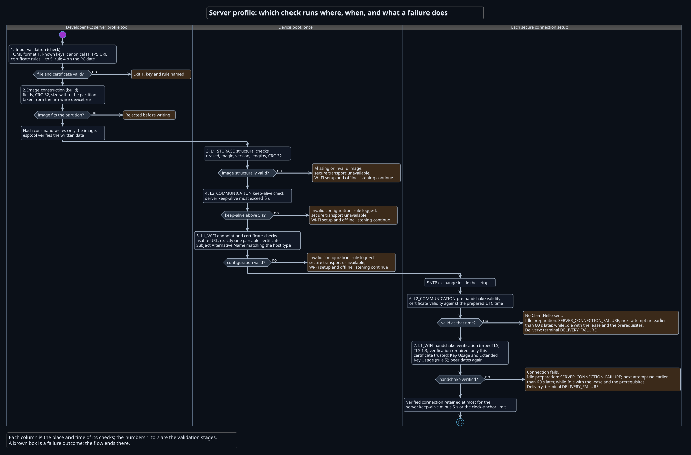

# Server profile from a deployment file

## Basis

This page refines the [server profile architecture](../../architecture/system/server-profile.md) and the [flash layout and image format](interfaces-and-behavior.md#flash-layout). It covers REQ-09, REQ-11, REQ-12 and REQ-13.

Each server deployment is defined by a single TOML file with the public server certificate embedded as PEM text. A single provisioning command validates the file, builds the binary image in format version 1 and writes it to the device. The deployment file is an input on the developer PC only.

## Deployment file

Each server deployment uses one `<deployment>.toml` file. The deployment name uses lowercase letters, digits and hyphens, for example `lab-hapi.toml`, and also names the built image. A server change updates only this file; no other provisioning input exists. The file holds public data only and no credentials. Production deployment files remain outside the repository and use the same tool.

The file follows TOML v1.0.0 [1]. Format 1:

| Key | TOML type | Required | Rule |
| --- | --- | --- | --- |
| `format` | integer | yes | `1`. Any other value is rejected, so a newer file never reaches an older tool. |
| `description` | string | no | For people: server, network and purpose. Not written to the image. |
| `server.base_url` | string | yes | HTTPS FHIR base URL; canonical form below. |
| `server.keep_alive_seconds` | integer | yes | The server's idle connection timeout, 6 to 4,294,967,295 seconds; the device closes its connection 5 seconds earlier. |
| `server.certificate` | string | yes | Exactly one PEM `CERTIFICATE` block [2], normally written as a multi-line basic string [1]. At most 8,192 bytes after line endings are normalized to LF. |

Unknown keys or tables are errors, so a misspelt key never silently drops a value. The file holds public information only: a `PRIVATE KEY` label or any other PEM label than `CERTIFICATE` is rejected.

```toml
format = 1
description = "Example HAPI FHIR test server"

[server]
base_url = "https://192.0.2.10:8443/fhir"
keep_alive_seconds = 600
certificate = """
-----BEGIN CERTIFICATE-----
MIID...
-----END CERTIFICATE-----
"""
```

### Canonical base URL

The tool writes the canonical form into the image, and registration binds to the same string. Scheme and host are lowercased [3]. The scheme must be `https`. A missing port becomes `:443`, because the server binding requires an explicit port. Trailing slashes are removed, and the remaining path is kept. Userinfo, query and fragment are rejected. The host is a DNS name or an IPv4 literal; IPv6 literals are rejected because the station resolves and connects over IPv4 only. The canonical URL has at most 256 bytes.

### Certificate checks

Before writing an image, the tool applies the certificate rules below so a mismatch fails on the developer PC. [Validation stages](#validation-stages) shows where and when the device applies each rule; rule 4 is applied at each connection setup, because boot has no valid clock:

1. The text is exactly one parsable X.509 certificate.
2. It is self-issued and its signature verifies with its own public key, because the device trusts it directly.
3. It has a Subject Alternative Name extension whose entry type follows the host: a DNS name host needs an equal DNS entry (case-insensitive, no wildcard); an IPv4 host needs an equal IP address entry, and a DNS entry spelling the address does not count. Common Name is never used [4].
4. It is valid on the developer PC's current date. The tool prints the expiry date.
5. Its key may sign TLS 1.3 server authentication: a Key Usage extension, if present, includes `digitalSignature` [5]; an Extended Key Usage extension, if present, includes `serverAuth` or `anyExtendedKeyUsage`. A certificate that violates this rule fails the handshake verification of the device [6].

## Image built from the file

The image uses format version 1 of the [flash layout](interfaces-and-behavior.md#flash-layout). Field mapping:

| Image field | From the deployment file |
| --- | --- |
| Magic `STPV`, version `1` | Fixed by the tool. |
| Base URL length and base URL | Canonical `server.base_url`, ASCII. |
| Server keep-alive | `server.keep_alive_seconds`. |
| Certificate length and certificate | `server.certificate` with LF line endings and one final newline. |
| CRC-32 | Computed by the tool over all preceding bytes. |

The tool rejects an image larger than `server_profile_partition`. It reads the partition start and size from the firmware's `server_profile_partition` devicetree definition so the layout is defined in one place, and rejects a build that omits that node.

## Commands

| Command | Result |
| --- | --- |
| Check | Validates the deployment file and certificate and reports the canonical URL, keep-alive, certificate subject, Subject Alternative Names, expiry and image size. |
| Build | Runs the check and generates the binary server profile image, which is no larger than `server_profile_partition`. |
| Flash | Runs the build, then writes only the server profile image at the partition offset and verifies the written data with esptool [7]. The firmware image and the settings partition remain unchanged. |

Every rejection names the key and the violated rule, fails with a non-zero exit status and writes nothing to the device.

## Validation stages



*Which check runs on the PC, at boot or during connection setup, who owns it, and what does its failure do?* Editable source: [puml/server-profile-validation.puml](puml/server-profile-validation.puml).

For rule 2, the device trusts only this certificate as its sole trust anchor ([TLS trust inputs](../COMMUNICATION/secure-transport.md#trust-and-server-profile-inputs)).

## Device behavior

At boot, `L1_STORAGE` reads and validates the image once, as the [flash layout](interfaces-and-behavior.md#flash-layout) defines, `L2_COMMUNICATION` checks the keep-alive and `L1_WIFI` applies certificate rules 1 and 3 ([validation stages](#validation-stages) 3 to 5). Every boot failure leaves secure transport unavailable with a configuration cause and keeps Wi-Fi setup and offline listening working. Certificate validity (rule 4) is checked after time synchronization and before each handshake, as the [TLS design](../COMMUNICATION/secure-transport.md) defines:

| Image state | Boot result |
| --- | --- |
| Erased partition | Missing image; no secure connection attempt. |
| Unknown magic or version, bad length, CRC mismatch | Invalid image. |
| Unusable URL, unparsable certificate, no matching Subject Alternative Name, server keep-alive below 6 seconds | Invalid configuration; the log names the rule. `L2_COMMUNICATION` rejects the keep-alive, because its 5-second margin would leave no idle time. |
| Valid image | Server configured; preparation follows the [TLS design](../COMMUNICATION/secure-transport.md). |

## Parameters

| ID | Value / meaning |
| --- | --- |
| P28-FILE | TOML v1.0.0 deployment file, format 1 (`<deployment>.toml`) |
| P28-LIMITS | Canonical base URL at most 256 bytes; certificate at most 8,192 bytes; keep-alive 6 to 4,294,967,295 seconds |
| P28-IMAGE | Image format version 1 of the flash layout; IEEE CRC-32 |
| P28-PARTITION | Server profile partition at fixed start `0xF00000` with size 192 KiB, independent of the settings partition size; image occupies at most 8,465 bytes from that start; provisioning derives start and size from `server_profile_partition` |

## Sources

[1] Tom Preston-Werner, Pradyun Gedam et al., *TOML v1.0.0*, specification, 11 January 2021, <https://toml.io/en/v1.0.0>, accessed 4 November 2026.

[2] Simon Josefsson and Sean Leonard, *Textual Encodings of PKIX, PKCS, and CMS Structures*, IETF RFC 7468, April 2015, sections 2 and 5, DOI [10.17487/RFC7468](https://doi.org/10.17487/RFC7468), accessed 4 November 2026.

[3] Tim Berners-Lee, Roy T. Fielding and Larry Masinter, *Uniform Resource Identifier (URI): Generic Syntax*, IETF RFC 3986, STD 66, January 2005, section 6.2.2.1, DOI [10.17487/RFC3986](https://doi.org/10.17487/RFC3986), accessed 4 November 2026.

[4] Peter Saint-Andre and Rich Salz, *Service Identity in TLS*, IETF RFC 9525, November 2023, sections 4 and 6, DOI [10.17487/RFC9525](https://doi.org/10.17487/RFC9525), accessed 4 November 2026.

[5] Eric Rescorla, *The Transport Layer Security (TLS) Protocol Version 1.3*, IETF RFC 8446, August 2018, section 4.4.2.2, DOI [10.17487/RFC8446](https://doi.org/10.17487/RFC8446), accessed 5 November 2026.

[6] Mbed TLS contributors, *`mbedtls_ssl_check_cert_usage` in `library/ssl_tls.c`*, Zephyr Mbed TLS module, revision `098e120afb51877ed814bdc04443890ae12e0642`, [source](https://github.com/zephyrproject-rtos/mbedtls/blob/098e120afb51877ed814bdc04443890ae12e0642/library/ssl_tls.c#L8639), accessed 5 November 2026.

[7] Espressif Systems, *esptool: Basic Commands (ESP32-S3)*, esptool documentation, latest; online revision and publication year not stated, <https://docs.espressif.com/projects/esptool/en/latest/esp32s3/esptool/basic-commands.html>, accessed 4 November 2026.
