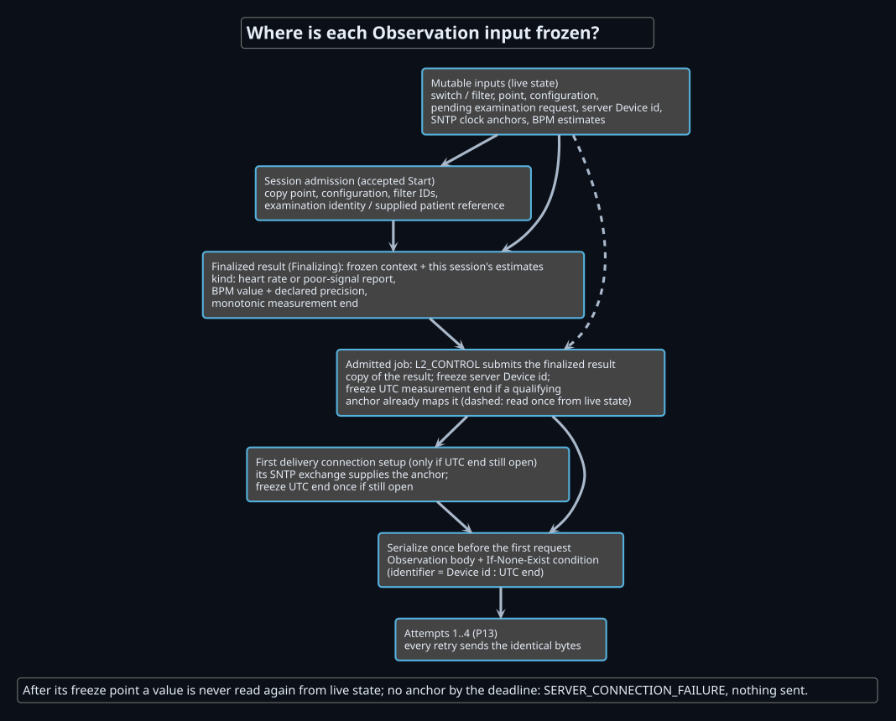
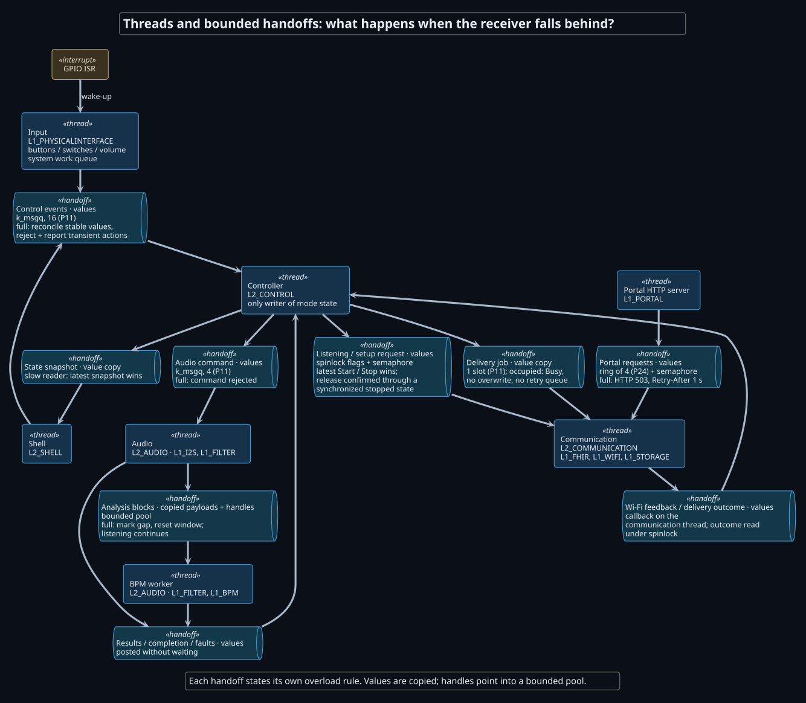

# Cross-module design

These contracts span several modules and have no single owning module: the data contracts between modules, the queues between modules, state entry and exit, the failure contract, the pin assignment, the design constraints and the parameters P10, P11 and P15. The [firmware structure](../architecture/system/firmware-structure.md) defines the modules, their ownership and their hand-offs. Everything that one module owns is defined in the design of that module.

## Data contracts

| Contract | Required fields and invariants |
|---|---|
| Audio block | pool handle, source ID/generation, sequence, first sample index, sample rate, frame count (≤64), representation/valid bits, discontinuity flag, readonly mono sample payload. Microphone samples are 24-bit, left-aligned in int32 with the low 8 bits cleared ([sample format](AUDIO/interfaces-and-behavior.md#sample-format)). Timestamp derives from sample count, not worker arrival. |
| Control event | event ID/type, origin (physical, shell or worker), monotonic timestamp, typed value, generation where relevant. `L2_CONTROL` serializes accepted order; equal timestamps use queue arrival order. Invalid fields are rejected before mutation. |
| Audio command | Start or Stop from `L2_CONTROL` (`audio_command` in `L2_AUDIO`). `L2_AUDIO` reports `started`, `stopped` or a fault event. It ignores Start while running and after a fault, and Stop while stopped. The volume passes separately as an atomic value. |
| State snapshot | Effective and requested settings, playback, measurement and delivery states, BPM validity and time, and error or outcome counters. Read as a coherent copy; a consumer such as `L2_SHELL` never edits it. |
| Measurement result | Result and session identity, valid flag and reason, BPM value and declared precision, quality value, coverage, sample interval, monotonic interval and UTC mapping, frozen Device id, point, filter settings and optional supplied patient reference. Invalid results carry no sendable numeric value. |
| Delivery job | Stable Observation identifier (Device id plus measurement end time, frozen as [result provenance](#result-provenance) shows), immutable payload serialized once before the first request, frozen server profile reference, and attempt count (up to 4 attempts within 10 s, [P13](COMMUNICATION/parameters.md#p13)). `L2_CONTROL` submits the finalized result as `communication_delivery`. Secrets stay outside logs. Result device, time and value are never resnapshotted from live state. |
| Health event | Module, error class, timestamp, severity and counter reference. |

### Result provenance

*Where is each Observation input frozen?* Source: [puml/shared-delivery-provenance.puml](puml/shared-delivery-provenance.puml).

## Queues and memory

Message queues (`k_msgq`) carry bounded values or handles rather than unbounded audio payloads. The
audio path uses nonblocking enqueue.

Each bounded handoff has its own overload rule:

*What happens at each bounded handoff when the receiver falls behind?* Source: [puml/shared-runtime-handoffs.puml](puml/shared-runtime-handoffs.puml); the [thread view](../architecture/system/puml/runtime-ownership.puml) shows the workers without capacities.

For the delivery slot, a terminal failure retains only redacted outcome metadata with no retry queue. The completed measurement is discarded and server recovery does not resend it ([REQ-10](../requirements/system-requirements.md#req-10)).

The 8 MB PSRAM holds the Wi-Fi buffers and the Wi-Fi heap, the mbedTLS heap and the large network buffers. Thread stacks stay in internal RAM, because flash writes disable the PSRAM cache. The I2S block pools stay in internal DMA-capable RAM. The [AUDIO sizing](AUDIO/interfaces-and-behavior.md#timing-and-sizing) accounts for the transport blocks, the mono working buffer and the analysis blocks.

## State entry/process/exit

| Region / state | Entry | Process | Exit / cancellation |
|---|---|---|---|
| Playback Boot | zero gain, capability checks; no I2S stream (silent TX priming happens at Start, [AUDIO states](AUDIO/interfaces-and-behavior.md#states)) | bounded adapter initialization | Idle on essential readiness; Fault otherwise |
| Idle | mute; no active transport/listening operation | allow configuration and network lease | Start is Busy during analysis; Start during sending cancels the delivery job; otherwise start only after lease released |
| Live | reset source-dependent state on source generation change | 64-frame normalized fan-out; selected listening filter; gain/saturation; TX | stop/fault mute |
| Measurement Acquiring | freeze context/config/ID and clear aggregation | original-rate windows; BPM filter, independent of the listening switch; valid estimates | Stop <15 s cancels; Stop ≥15 s → Finalizing; identity change rejected; an Error with audio muted invalidates the session |
| Finalizing | stop accepting windows for that interval; audio stopped | aggregate and union valid temporal coverage; no delivery connection setup; it starts at job submission ([P13](COMMUNICATION/parameters.md#p13)) | freeze valid/invalid result once; late blocks cannot mutate result |
| Delivery decision (end of Analysing) | after the valid/invalid latch | check Wi-Fi configuration and, only when Wi-Fi is configured, the delivery prerequisites (Device id and a valid server profile image with endpoint and certificate) once; no waiting | Wi-Fi unconfigured: no send or Wi-Fi error; result not retained. Delivery prerequisites fail: latch DELIVERY_NOT_POSSIBLE and release Busy at once. Delivery prerequisites pass: submit the one job with the exclusive network lease to Sending for a valid BPM, or to ReportingError for an invalid BPM (validated error report, no numeric value) |
| Sending | job submitted with the lease; freeze the Device id and, if a qualifying clock anchor exists, the UTC measurement end | connection setup starts at once unless an eligible retained verified connection is reused; serialize once before the first request; bounded connect/TLS/conditional POST, receipt | outcome event + release lease; terminal failure latches DELIVERY_FAILURE and releases Busy; Start cancels the job and is never queued |
| Error, audio affected | mute and invalidate active acquisition; block every input, including Start | expose latched cause on the red LED and serial log | audio errors are restart-required; the device stays halted until restart |
| Error deferred during listening | a non-audio halting error is latched without indication; listening continues | none until the operator stops the examination | on manual Stop, discard the result of that examination, show the error and apply its catalogue halt/clear rule |

Changing source or point during a session leaves the frozen context unchanged and raises SESSION_CONTEXT_CHANGE with the catalogue halt/restart rule, deferred until the manual Stop when it occurs while listening. Outside a session `L2_CONTROL` may accept configuration changes and reset source-dependent histories. Generation checks reject stale completions. Separate acknowledgement clears the indication of an Error that the catalogue allows to clear, without starting, retrying or changing an active workflow. A halted Error follows the catalogue clear rule; a short press cannot clear a restart-required fault.

A completed result does not wait for delivery prerequisites. When Wi-Fi is configured and they fail after finalization, `L2_CONTROL` releases Busy at once and latches DELIVERY_NOT_POSSIBLE; the result is not retained. When Wi-Fi is configured and they hold, the single job is granted to Sending; `L2_CONTROL` does not queue Start or a second result. Start during Analysing is rejected with Busy before acquisition. Start during Sending cancels the delivery: a connection setup or request in flight is cancelled and its connection closed, a retry gap ends at once and no further attempt starts. The job ends with DELIVERY_FAILURE, or with SERVER_CONNECTION_FAILURE when its UTC measurement end was never frozen, and the result is lost. If the server had already committed the request it keeps the Observation; without readback the device does not learn this. If the cancellation cannot be proven, WIFI_CLEANUP_FAILURE follows under [P23](COMMUNICATION/parameters.md#p23). Listening starts after the network release. Admission resumes only after delivery succeeds, terminates or is cancelled and the network lease is released; the normal error-clear rules still apply to these latches. Success confirms the result; failure loses it visibly ([REQ-09](../requirements/system-requirements.md#req-09), [REQ-10](../requirements/system-requirements.md#req-10)). A later measurement needs a fresh Start; the lost result cannot be reconstructed or retried.

## Session handling

BPM analysis retains bounded streaming analysis state and window estimates. Session identity changes are rejected and follow `SESSION_CONTEXT_CHANGE` halt and restart handling in the [status and error catalogue](FEEDBACK/catalogue.md#status-and-error-catalogue). Invalid BPM produces an error-report Observation with no numeric value. Session state transitions follow the [system architecture](../architecture/system/README.md).

## Failure contract

Service operations return Accepted, Rejected(reason) or Busy for commands and emit one terminal outcome per accepted action. Essential audio faults mute output. Analysis gaps invalidate BPM analysis without stopping live listening. No module persists captured patient audio, and no prior result is relabelled with a new ID. Error indication and recovery follow the [status and error catalogue](FEEDBACK/catalogue.md#status-and-error-catalogue), including its Wi-Fi-only, server-connection and registration-only audio exceptions and restart rules. Bounded requests are used instead of implicit retry loops.

## Pin assignment

| Function | Connector | ESP32-S3 pins |
|---|---|---|
| INMP441 microphone, `i2s0` RX | J3 | bit clock GPIO4, word select GPIO5, data input GPIO6 |
| PCM5102A DAC, `i2s1` TX | J4 | bit clock GPIO40, word select GPIO41, data output GPIO42 |
| Start/Stop button | J6 | GPIO16; closes to ground, pull-up |
| Red button LED | J6 | GPIO17; active high; the LED keeps its current limiting |
| Volume potentiometer | J7 | wiper on GPIO1, ADC1 channel 0 |
| Raw/Murmur/BPM switch | J8 | GPIO18, GPIO21 and GPIO38 with pull-ups. Raw connects GPIO18 to ground; Murmur connects GPIO18 to GPIO21; BPM connects GPIO18 to GPIO38 |
| RGB status LED | on the DevKit | GPIO48, driven through the SPI3 data line |
| Octal PSRAM | on the module | GPIO33 to GPIO37; not assigned to any function |

## Design constraints

The design constraints apply across modules. The numeric values are in the [parameters](#parameters) and in the parameters of the module designs ([parameter index](README.md#parameters)).

| Area | Constraint |
|---|---|
| Copies and locks | Settings and snapshots are copied under a short lock or passed by message hand-off. A delivery job occupies the one job slot of `L2_COMMUNICATION`; while it is occupied a new job gets Busy, without overwrite and without a retry queue. DMA allocations stay in internal DMA-capable SRAM. |
| Hardware | ESP32-S3 N16R8, INMP441 on I2S0, PCM5102A on I2S1, potentiometer on ADC1, with the pins of the [pin assignment](#pin-assignment). The device ends at the DAC line output. |
| Audio | `L2_AUDIO` converts the signed 24-bit left-channel data of the INMP441 into normalized mono blocks with sequence numbers. The DMA buffers are in internal RAM, TX is primed with silence, and the mono signal is duplicated to both DAC channels. Listening continues when analysis cannot accept a block; the gap invalidates the affected BPM window. On a microphone or DAC failure the output is silent, the session is cancelled and an Error with audio muted is raised; the operator removes the cause and restarts the device as the catalogue requires. |
| Input | `L1_PHYSICALINTERFACE` reports debounced, timestamped events, one per stable transition. Interrupt handlers only signal deferred work. The volume is clamped to 0–100 %. On a potentiometer ADC failure or an invalid switch position the input takes its safe value, and CONTROL_INPUT_FAILURE (restart) follows. A long press (≥2 s) is a distinct event and suppresses the ordinary press. |
| Control | `L2_CONTROL` is the only writer of mode, filter and workflow state; the other modules send events and read snapshots. Context changes during a session are rejected with SESSION_CONTEXT_CHANGE halt/restart handling. Active network work runs only at boot and in Idle; Start cancels Wi-Fi setup safely and cancels a delivery in Sending (result lost); Start during analysis is Busy. Start/Stop and acknowledgement are separate. The portal opens only from Idle. |
| Listening | The listening filters are Raw, Murmur and BPM; Raw applies no band filter; the BPM position applies the filter of the BPM analysis. Output saturates before integer conversion. Listening filter and volume never change the analysis input. The DSP core is pure C without Zephyr headers and without heap use per block. |
| BPM | BPM analysis gets audio before the volume control and always applies the BPM filter, independent of the listening switch. It evaluates whole-cycle periodicity, not single S1/S2 peaks. Invalid windows carry a reason; an old BPM is never reused. Aggregation counts overlapping windows once and freezes value, interval and settings. Cancel discards the aggregation. There is no fixed numeric quality threshold. |
| Network | Connection, time sync, TLS and HTTP run only under the Idle lease. The result is a FHIR R4 Observation (LOINC 8867-4, UCUM /min, `effectiveDateTime` = interval end), sent as a conditional create with a `device` reference; `subject` is copied only from a server-requested examination with a supplied patient reference and is otherwise omitted. Delivery has up to 3 retries, takes `201`/`200` as receipt and has no readback. TLS 1.3 verifies the server profile's public server certificate, endpoint SAN and validity against the clock of the SNTP exchange directly before each ClientHello; there is no older TLS or plain-HTTP fallback. No device certificate is configured. See [TLS preparation and reuse](COMMUNICATION/secure-transport.md). Credentials stay out of source and logs. Wi-Fi credentials and the server-assigned Device id persist in the flash settings partition; Device registration conditionally creates or recovers the resource and reuses its committed server-bound id after restart; Wi-Fi changes alone do not invalidate it. See [registration and FHIR messages](COMMUNICATION/server-communication.md). |
| Indication | RGB LED shows the context colour and status pattern; during an error it keeps the colour of the context where the error occurred. The red button LED shows the blink code of the highest-priority error (see [status and error catalogue](FEEDBACK/catalogue.md#status-and-error-catalogue)). The catalogue is one append-only `FEEDBACK_` enum. Errors also go to the serial log, written by the component that detects them. The hotspot is open, runs setup only at boot or in Idle, and has an inactivity timeout and a bounded number of clients; no credentials appear in logs. |
| Monitoring | Stalls, dropped blocks, deadline misses, clipping, analysis gaps and queue saturation are counted. Stack and heap watermarks are reported. A stalled audio worker raises an Error with audio muted at once; a stalled BPM worker raises its Error under the deferral rule of the catalogue, so listening continues until the manual Stop. |

## Parameters

Owners are the firmware modules in the [module map](../architecture/system/firmware-structure.md#static-dependency-and-module-map).

| ID | Parameter | Value | Basis | Owners |
|---|---|---|---|---|
| P10 | Input and indication response | Switch and button debounce 30 ms; potentiometer full scale 3083 mV, which is 100 % volume; effective setting ≤100 ms; status indication ≤500 ms | The break-before-make time of the filter switch (J8) is at most 21 ms, so a 30 ms debounce spans that gap; the Start/Stop button (J6) uses the same interval. 3083 mV is the highest wiper voltage that the ADC reads at the 3V3 end of the potentiometer (J7; ADC1 channel 0, gain 1/4, internal reference, 12 bits) | L1_PHYSICALINTERFACE, L2_CONTROL |
| P11 | Queue / pool capacities | 16 control events, 1 pending network job; 4 audio commands, a command to a full queue is rejected; 5 RX + 5 TX DMA blocks (RX queue 3, TX queue 4, 4 TX blocks primed); receive and TX-block waits 20 ms | [AUDIO sizing](AUDIO/interfaces-and-behavior.md#timing-and-sizing) | L2_AUDIO, L1_I2S, L2_CONTROL, L2_COMMUNICATION |
| P15 | Memory capacity | 16 MB flash, 8 MB PSRAM; DMA buffers in internal SRAM | Hardware module capacity | MONITOR |
