# Implicit state machines: explicit statecharts and refactor plan

Purpose: show, for every behavior whose state lives in flags, timers, callbacks or the call stack, its explicit statechart; decide per machine whether code should make it explicit (TICKET-224); record what already protects it and what this review found.

Basis: implementation at integration `994ce24`, reviewed 13 November 2026. Every diagram shows **implemented** behavior unless an element says **documented**. Orange states are findings; red states are terminal until restart or end one operation. Implicit does not mean wrong: most machines below are correct and well protected. Replacing flags with an enum is not itself a fix, and no refactor is authorized by this page; TICKET-224 is the later code work.

## Inventory and verdicts

| Machine | Source under `coding/app/` | State held today | Verdict for TICKET-224 | Refactor risk |
|---|---|---|---|---|
| [Worker workflow](#communication-worker-workflow) | `L2_COMMUNICATION/communication.c` | `communication_State` (4 values) plus `ListeningIsActive`, `SetupIsRequested`, `BootJoinIsPending`, `CleanupFaultIsLatched` and the call stack | **Make explicit:** activity enum + one dispatch function | Medium |
| [Network/audio handover](#networkaudio-handover) | same | `PendingWork` bits, `State` STOPPED as acknowledgement, fault latch | **Keep** the bitmap; name the acknowledgement as a derived state | Low |
| [Setup](#setup) | same | `State = SETUP`, portal status, call stack of `runSetup` | **Make explicit** together with the worker, as a step enum | Medium–high |
| [Transport readiness and registration](#transport-readiness-and-registration) | same | `TransportIsVerified`, `SecureConnectionIsRetained`, retry timepoints; `RegistrationIsAvailable/Ready/Unsaved`, attempt count | **Keep separate facts;** registration may get an enum | Low |
| [Delivery](#delivery) | same | `DeliveryIsPending`, `DeliveryOutcome`, `ObservationIsFrozen`, loop locals | **Make explicit:** job enum with its own deadline transition | Medium (interacts with TICKET-222) |
| [WIFI station and scan](#wifi-station-and-scan) | `L1_WIFI/wifi.c` | Station atomics and event bits; scan flags under `wifi_ScanLock` | **Station: make explicit;** scan: keep | Medium / none |
| [SNTP and TLS workers](#sntp-and-tls-workers) | `L1_WIFI/wifi.c`, `wifi_secure_connection.c` | Explicit enums plus generation, claim, retained flag | **Keep;** optionally extract the shared lifecycle | Medium if extracted |
| [DNS lookup](#dns-lookup) | `L1_WIFI/wifi_dns.c` | `struct wifi_dns_lookup` fields | **Keep implicit** | — |
| [HTTP response reader](#http-response-reader) | `L1_WIFI/wifi_http.c` | Per-reader flags driven by parser callbacks | **Keep implicit;** fix H1 separately | — |
| [PORTAL server](#portal-server) | `L1_PORTAL/portal.c` | `StopIsConfirmed`, `IsOpen`, `ServerHasListener`, status, queue, form owner | **Make the server lifecycle explicit;** keep admission as a guard | Medium |
| [Setup page](#setup-page) | `L1_PORTAL/portal.html` | `view` plus untracked fetches | **Make explicit with TICKET-223:** view + operation generation | Low |
| [Button, CONTROL, lights](#button-control-and-status-light) | `L1_PHYSICALINTERFACE/physicalinterface.c`, `L2_CONTROL/control.c` | Button flags and work items; `control_isIdle`, `control_wifiIndication`; light pattern and overlay | **Button, lights: keep. CONTROL: make explicit** when the session machine is implemented | Low |
| [STORAGE](#storage) | `L1_STORAGE/storage.c` | Zephyr settings state, per-read result | **Keep implicit** (sequential) | — |
| AUDIO, I2S, filter, BPM | skeletons | none yet | Nothing to model; do not present draft audio states as implemented | — |

## COMMUNICATION worker workflow

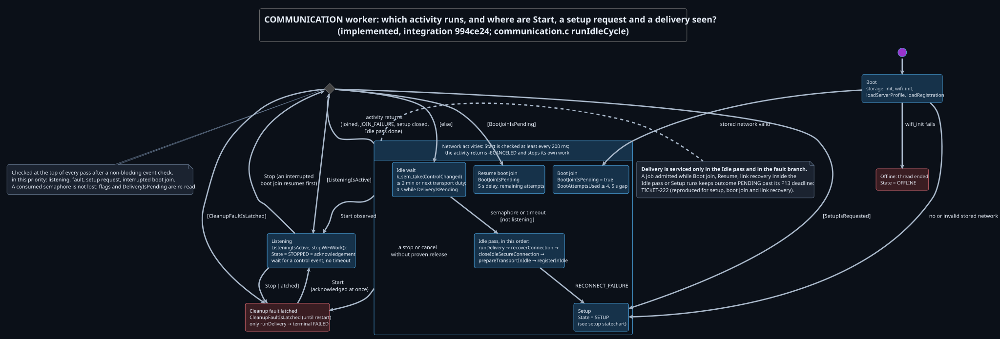

*Which activity does the worker run, and where are Start, a setup request and a delivery observed?*

- **Verdict: make explicit.** The outer `communication_State` (RUNNING, SETUP, STOPPED, OFFLINE) is a view for CONTROL, not the behavior; the real state is which function is on the stack plus four flags. An `enum communication_activity` (BOOT_JOIN, IDLE_WAIT, IDLE_PASS, RESUME_JOIN, SETUP, LISTENING, CLEANUP_FAULT, OFFLINE) and one `communication_dispatch()` that implements the priority order of [`runIdleCycle`](../../coding/app/L2_application/L2_COMMUNICATION/communication.c#L904-L972) would make the diagram reviewable against code.
- **Keep blocking activities.** A full event-driven rewrite (no blocking calls) is not recommended: every activity already checks Start at least every 200 ms, and the blocking structure keeps cancellation local to the activity that owns the work.
- **Preserve:** the non-blocking event check at the top of every pass; re-reading `SetupIsRequested`, `ListeningIsActive` and `DeliveryIsPending` after any semaphore take (a consumed semaphore is never the only record of an event); `communication_postEvent` resetting STOPPED to RUNNING so every Start/Stop needs a new acknowledgement; the cleanup-fault branch still giving a pending delivery its terminal outcome.
- **TICKET-222 interaction:** the deadline of an admitted delivery is serviced only by `runDelivery` in the Idle pass and the fault branch, so every other activity delays it (see [newly found issues](#newly-found-issues)). An explicit activity enum is the natural place for a decided rule (reject admission outside Idle, or service the deadline from every activity), but the rule itself is a design decision.
- **Equivalence tests:** `tests/host/test_communication.py`, `test_delivery.py`, `test_registration.py` and `integration/test_services.py` run the production translation unit in the deterministic simulator; they must pass unchanged. Add trace comparisons for Start during each activity and for a setup request during the Idle pass.

## Network/audio handover

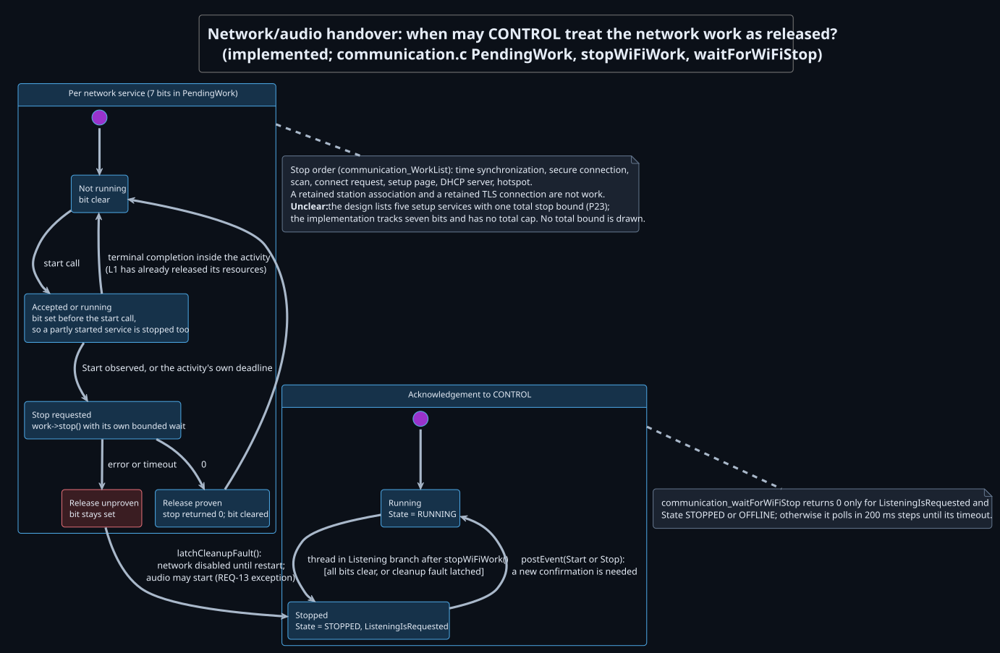

*When may CONTROL treat the network work as released?*

- **Verdict: keep** the `PendingWork` bitmap; it is already an explicit per-service state set with a fixed stop order. Make the acknowledgement explicit only as a named helper (`communication_isNetworkReleased()`), because today it is the pair `ListeningIsRequested ∧ State ∈ {STOPPED, OFFLINE}` read in [`checkWaitTarget`](../../coding/app/L2_application/L2_COMMUNICATION/communication.c#L2101-L2112).
- **Preserve:** setting the bit before the start call ([`startService`](../../coding/app/L2_application/L2_COMMUNICATION/communication.c#L2392-L2406)); clearing it only after a proven stop; latching the cleanup fault instead of retrying when release is unproven; no retry while a bit is still set ([`retry`](../../coding/app/L2_application/L2_COMMUNICATION/communication.c#L2236)).
- **Open, not decided here:** the design names five setup services with one total stop bound (P23); the implementation tracks seven bits and has no total cap. No total bound is drawn.
- **Equivalence tests:** the existing stop-failure, release-wait and fault cases in `test_communication.py` (`stop_failures`, `scan_stop_failures`, `disconnect_failures`, `secure_cancel_failures` inputs).

## Setup

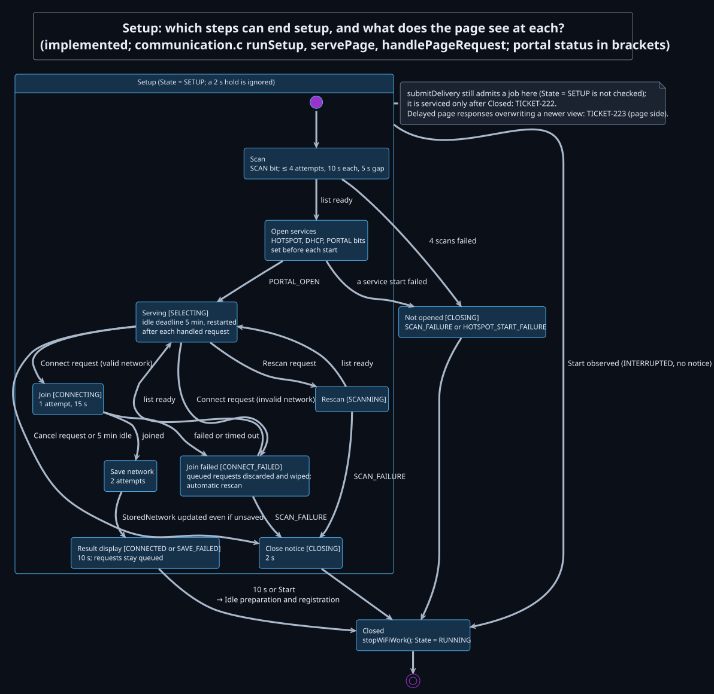

*Which steps can end setup, and what does the page see at each?*

- **Verdict: make explicit** as `enum communication_setup_step` inside the worker refactor, not on its own. Today the step is encoded by the position in `runSetup` → `servePage` → `handlePageRequest` → `handleConnectRequest` and by the published portal status; the published status can run ahead of the worker (D4).
- **Risk: medium–high.** Setup mixes radio work, page status, secrets and timers; a step enum must keep the password wipes at every exit and the discard of requests queued during a failed join.
- **Preserve:** inactivity deadline restarted only after a handled request; request queue left unread during the 10 s result display; `stopWiFiWork()` on every exit, including a failure before the services opened; a hold during setup ignored (`State = SETUP`).
- **TICKET-222/223:** delivery is admitted during setup but not serviced (TICKET-222). Browser-side ordering is TICKET-223; server-side admission already rechecks state under the lock.
- **Equivalence tests:** the setup scenarios in `test_communication.py` and `integration/test_services.py` (rescan, failed join with rescan, save failure, inactivity, Start in every step).

## Transport readiness and registration

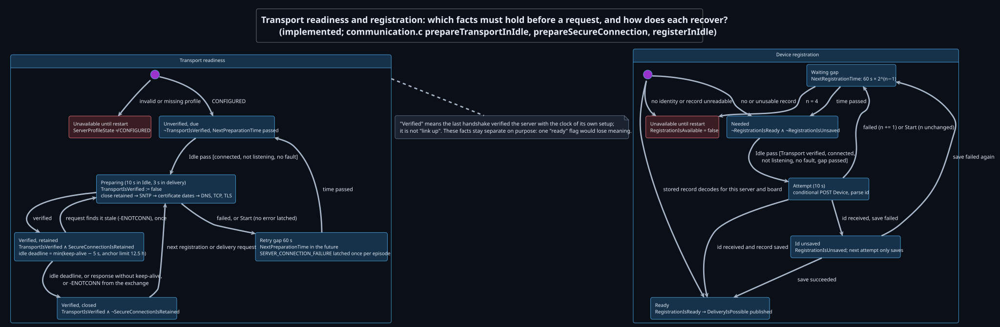

*Which facts must hold before a request, and how does each recover?*

- **Verdict: keep the separate facts.** Verified (last handshake verified with its own clock), retained (a reusable connection exists) and connected (station address) are different facts; one `ready` state would lose that. Registration could become `enum communication_registration_state` (UNAVAILABLE, NEEDED, WAITING, UNSAVED, READY) at low risk, but the gain is small.
- **Preserve:** `TransportIsVerified := false` at the start of every preparation; preparation and registration deferred without consuming an attempt when prerequisites are missing; an interrupted attempt starting the gap without counting or latching an error; "server accepted" and "saved locally" kept apart (`RegistrationIsUnsaved` retries only the save).
- **Equivalence tests:** `test_registration.py`, the transport cases in `test_delivery.py` (`test_every_connection_setup_starts_with_its_own_time_synchronization`, keep-alive and stale-connection cases).

## Delivery

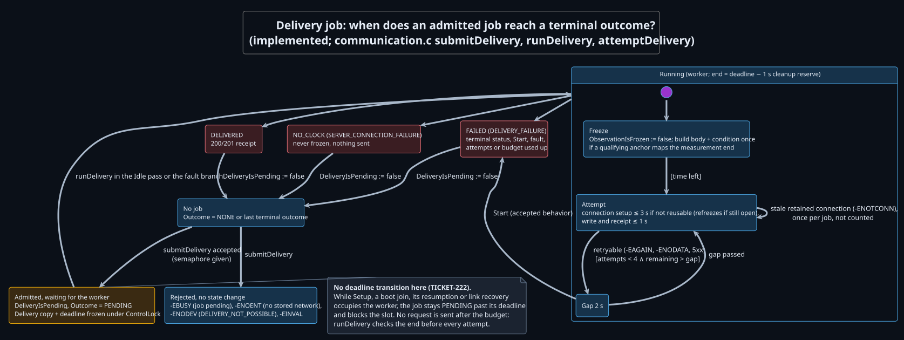

*When does an admitted job reach a terminal outcome?*

- **Verdict: make explicit** as `enum communication_delivery_state` (NONE, WAITING, FREEZING, ATTEMPT, GAP, terminal outcomes) with the deadline as an explicit transition. This is the machine where an explicit model pays most, because its timing contract (P13) spans other activities.
- **Preserve:** one job, no queue (`-EBUSY`); the copy and deadline taken under `ControlLock`; the 1 s cleanup reserve before the deadline; no request after the end (checked before every attempt); identical bytes on every retry (freeze once); one uncounted replacement of a stale retained connection; Start ending the job (accepted behavior, see below).
- **Start during Sending:** Start cancels the job instead of returning Busy. Nico has accepted this as intended behavior; the documented Busy rejection in [interfaces and behavior](interfaces-and-behavior.md) still differs and is not changed here.
- **TICKET-222:** the WAITING state has no deadline transition. Fixing that is a design choice (reject admission outside Idle, or service the deadline from every activity) and belongs to TICKET-222, not to the refactor; the refactor must not change it silently.
- **Equivalence tests:** all of `test_delivery.py`; add a test that requires a terminal outcome and a free slot by the deadline once TICKET-222 is decided (the current `test_no_request_after_the_deadline` checks only the weaker property).

## WIFI station and scan

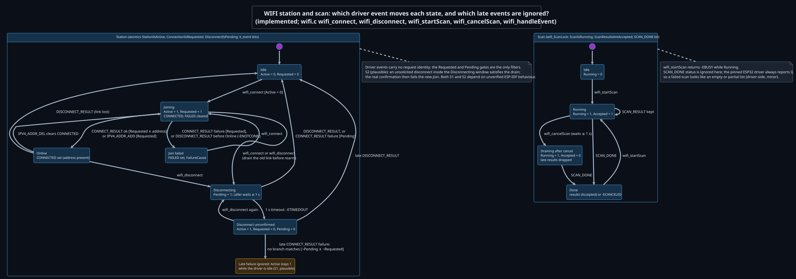

*Which driver event moves each state, and which late events are ignored?*

- **Station verdict: make explicit** (`IDLE, JOINING, ONLINE, DISCONNECTING, DISCONNECT_UNCONFIRMED`) with one transition function called from the API and from `wifi_handleEvent`. Today three atomics and three event bits encode it, and the unconfirmed state after a disconnect timeout has no explicit handling (S1).
- **Scan verdict: keep.** Four states under one lock; late results are rejected and a new scan waits for SCAN_DONE.
- **Preserve:** drain the old link before rearming; the `ConnectionIsRequested` gate on connect and address events; the `DisconnectIsPending` mapping of the ESP32 "cancelled join reported as connect failure"; removal of retained DHCP addresses; the scan acceptance gate under the spinlock.
- **Equivalence tests:** `tests/host/l1_wifi/test_wifi.py` (join from each state, late join and rearm, disconnect confirmation, late scan and rearm, scan cancel). Add cases for S1 and S2 once the ESP-IDF behavior is measured.

## SNTP and TLS workers

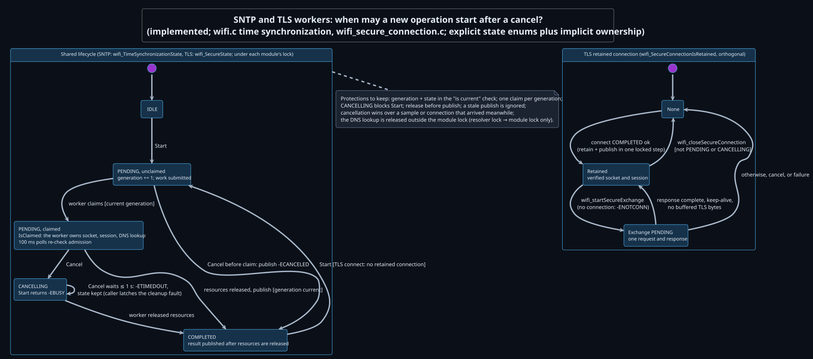

*When may a new operation start after a cancel?*

- **Verdict: keep.** Both already use explicit enums (`wifi_time_synchronization_state`, `wifi_secure_state`); the implicit part is resource ownership (claim) and the orthogonal retained-connection flag, which the diagram names. Optionally extract the duplicated start/claim/cancel/publish lifecycle into one helper (medium risk) and model "retained" as its own state.
- **Preserve:** generation + state in the "is current" check; one claim per generation; CANCELLING blocking Start until release is proven; release before publish; stale publish ignored; cancellation winning over a result that arrived meanwhile; retain and publish in one locked step; DNS released outside the module lock.
- **Equivalence tests:** `test_wifi.py` covers SNTP with the real `wifi.c` and `wifi_dns.c`. **Gap:** `wifi_secure_connection.c` is stubbed on the host (`tests/host/service_boundary.c`), so no test covers the TLS machine; a harness with socket and mbedTLS substitutes (cancel before claim, during DNS, TCP, handshake and exchange; release failure; keep or drop after an exchange) is a precondition for touching it.

## DNS lookup

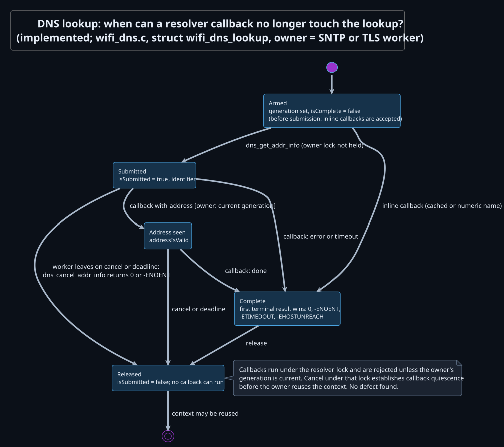

*When can a resolver callback no longer touch the lookup?*

- **Verdict: keep implicit.** Small, documented, and protected by generation checks and cancellation under the resolver lock (callback quiescence before reuse). Covered indirectly by the SNTP host tests.

## HTTP response reader

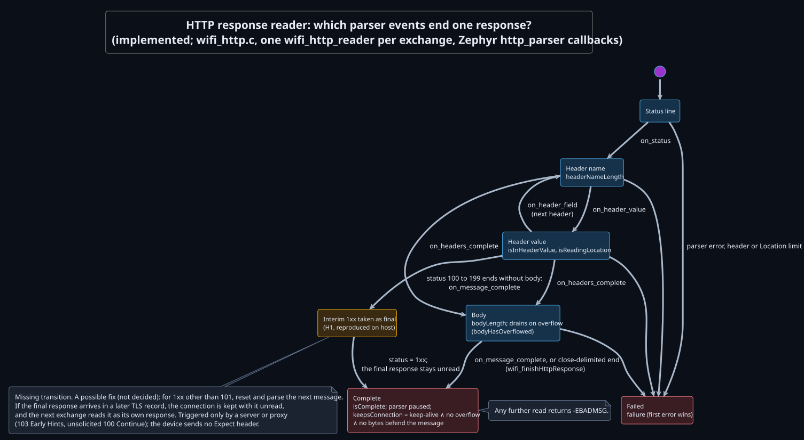

*Which parser events end one response?*

- **Verdict: keep implicit.** The parser's callback structure dictates the states; an enum would duplicate the parser's own state.
- **H1** (missing interim-response transition) is a separate fix, not part of TICKET-224. Tests: `tests/host/l1_wifi_http/test_wifi_http.py`; add 100 and 103 followed by a final response in the same and in a later piece.

## PORTAL server

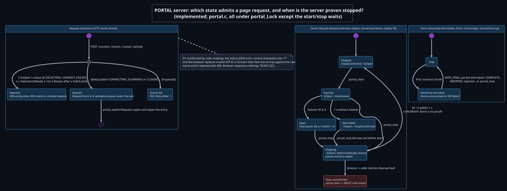

*Which state admits a page request, and when is the server proven stopped?*

- **Verdict: make the lifecycle explicit** (`STOPPED, STARTING, OPEN, START_FAILED, STOPPING, STOP_UNCONFIRMED`) instead of combinations of `portal_ServerStopIsConfirmed`, `portal_IsOpen` and `portal_ServerHasListener`. Keep request admission as a guard on the published status and form ownership as it is.
- **Preserve:** state recheck under `portal_Lock` at queue time; `IsOpen` cleared before `http_server_stop`; stop proven only by the listener fd, not by `-EALREADY`; the bounded queue (4, 503 with `Retry-After: 1` when full); secret wipes on dequeue, abort and stop.
- **Equivalence tests:** `tests/host/l1_portal/test_portal.py` (VT-14) compiles the real `portal.c`; add a lifecycle × API transition table and start-timeout → stop → start.

## Setup page

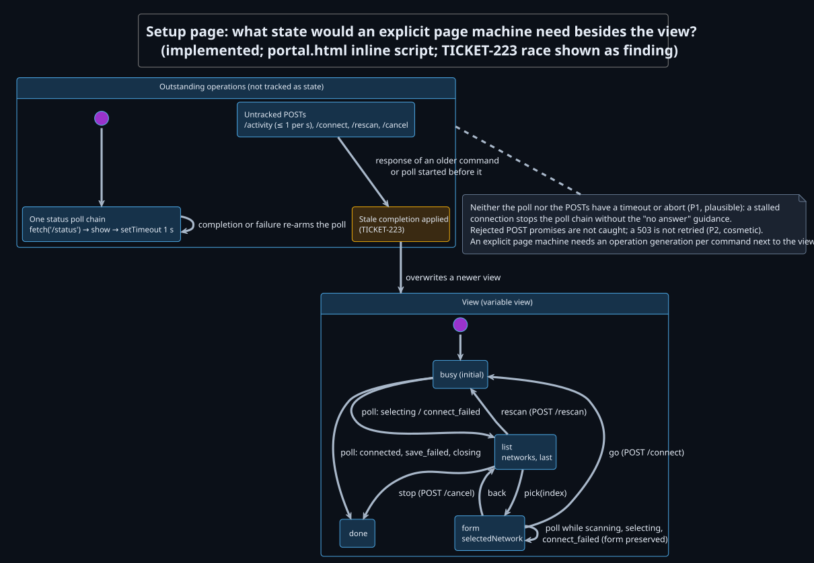

*What state would an explicit page machine need besides the view?*

- **Verdict: make explicit together with TICKET-223:** keep the single `view` and add an operation generation (or response-order guard) so a completion older than the latest command cannot change the view. Add a fetch timeout (AbortController) for the poll.
- **Preserve:** one outstanding poll; text escaping; form preservation during polls; activity throttling.
- **Equivalence tests:** `test_portal.py` runs the production script in Node; extend it with controlled completion order (as in the audit's `portal-race.cjs`) and a stalled fetch.

## Button, CONTROL and status light

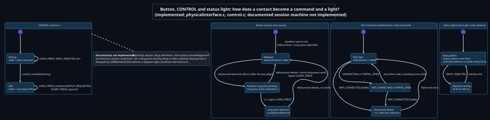

*How does a contact become a command and a light?*

- **Button and lights verdict: keep.** All button state is touched only by work on the cooperative system work queue; the light already separates base pattern and overlay.
- **CONTROL verdict: make explicit when the documented session machine (Start/Stop, Busy, acknowledgement) is implemented.** Today CONTROL has only Startup and Idle; refactoring it alone gains little.
- **Preserve:** the locked indication handoff; flash-end cancellation by a newer code; the priority assumptions that keep unlocked read-then-show sequences safe (COMMUNICATION priority 10 below main, cooperative work queue, single core).
- **Tests:** none exist for `physicalinterface.c` or `control.c`. A host harness with fake GPIO, work queue and time is needed before any change.

## STORAGE

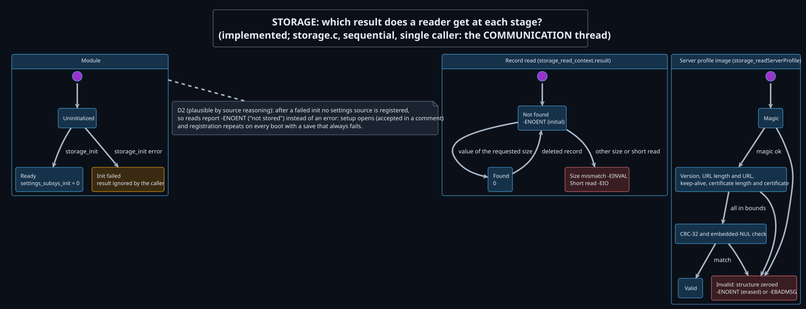

*Which result does a reader get at each stage?*

- **Verdict: keep implicit.** Sequential lifecycle, one caller. Optionally keep the init result and return an error from read/write while uninitialized (D2).
- **Tests:** `tests/host/l1_storage/test_storage.py` covers only the server profile; read/write appear only in the simulator.

## Already protected

These protections hold today and must survive TICKET-224; they are checked against source, and the delivery and portal ones also by host runs.

- **Delivery admission:** a second submission returns `-EBUSY`; retries keep the same payload identity.
- **SNTP and TLS:** generation checks, single claim, CANCELLING gates and release-before-publish prevent reuse while cancellation is outstanding.
- **DNS:** cancellation under the resolver lock establishes callback quiescence before context reuse.
- **Scan:** late results after cancel are rejected; a new scan waits for SCAN_DONE.
- **Station:** the old disconnect is drained before rearm; stale connect and address events are gated by `ConnectionIsRequested`.
- **Handover:** bits set before start, cleared only after proven stop, fault latched otherwise; acknowledgement requires a fresh confirmation after every Start or Stop.
- **Portal:** state recheck under the lock, bounded admission with 503, stop proven by the listener fd, secrets wiped on every exit.
- **Worker wake-ups:** no lost wake-up was found. Every event that can be consumed by a non-blocking semaphore take is also held in a flag (`SetupIsRequested`, `ListeningIsRequested`, `DeliveryIsPending`) that is re-read before the next long wait, and `timeUntilTransportDuty` returns 0 while a delivery is pending.

## Newly found issues

Known and excluded: TICKET-222 (delivery past deadline during setup), TICKET-223 (page response order), and Start cancelling Sending (accepted as intended).

| ID | Machine | Finding | Evidence | Status | Severity |
|---|---|---|---|---|---|
| T222+ | Worker, delivery | TICKET-222 is not specific to setup: a job admitted during a **boot join** or **Idle link recovery** (4 × 15 s joins, then setup) also stays PENDING past its deadline | Host simulator runs below | **Reproduced** | Medium (same class as TICKET-222) |
| H1 | HTTP reader | A 1xx interim response is taken as the final response. With the final response in a later TLS record the connection is kept with that response unread, so the next exchange reads it as its own; a delivery is classified as failed although the server may create it | `http_harness` with production `wifi_http.c` and the vendored pinned parser: `100 Continue` and `103 Early Hints` give status 100/103, result OK, `keepsConnection = 1` when split | **Reproduced** | Low–medium; only a server or proxy can trigger it |
| D1 | PORTAL | Networks whose name contains control characters (shown as `?`) or invalid UTF-8 are listed but cannot be selected: Connect fails `strcmp` against the raw name → 400 | [`portal_appendName`](../../coding/app/L1_services/L1_PORTAL/portal.c#L755-L780), [listed check](../../coding/app/L1_services/L1_PORTAL/portal.c#L583-L590) | Confirmed by code reading | Low |
| D2 | STORAGE | A failed `storage_init` is ignored; reads then report `-ENOENT` ("not stored"), so registration repeats on every boot with a save that always fails | [`communication_thread`](../../coding/app/L2_application/L2_COMMUNICATION/communication.c#L779-L780); Zephyr settings returns 0 without a load source | Plausible by source reasoning, not reproduced | Low–medium |
| D5 | CONTROL | A long press during setup, while listening or with a latched cleanup fault is dropped by COMMUNICATION without a rejection light; `postEvent` returns 0 | [`postEvent`](../../coding/app/L2_application/L2_COMMUNICATION/communication.c#L672-L678), [`control_handleButton`](../../coding/app/L2_application/L2_CONTROL/control.c#L128-L147) | Confirmed by code reading | Low (UX; documented rejection) |
| S1 | WIFI station | A connect-failure event arriving after a 1 s disconnect timeout matches no branch, leaving `StationIsActive = 1` while the driver is idle; whether later connects recover depends on ESP-IDF answering a disconnect on an idle station | [`wifi_handleEvent`](../../coding/app/L1_services/L1_WIFI/wifi.c#L1219-L1244) | Plausible; needs a target check | Low |
| S2 | WIFI station | An unsolicited disconnect inside the disconnect window satisfies the drain; the real confirmation then fails the new join while the driver keeps joining, and retries return `-EALREADY` | [`wifi_disconnect`](../../coding/app/L1_services/L1_WIFI/wifi.c#L415-L456) | Plausible; rare timing, needs a target check | Low |
| D4 | PORTAL/setup | During the automatic rescan after a failed join, the page status is CONNECT_FAILED (selection ready), so a queued request publishes CONNECTING/SCANNING/CLOSING while the worker still scans; it converges when the request is handled | [`handleConnectRequest`](../../coding/app/L2_application/L2_COMMUNICATION/communication.c#L2541-L2584) | Plausible | Low |
| P1 | Page | No fetch timeout: a stalled connection stops the poll chain without "no answer" guidance | [`poll`](../../coding/app/L1_services/L1_PORTAL/portal.html#L117-L123) | Plausible | Low |

Minor, not state-machine defects: CONTROL shows every Wi-Fi error code as the green Idle light (D3; already in the audit's deviation table), a `WIFI_CONNECTED` before Idle is never flashed, a failed GPIO read on release can turn a short press into a long press (B1, practically implausible), a failed LED update for a static pattern is not retried (L1), uncaught POST rejections and no 503 retry in the page (P2), and the ESP32 driver reports every scan as status 0, so a failed scan looks like an empty list.

### TICKET-222 scope reproduction

Production `communication.c` and `fhir.c` were built with the existing simulator (`tests/host/simulation.c`, GCC `-Wall -Wextra -Werror`, the command in the audit's `build.json`). Outcome values: 1 = PENDING, 4 = NO_CLOCK; the simulator's deadline is submission + 10 s.

Boot join, delivery admitted at 500 ms (deadline 10,500 ms): PENDING at 11,000 and 15,000 ms; terminal NO_CLOCK only at 19,000 ms after the fourth join failed.

```text
horizon 40000
stored 1
server 1
registration 1
join -111 1000
join -111 1000
join -111 1000
join -111 1000
event 500 deliver 0
event 11000 outcome 0
event 15000 outcome 0
event 30000 outcome 0
```

Link recovery, second delivery admitted at 13,000 ms (deadline 23,000 ms) while recovery joins time out: PENDING at 23,500, 60,000 and 100,000 ms; at 76,600 ms recovery fails and setup opens, which holds the job for up to another 5 min.

```text
horizon 120000
stored 1
server 1
registration 1
join 0 100
join -111 15000
join -111 15000
join -111 15000
join -111 15000
event 1000 drop 0
event 1500 deliver 0
event 13000 deliver 0
event 23500 outcome 0
event 60000 outcome 0
event 100000 outcome 0
```

Both runs show no request after the budget; the violated property is the timely terminal outcome and slot release, as in TICKET-222.

### What was checked, and the limits

- All machines in the inventory were reviewed in source for races between callers and callback, ISR or work-queue contexts, lost wake-ups, stale callbacks, missing terminal transitions, lock order and resource lifetime. Zephyr semantics were checked against the pinned Zephyr sources (net_mgmt event thread, ESP32 Wi-Fi driver, DNS resolver, HTTP server, settings).
- Host runs: the simulator scenarios above, the audit's three delivery scenarios (unchanged results), and the HTTP reader harness for H1. pytest is not installed in the review environment, so the full host suite was not run.
- Conclusions about preemption assume the current configuration: cooperative network and system work-queue threads, COMMUNICATION at priority 10, and a single core. Several races ruled out here (CONTROL indication handoff, the Zephyr HTTP server stop wake-up, net_mgmt queue overflow losing SCAN_DONE) become reachable with SMP, preemptive network threads or changed priorities.
- No target build, hardware, ESP-IDF or server measurement was performed; S1 and S2 need a target check. This is a review, not exhaustive model checking of every flag combination.

## Refactor plan for TICKET-224

Order by value and by test coverage available; each step keeps behavior identical and lands separately.

1. **Prerequisite tests.** Add a host harness for `wifi_secure_connection.c` (socket and mbedTLS substitutes) and for `control.c`/`physicalinterface.c` (fake GPIO, work queue, time). Record current traces of the communication simulator for Start, setup request and delivery during every activity as golden traces.
2. **Delivery job enum.** Replace `DeliveryIsPending` + loop locals with `enum communication_delivery_state` and a transition function; keep admission under `ControlLock`. Decide TICKET-222 first or keep its behavior explicitly (WAITING without deadline transition), so the refactor does not change it silently.
3. **Worker activity enum and dispatch.** Introduce `enum communication_activity` and one dispatch function with the current priority order; setup becomes `enum communication_setup_step` inside it. Keep blocking activities and their 200 ms Start checks. Golden traces must match.
4. **WIFI station enum.** One transition function for API calls and driver events, including the unconfirmed-disconnect state; S1/S2 behavior changes only after the target check, in a separate change.
5. **PORTAL server lifecycle enum.** Replace the three booleans; keep admission and form ownership as they are. VT-14 must pass unchanged.
6. **Setup page operation generation**, together with TICKET-223.
7. **CONTROL session enum** when Start/Stop and acknowledgement are implemented, following the documented session statechart.
8. **Not planned:** scan, SNTP/TLS (already explicit), DNS, HTTP reader, button, lights, STORAGE. The optional SNTP/TLS lifecycle extraction needs step 1 first.

Every step must keep the protections listed under [already protected](#already-protected) and the per-machine "Preserve" items: generation checks, CANCELLING gates, callback quiescence, bounded admission, drain-before-rearm, bit-before-start and proven release.
