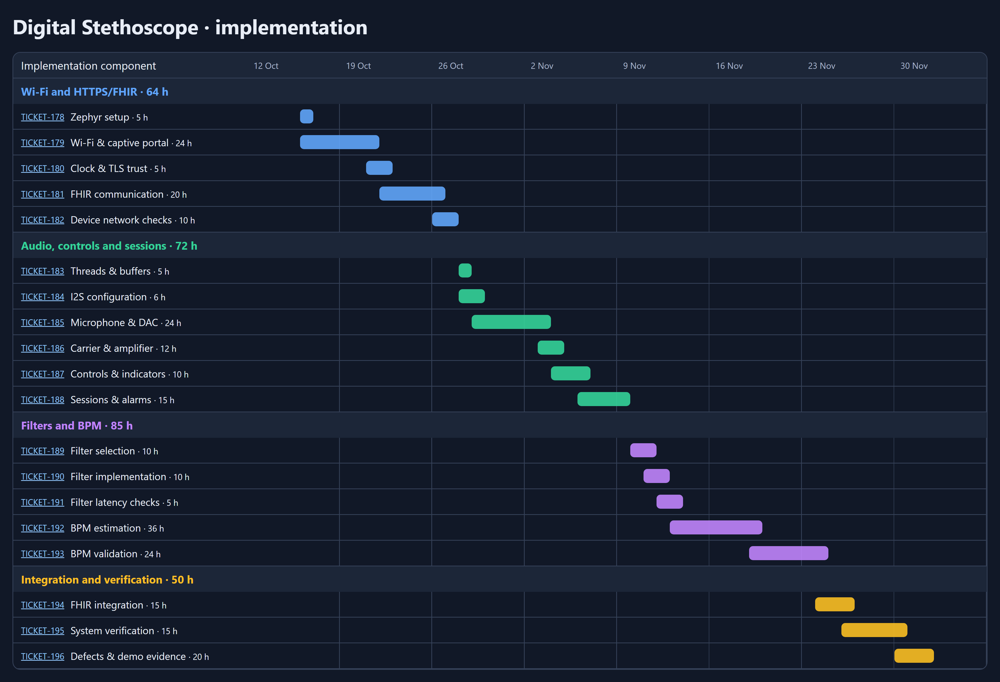

# MVP component implementation timeline

**Current plan (Jira, decided 14 October 2026):** TICKET-178…TICKET-197 under [TICKET-129](https://nfrie.atlassian.net/browse/TICKET-129), one implementer (Nico), up to 8 h per weekday from 16 October to 2 December. 271 h planned effort (200 h base + 71 h allowance) plus 12 h for patient assignment ([TICKET-197](https://nfrie.atlassian.net/browse/TICKET-197)) on Saturdays and the slack before the carrier board arrives. Jira is the source of truth for dates; [14 October decisions](mvp-decisions-2026-10-14.md) define scope. Acceptance is the [system requirements](../requirements/system-requirements.md).

**Realism (14 October):** the weekday plan has about 1 h of slack. It holds only if Saturdays cover TICKET-197 and meetings, documentation and illness stay small. Hours exceed the registered software, hardware and integration budget (156 h) by more than the 64 h buffer. Writing runs 3–30 December; submission is 11 January 2027, with writing and proofreading finished by 4 January at the latest, ideally 28 December.

## Timeline submitted for implementation-start approval

The chart is an 11 October snapshot of the Jira timeline (TICKET-178 to TICKET-196) and does not include TICKET-197.

| Jira | Task | Effort | Start → due | Section below |
|---|---|---|---|---|
| [TICKET-178](https://nfrie.atlassian.net/browse/TICKET-178) | Zephyr project structure, board configuration, reproducible build | 5 h | 10-16 → 10-16 | BASE |
| [TICKET-179](https://nfrie.atlassian.net/browse/TICKET-179) | Wi-Fi connection, hotspot page and saved credentials | 24 h | 10-16 → 10-21 | WIFI |
| [TICKET-197](https://nfrie.atlassian.net/browse/TICKET-197) | Patient assignment portal and Device registration | 12 h | 10-17 → 10-27 (Saturdays) | PORTAL |
| [TICKET-180](https://nfrie.atlassian.net/browse/TICKET-180) | Clock synchronization and HTTPS certificate validation | 5 h | 10-21 → 10-22 | WIFI |
| [TICKET-181](https://nfrie.atlassian.net/browse/TICKET-181) | FHIR delivery with retries, error reporting, matching readback | 20 h | 10-22 → 10-26 | FHIR |
| [TICKET-182](https://nfrie.atlassian.net/browse/TICKET-182) | Verify Wi-Fi/FHIR communication on the ESP32-S3 | 10 h | 10-26 → 10-27 | NETTEST |
| [TICKET-183](https://nfrie.atlassian.net/browse/TICKET-183) | Threads, message queues and audio buffer ownership | 5 h | 10-28 → 10-28 | CTL |
| [TICKET-184](https://nfrie.atlassian.net/browse/TICKET-184) | I2S drivers and microphone/DAC pin assignments | 6 h | 10-28 → 10-29 | AUDIO |
| [TICKET-185](https://nfrie.atlassian.net/browse/TICKET-185) | Continuous microphone capture and DAC playback | 24 h | 10-29 → 11-03 | AUDIO |
| [TICKET-186](https://nfrie.atlassian.net/browse/TICKET-186) | Verify carrier wiring and physical audio operation | 12 h | 11-03 → 11-04 | BOARD |
| [TICKET-187](https://nfrie.atlassian.net/browse/TICKET-187) | Buttons, mode selection, volume and status indicators | 10 h | 11-04 → 11-06 | CTL |
| [TICKET-188](https://nfrie.atlassian.net/browse/TICKET-188) | Session controller, Start/Stop and alarm states | 15 h | 11-06 → 11-09 | CTL |
| [TICKET-189](https://nfrie.atlassian.net/browse/TICKET-189) | Filter study: listening and BPM filters (each listening filter also as BPM input) | 10 h | 11-10 → 11-11 | DSP |
| [TICKET-190](https://nfrie.atlassian.net/browse/TICKET-190) | Selected listening filters and BPM preprocessing | 10 h | 11-11 → 11-12 | DSP |
| [TICKET-191](https://nfrie.atlassian.net/browse/TICKET-191) | Filtering latency and CPU/RAM cost | 5 h | 11-12 → 11-13 | VERIFY |
| [TICKET-192](https://nfrie.atlassian.net/browse/TICKET-192) | BPM estimation, rejection and aggregation | 36 h | 11-13 → 11-19 | BPM |
| [TICKET-193](https://nfrie.atlassian.net/browse/TICKET-193) | Validate BPM against reference and investigate failures | 24 h | 11-19 → 11-24 | BPM |
| [TICKET-194](https://nfrie.atlassian.net/browse/TICKET-194) | Integrate measurement sessions with HTTPS/FHIR delivery | 15 h | 11-24 → 11-26 | INTEGRATE |
| [TICKET-195](https://nfrie.atlassian.net/browse/TICKET-195) | Verify latency, resources, transitions and fault handling | 15 h | 11-26 → 11-30 | VERIFY |
| [TICKET-196](https://nfrie.atlassian.net/browse/TICKET-196) | Fix remaining defects, prepare demonstration evidence | 20 h | 11-30 → 12-02 | BUFFER |

All dates are 2026. The carrier board (around 25 October) and the external equipment are prerequisites, not demonstrated facts. Wi-Fi, FHIR and the hotspot run on the DevKit before the carrier arrives. The sections below give inputs and acceptance evidence per work area; they were written for the earlier 11 October draft (TICKET-166…177 were never created) and are kept as task notes.

## BASE — Pin Zephyr and establish MVP contracts

**Inputs:** Newest stable Zephyr release; current application structure and evaluation baseline.

**Output and acceptance evidence:** Pin release tag/SHA and SDK; build ESP32-S3 baseline; define frozen result, error event and network lease contracts. No physical peripheral qualification implied.

## WIFI — Implement Wi-Fi configuration and clock mapping

**Inputs:** ESP32-S3 DevKit, lab AP and private deployment configuration. Carrier PCB not required.

**Output and acceptance evidence:** Serial/shell provisioning as the first and diagnostic path; the operator path is the PORTAL Wi-Fi page. Credentials stored outside source and never logged. DHCP/DNS, finite connection timeout, SNTP on configured lab network before measurement; freeze UTC/monotonic anchor. Unset time forbids patient send; unconfigured Wi-Fi causes no send error; configured connection failure leaves offline listening available.

## FHIR — Implement HTTPS/FHIR delivery and invalid-result reporting

**Inputs:** Frozen result/error contracts, endpoint https://nglegion:8443/fhir, ca.pem, synthetic Patient/stetho-test-01.

**Output and acceptance evidence:** Conditional create (`POST` + `If-None-Exist` on the stable identifier) plus matching GET, numeric value comparison; CA, hostname and clock verification. Up to 3 retries within 10 s, then a visible error ([14 October](mvp-decisions-2026-10-14.md)). Invalid BPM has no numeric value; agree and validate missing-value error representation with server. Production fixture provenance guard remains intact.

## NETTEST — Verify one device-originated FHIR integration run

**Inputs:** Flashed DevKit, configured lab network/server and diagnostic test payload; owner executes device operations.

**Output and acceptance evidence:** Record hash/config, device request/status, ID/patient/value/unit/time matching readback and validator output. Explicit diagnostic harness sends only synthetic-patient fixtures; do not bypass production source guards. Wrong CA/name, unset clock, missing Patient, lost response and failed readback tested. This proves transport, not acoustic measurement accuracy; repeat with actual microphone session at INTEGRATE.

## PORTAL — Implement hotspot portal and patient assignment

**Inputs:** Working WIFI/FHIR client on the DevKit, [12 October decisions](mvp-decisions-2026-10-12.md), lab server with synthetic Patient/stetho-test-01 and a seeded in-progress Encounter.

**Output and acceptance evidence:** Plain HTML pages. Boot `GET`/create-only `PUT` of the own Device without erasing an assignment. Long press ≥2 s in Idle and the no-credentials boot path open a WPA2 hotspot with timeout. Patient list loaded before the switch and shown with load time; explicit confirmation; `PATCH Device.patient` plus matching readback. Wi-Fi page stores credentials write-only. Tested: rejected long press outside Idle, timeout, cancel, empty/failed list, failed PATCH/readback, wrong Wi-Fi credentials, no secrets or patient data in logs. Verify SoftAP/HTTP server/station switching on target first; a failed spike is reported immediately because it changes the plan.

## CTL — Implement session controller and alarm states

**Inputs:** Confirmed Start/Stop/session decisions and network completion events.

**Output and acceptance evidence:** Start blocked with busy indication during analysis/sending. Reject mode/patient/context changes in session without mutation; normal fault. Separate acknowledgement click clears normal Wi-Fi latch only manually; no implicit Start. DA mutes and latches until full restart, no button recovery. Stop <15 s cancels; Lung no BPM/FHIR. Portal state: long press accepted only in Idle; Start and session commands rejected while the hotspot is open. Host race/state matrix passes.

## BOARD — Verify latest evaluation carrier and component wiring

**Inputs:** Latest Altium evaluation PCB, fitted carrier and current pin map; carrier expected around 25 October, not confirmed.

**Output and acceptance evidence:** Record exact PCB revision/export hash and GPIO/I2S mappings. The device ends at the DAC line output; the amplifier is outside the project scope. Carrier arrival and test fixture access are blocking prerequisites; driver readiness is not physical operation.

## AUDIO — Implement and verify microphone-to-output audio path

**Inputs:** INMP441, PCM5102A line output and verified carrier.

**Output and acceptance evidence:** Signed 24-bit normalization, bounded internal DMA pools, DAC output, volume and controls. Record physical input/output proof and timing. No replay or full-session audio storage in MVP. DA injection and full-restart recovery verified.

## DSP — Implement independent listening and analysis filters

**Inputs:** Original-rate blocks and candidate Raw/Murmur/BPM bands.

**Output and acceptance evidence:** Listening filter/gain changes cannot change analysis input. Measure response, smoothing/clipping and delays. Raw, 40–800 Hz Murmur and 25–150 Hz analysis are evaluation candidates, not proven optimal bands; document INMP441 low-frequency constraint.

## BPM — Implement streaming BPM and reference validation

**Inputs:** Selected PCG corpus with independent reference, proposed acceptance table.

**Output and acceptance evidence:** 8 s window/1 s update/30 s recommended session; Stop >=15 s finalizes if quality/coverage pass. Whole-cycle estimator, gap/clipping/harmonic guards, median and union-based coverage. Report MAE/bias/tolerance pass fraction and invalid-session fraction on held-out subjects. No raw-session capture required.

## INTEGRATE — Integrate completed sessions with FHIR and error reporting

**Inputs:** Verified streaming result and network/controller contracts.

**Output and acceptance evidence:** Real microphone Heart session produces one frozen result with measured interval/time; stop, analysis and send block Start. Readback matches; invalid BPM generates only agreed error report. Session subject is the frozen local assignment; pre-send Device.patient mismatch or missing assignment sends nothing. Failed sends abort, Lung/offline/cancel and DA paths verified. Remove rolling-estimate 2.5 s age gate from completed-result eligibility; retain provenance/time guards.

## VERIFY — Verify MVP timing, resources and fault containment

**Inputs:** Integrated current image plus latency fixture/equipment access.

**Output and acceptance evidence:** 30 min load soak; no audio deadline misses/drops, <=4 ms critical execution per 8 ms block, <=100 ms input effect, <=500 ms status, >=25% measured stack/internal-heap headroom. The <30 ms end-to-end latency target (<10 ms stretch) stays unverified: no two-channel measurement setup is available. REQ-05 is checked by ear only. Separate detection from mute latency in software traces.

## BUFFER — Resolve integration findings and freeze MVP evidence

**Inputs:** Logged findings and reproducible evidence.

**Output and acceptance evidence:** Re-test fixes, reconcile requirements/diagrams, record remaining limitations. Eight-hour contingency, not optional-feature allocation; flag slippage rather than compressing physical verification. Implementation ends 2 December; TICKET-133 (implementation complete) is 3 December.

## Progress and replanning

Log actual time and update remaining estimate at each work block. If remaining effort exceeds the baseline, a blocker remains open at the scheduled start, or a task misses its due date, recalculate successor dates and compare the finish with 2–3 December. Preserve the baseline in this document; explain scope/evidence changes in Jira. Independent work may move earlier when the carrier is delayed; one owner cannot execute overlapping allocations. No extra optional features before required evidence closes.

Updated by Claude-Opus-5.5 on behalf of Nico running in T3 Code through Claude Code.
