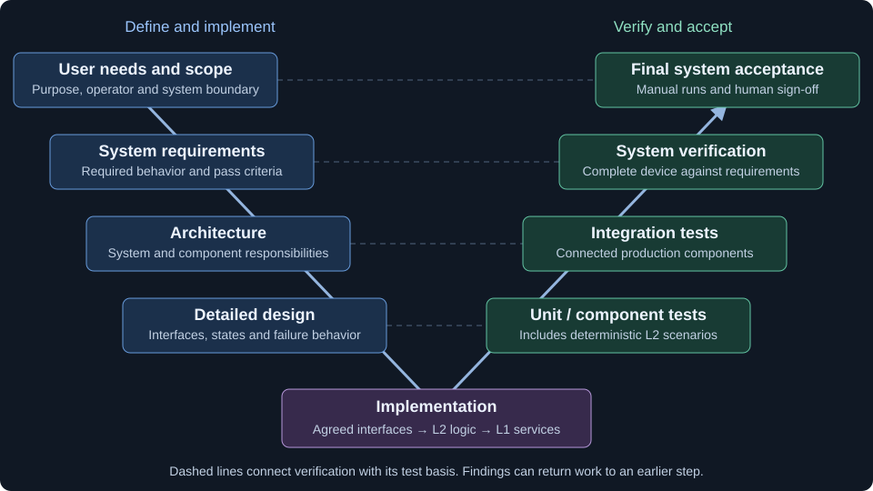
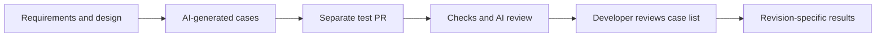
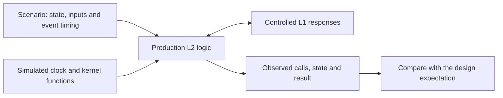

# Application development process

This describes how the digital stethoscope is developed: from requirements and design to implementation, tests and human review. The product includes its hardware and application software. The phone, server and external audio amplifier sit outside the system boundary.

The process is defined here. [Verification operations](../testing/ci/OPERATIONS.md) describes test execution and infrastructure. Verification cases contains the application-specific checks.

## The V-model

On the way down, the developer agrees the requirements, architecture, detailed design and interfaces. Implementation follows that design: L2 (layer 2) application logic first, then L1 (layer 1) services and driver wrappers.

On the way up, AI (artificial intelligence) generates tests from those agreed documents. Automated tests check the implementation. The developer performs the manual device tests and signs off the recorded outcomes. Failures can send work back to any earlier step; changes to requirements, design or implementation are agreed by the developer.

## Current state and target

Architecture and detailed design are organised into system, WIFI, STORAGE, COMMUNICATION, PORTAL and FEEDBACK pages. Architecture defines responsibilities and dependencies; design defines the interface contracts, workflow rules and parameters. COMMUNICATION owns setup and retry policy; WIFI owns operations, STORAGE owns records, PORTAL owns the page and HTTP contract, and FEEDBACK owns the indication catalogue.

Implementation status and verification evidence belong to the identified component PR revision. A communication test batch derives VT-14 cases from the identified design revision. When the suite is present, the host selector finds it and the scenario reporter records passes and known expected failures separately. Unexecuted VT-14 target procedures and other application coverage gaps remain explicit in the case catalogue. The host integration batch connects real L2 and L1 services at the Zephyr API boundary; concurrent target scheduling and device acceptance remain pending.

[Bring-up firmware](../../../preThesis/06-bringup-zephyr/README.md) is archived pre-thesis material with local build instructions and no CI. Application-only builds, publication and exact-commit artifact reuse use the pinned Zephyr toolchain. Medical-device compliance, software safety class and independent validation need a separate, sourced assessment.

## Documents and component PRs

Requirements exist only at system level: scope, use cases and whole-system requirements stay together in the Requirements stage. Do not create component requirements documents. Architecture and detailed design each exist at system level and per component; component contracts trace back to system requirements. The architecture pages contain the relevant diagrams and links to their editable sources. Detailed design uses the same system, WIFI, STORAGE, COMMUNICATION, PORTAL and FEEDBACK structure.

Architecture defines components, responsibilities, boundaries and dependencies. Detailed design defines software flows, business logic, interface contracts, states, parameters and failure handling. Shared decisions belong at system level. PR (pull request) stage labels show progress. The [VT coverage check](../testing/ci/validate_docs.py) reports case references and explicit gaps. These records supply status without a page written by hand.

The whole-system baseline comes first. The **Requirements** stage (`Requirements`) defines scope, use cases and system requirements. The AI-generated system verification catalogue, final manual check sheet and recorded evidence belong to a separate `Tests` PR after the identified implementation/design basis, alongside the component test batch. Project history, risk acceptances and thesis records use `Records`. Each component then has separate PRs:

1. **Architecture:** components, responsibilities, boundaries and dependencies.
2. **Detailed design:** software flows, business logic, contracts and failure handling.
3. **Interfaces + L2:** agreed interfaces and application logic against substitute L1 services.
4. **L1 services:** service implementation and driver wrappers.
5. **Tests:** a generated component batch and a readable explanation of its coverage.

Design PRs are discussion material and linked context. Their review does not block implementation from starting. Each PR uses one stage label: `Process`, `Requirements`, `Architecture`, `Design`, `L2`, `L1`, `Tests` or `Records`. Its **Basis** section records the full design and requirements commit SHA (secure hash algorithm), the covered VT-xx and REQ-xx IDs (identifiers), and links to agreed decisions. Keep each stage PR concise: architecture PRs contain architecture documents; design PRs contain design documents. Groundwork introduces the application skeleton and build/developer tools. Implementation PRs contain source, headers and the application build inputs needed to compile them, with at most small documentation updates. CI, workflow, test-tooling and process changes belong in a Process PR. Infrastructure-only PRs explain why a design basis does not apply. The label and basis remain in the PR record after merge. Bring unresolved design choices back to discussion.

A necessary interface change gets its own interface-and-documentation PR. Dependent L1 implementation merges wait for that adjustment.

Implementation PRs may merge before the new test batch when existing required checks and reviews pass. Existing tests continue to run. The component's automated batch must pass before its implementation enters GitLab human review. Hardware cases still awaiting execution remain explicit.

Documents link requirements and design decisions to their implementation PRs and test evidence. Gaps are recorded in the affected document and addressed through the corresponding design, implementation or test PR.

## How tests are generated

The test basis is the requirements, architecture, detailed design and agreed interfaces. An AI session derives cases from identified revisions of these documents, with the implementation and existing harness available where needed.

The generated batch covers normal operation, boundaries and specified failures, including timeouts and cancellation where relevant. It contains executable tests, test-only substitutes and manual procedures for cases that require the real device or human observation.

The test PR contains a case list: scenario, linked requirement or design basis, and expected result. The developer reviews this list and records agreement or findings in the PR before the test batch enters the GitLab baseline. AI reviews the executable test source. The description also explains how the cases run and what remains unverified. Results identify the tested source revision and distinguish real components from substitutes.

Claude and GPT models are used across authoring and independent review. CodeRabbit is the primary PR reviewer, with the existing repository fallback when unavailable. Let automatic reviews trigger; request a review manually only when none triggered, never while one is running. Do not assume a fixed subscription review quota. Critical and major findings block delivery. Minor findings and nitpicks are nonblocking and may remain open or be deferred without another review cycle. Unknown severity remains blocking until classified. Owner questions still require real answers. Separate sessions and models support the project's automated review.

Implementation follows the production design. Tests fit the agreed boundaries; they do not justify extra production hooks or abstractions just to make testing easier. Missing expected behavior returns to design discussion. A failed test is examined to locate the defect in the implementation, test, substitute or specification. An expectation is not changed merely to get a pass.

CI (continuous integration) executes committed tests. It does not regenerate them on each push. New cases and changes to existing expectations are explicit test-PR work.

## Deterministic simulation for L2 testing

The simulation runs production L2 logic on a host computer. Controlled substitutes provide the required L1 services and Zephyr kernel functions. This allows application behavior to be tested before the real services and drivers are ready.

Each scenario starts with fresh state. Simulated time advances during waits, and events occur at selected times. The same executable and controlled scenario can therefore repeat a retry, timeout or cancellation without relying on radio behavior or real-time delays.

Thread and lock functions are controlled substitutes. These tests check application logic; real-service integration and device measurements check concurrent scheduling and physical timing.

## Manual component and final system tests

AI drafts manual procedures from the same test basis. The developer executes the steps, records observations and signs off the run. Reusable procedures belong under `testing/<COMPONENT>/` and `testing/system/`. Completed runs are records for a particular device and firmware build. Nico executes and signs them using the JSON run format described in the verification operations; CI validates record completeness without claiming execution.

Each procedure is one short document:

| Section | Contents |
| --- | --- |
| Header | Test ID, title and linked requirement or design contract. |
| Device and software | One text field for device, firmware/build and setup identity. |
| Preconditions | A list of required starting conditions and equipment. |
| Execution | Numbered actions with an observable pass criterion in the action text. Each step has a Pass / Fail / Blocked / Not run selector and one note field. |
| Completion | Overall result and one sign-off field for name, date and signature reference. |

The GitLab review links the source procedure at its commit SHA. Notes contain observations, deviations and evidence references. Sign-off confirms the recorded execution and outcome. Independent review is recorded separately.

Component runs accompany their corresponding GitLab review. Final system acceptance is a separate record covering complete operator flows and system requirements, including failures. The procedure, firmware identity, evidence and dated sign-off remain together.

## GitHub development and GitLab human review

GitHub is the internal development source. GitLab provides the human-review layer. Architecture, design, interfaces/L2, L1 services and tests keep separate reviews on both platforms.

Transfer a component when its architecture, design, L2, L1 and test PR set is complete and its automated batch is green. Record any pending device cases and the developer's case-list review. Keep the separate stage reviews on GitLab.

For each baseline:

1. Create a Git tag at the exact source commit. Proposed name: `review/<component>/<YYYY-MM-DD>-<sequence>`, for example `review/wifi/2026-10-22-01`. A changed baseline gets a new tag.
2. Open the GitLab MR (merge request) with the tag, full source SHA and links to the component PR set and automated reviews.
3. Attach an evidence bundle to the MR before GitHub artifacts expire: 14 days for diagnostics and eight days for firmware. Include the case list with expected results, JUnit reports, logs, coverage gaps, toolchain/configuration identity, firmware manifest and checksums, and any completed manual records. Keep these files with the reviewed baseline.
4. Record human findings and the reviewed tag in the MR. Generated test source stays on GitHub initially, linked at the same SHA. Transfer it too if GitLab CI is introduced.

Internal development continues while human review is open. Transfer and feedback tracking are manual. GitLab findings return through GitHub PRs adapted to the newer implementation. Those changes pass the affected checks and return for human review. Approval stays attached to the revision actually reviewed.

The [verification operations](../testing/ci/OPERATIONS.md) document defines which suites run, where they run and what evidence they retain.
