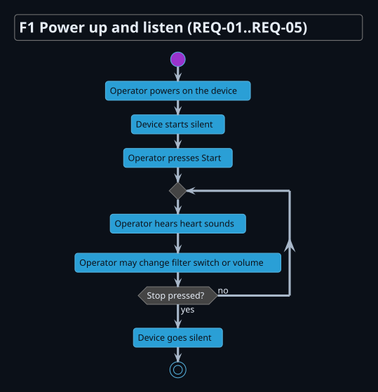
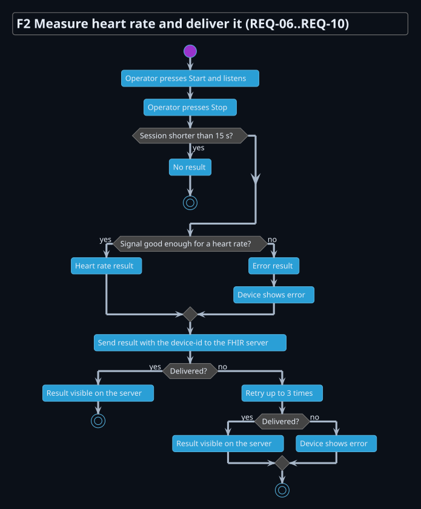
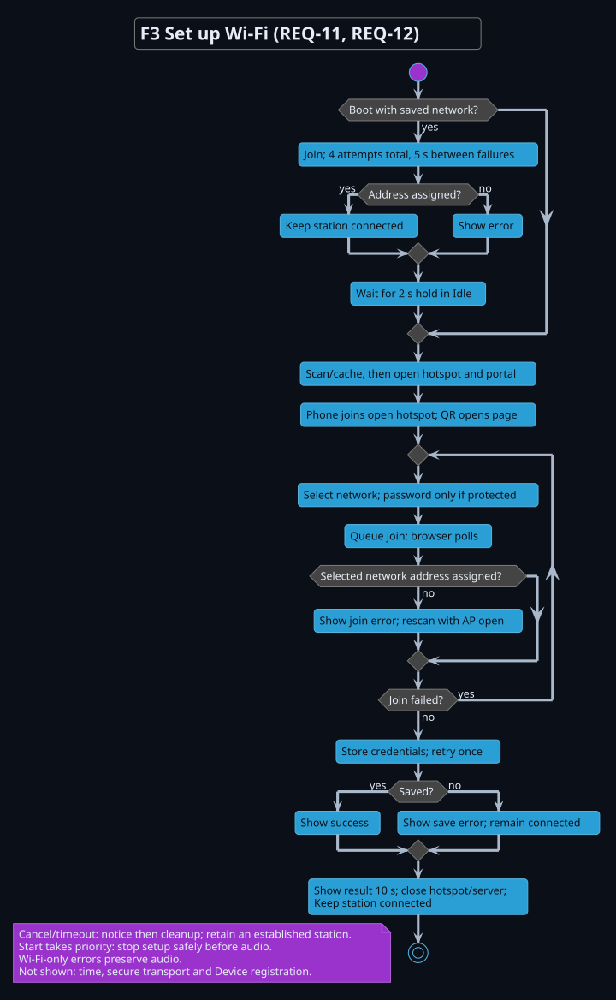
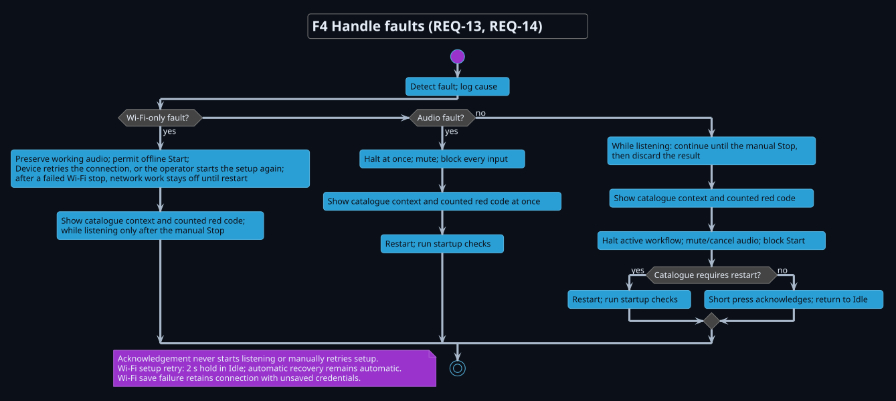

# Use cases

Abstract operator flows for the [system requirements](system-requirements.md). Architecture and
design derive internal workflows and interface contracts from these operator flows.
Sources are in [`use-cases/`](use-cases/). Render from that directory with PlantUML 1.2026.9:

```sh
java -jar /path/to/plantuml.jar -charset UTF-8 -failfast2 -tsvg -o rendered "*.puml"
```

## F1 — Power up and listen



## F2 — Measure heart rate and deliver it



## F3 — Set up Wi-Fi



## F4 — Handle faults


