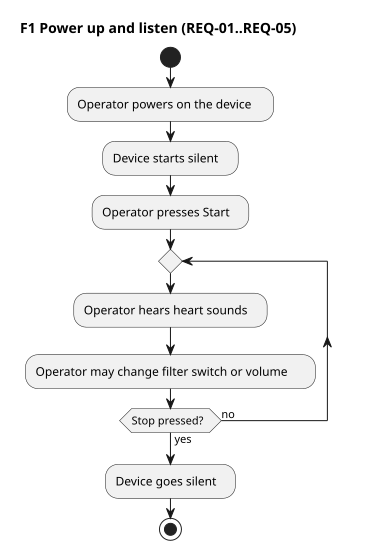
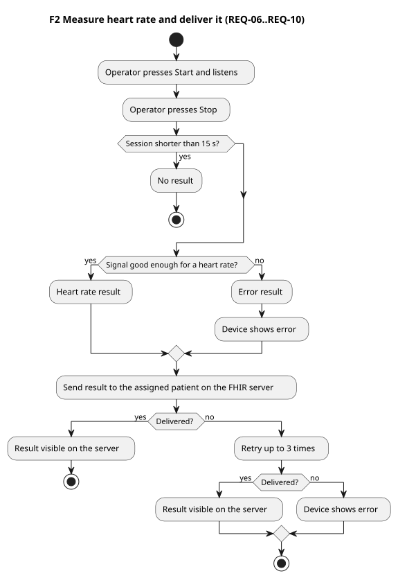
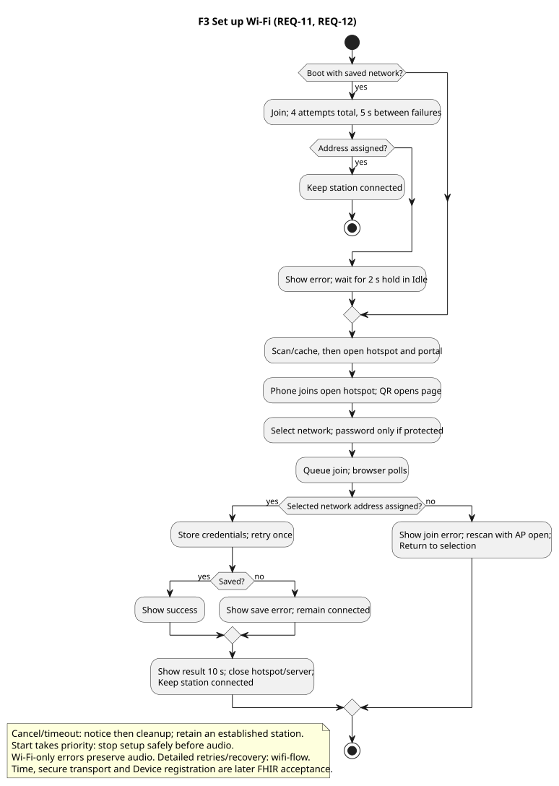
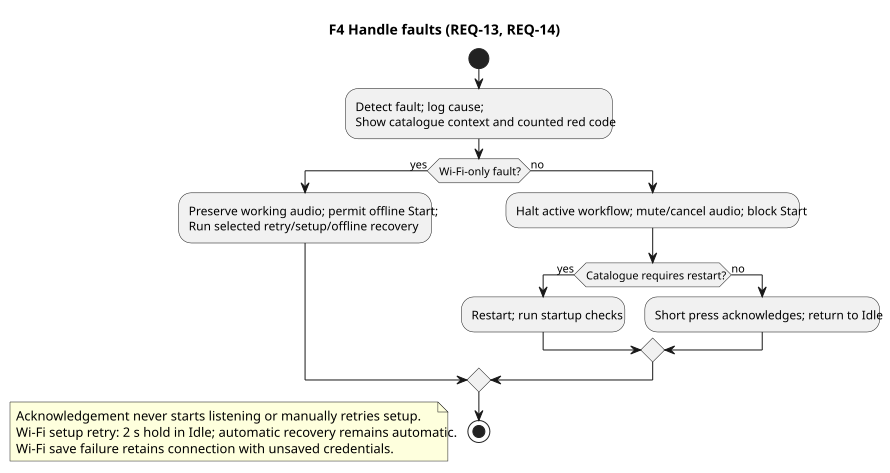

# Use cases (MVP)

Decisions in force for each topic: current baseline.

Abstract operator flows for the [system requirements](system-requirements.md), decided on 14 October 2026
(decisions). Later architecture and design stages
derive internal workflows and interface contracts from these operator flows.
Sources are in [`use-cases/`](use-cases/). Render from that directory with PlantUML 1.2026.2:

```sh
java -jar /path/to/plantuml.jar -charset UTF-8 -failfast2 -tsvg -o rendered "*.puml"
```

## F1 — Power up and listen



## F2 — Measure heart rate and deliver it



## F3 — Set up Wi-Fi

Changed on 15 October 2026 (decisions): patient selection is no longer on the device.



## F4 — Handle faults



The earlier use cases UC-01…UC-10 were retired on 14 October 2026; their IDs are not reused.
Optional flows (replay, Lung, test recordings on the device) are removed for now; they are backlog items TICKET-202, TICKET-203 and TICKET-204.
