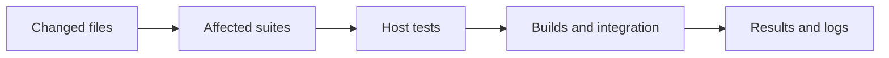

# Verification operations

This is the execution guide for the [application development process](../../process/README.md). It defines the target test coverage, suite selection and evidence. The process document owns test generation, PR order, manual-test format and GitLab review.

Component test PRs add the suites. Concrete application checks are listed in [verification cases](../specification-verification.md).

## Current state and target

The planned application host suite runs communication L2 (layer 2) logic with controlled L1 (layer 1) services. Application unit and real-service integration suites are target work. Device verification and acceptance need manual records. The bring-up host and native suites remain internal reference checks; they include historical readback tooling. Application delivery follows the receipt-based case VT-07.

The repository stages application firmware with the bring-up profiles for publication. The application still contains service placeholders; real-service and device results remain pending. The external cloud importer needs verification against the bundle contract below. The sections below describe the implemented selection; component routing for WIFI, PORTAL and L2_COMMUNICATION selects the communication suite once its test folder exists. Shared system pages and requirements also select it. Other component suites are added with their test PRs.

## Test levels

| Level | Test basis | What runs |
| --- | --- | --- |
| Unit tests (target for the application) | Detailed design and interfaces | Individual functions, libraries and service logic, including boundaries and specified failures. Host tests cover portable code; hardware-dependent units require device runs. |
| L2 deterministic simulation | Detailed design and interface contracts | Production L2 workflows with controlled L1 responses, simulated time and injected events. The cases check states, ordering, retries, cancellation and recovery. |
| Integration tests (target) | Architecture and interface contracts | Connected production components: L2 with implemented L1 services, interacting services, and wrappers with Zephyr drivers. Reports identify any remaining substitutes. |
| System verification (target) | Whole-system requirements | Complete operator flows and failure behavior. Automatable cases run in CI; physical behavior is checked on the device. |
| Final system acceptance (target) | User needs and product scope | Manual runs on the complete device, with evidence and human sign-off. |

CI means continuous integration. L2 simulation checks application behavior with substituted services. Integration tests use real L1 services. A simulated deadline checks time logic, while a device measurement checks physical timing.

## CI selection and results



| Change | Implemented selection |
| --- | --- |
| Requirements, architecture or design | Document validation and application host scenarios. |
| Application source or configuration | Application build and application/bring-up host regressions. Application host-test edits run host regressions without a target build. |
| Bring-up source or configuration | Bring-up profile builds, bring-up native tests and both host suites. |
| Bring-up host tests or tools | Bring-up and application host suites; test-source changes also validate VT references. |
| Build toolchain or quality workflow | Both applications and affected regression suites. Tooling-only edits run tooling tests; build input edits also run builds. |
| Merge-gate source | Merge-gate regression tests. |
| Daily publication, integration dispatch or `firmware` label | Application and bring-up builds, bring-up native tests and both host suites, or daily reuse of an exact verified artifact. |
| Weekly or full dispatch | Every implemented suite and clean builds of both applications. |

Static checks and QC (quality control) run on every active verification batch. An unchanged daily publication can skip the batch. A `firmware` label requests publication. The [selector](firmware_changes.py) supplies the component and suite outputs; QC is unconditional and has no selector output. New test PRs connect their suites to this routing. The [process](../../process/README.md#documents-and-component-prs) defines how coverage gaps are recorded.

Application host scenarios run in a separate step within `Quality / Static Checks`. They write `artifacts/ci/application-host.xml`. A following step puts each scenario, VT ID (identifier) and result in the job summary. Missing, empty or unsuccessful results fail that step. Bring-up host results use `artifacts/ci/bringup-host.xml`. Failures in either step fail the required check. Result accounting also rejects missing suite selectors.

The required check names remain `Quality / Static Checks`, `Zephyr / Firmware Build` and `agent-gate`. Selected work must produce a result; missing outputs, failures and cancellations do not silently pass. Workflow-level path filters are avoided because even documentation-only PRs need required results. Protected branches need matching workflow triggers.

Static checks cover formatting, configuration parsing, workflow and shell validation, and local Markdown links and anchors. PlantUML envelope checks confirm start/end markers; rendered diagrams are checked separately. Supported host/native tests also use ASan (AddressSanitizer) and UBSan (UndefinedBehaviorSanitizer) to detect memory errors and undefined behavior.

## Execution environment

Static checks and builds run in disposable home-lab VMs (virtual machines). GitHub-hosted runners handle routing, result accounting and artifact promotion. Heavy work has no hosted fallback. Fork builds receive no privileged credentials. Hardware flashing, serial access and device-network operations require owner authorization.

The [quality workflow](../../../../.github/workflows/quality-gates.yml) runs for PRs into `integration`, integration pushes, scheduled verification and manual dispatch. Tool and board versions are defined by [toolchain.json](toolchain.json), the workflow and the hash-locked dependency files.

### Prepared environments

Static jobs validate `/opt/stethoscope-ci` against the required Python version, package state and dependency hashes. Firmware jobs validate `/opt/zephyr-workspace` against Zephyr/module revisions, compiler inputs and Espressif binary hashes. Missing or changed inputs trigger setup. Validators are checksum-checked before reuse or download.

Every build starts with a clean CMake build tree. Compiler outputs can be reused through the pinned 512 MiB ccache, separated by toolchain/cache versions. PRs read entries; successful integration verification saves them. Weekly and full verification disable compiler-cache reuse. Disposable guest writes are discarded; the base images remain read-only.

## Evidence and publication

A result identifies the production source, test source, toolchain and configuration. Each suite supplies machine-readable reports plus a readable coverage summary: behavior checked, expected outcome, actual outcome, substituted boundaries and pending device cases. A failed case retains its inputs and logs for diagnosis and retest.

Diagnostic artifacts are retained for 14 days; firmware artifacts for eight days. Review evidence is copied to its durable review record before expiry, as defined in the [GitLab review process](../../process/README.md#github-development-and-gitlab-human-review).

Application publication requires successful selected automated verification and four profiles: `application`, `offline`, `qc` and `network-qc`.

The `application` profile uses the application's default `prj.conf`; the other three build bring-up firmware. Each manifest entry names the component, profile, version and SHA-256 (secure hash algorithm 256) checksum. The application prints the same version at boot. Its configuration, ELF (Executable and Linkable Format) image, map and generated device tree are retained under `artifacts/firmware/application/`.

Artifact reuse starts from a successful run for the exact source revision and configuration. The manifest must list every required profile, and every checksum must match. Missing eligible artifacts trigger a build; corrupt artifacts fail publication. Build guests hold no cloud credentials. Published firmware carries a development-build identity; manual acceptance has a separate record.

The repository uploads the complete bundle under the existing `firmware-build-<attempt>` artifact name. Exact-commit reuse requires all four profiles and matching component fields. Each integration push selects both applications and their regression suites, then retains the complete verified bundle for exact-commit reuse. PR builds keep component selection. The publisher's profile and artifact rules are defined in [firmware_release.py](firmware_release.py) and the workflow.

### External publication handoff

The homelab importer and Personal Cloud service are outside this repository. Before application downloads can be confirmed, their owner must check these inputs:

- Accept `profile=application` and `component=application`; the existing profiles use `component=bringup`.
- Import all four manifest entries as one build and retain their version, source commit, board and checksums. Retire the previous build only after all four uploads succeed.
- Accept `--profile application --parts 4` in `cloud-publish`, and present the application image separately from bring-up images in the download view.

Repository artifacts contain the application binary and its manifest identity. Importer compatibility and an end-to-end download remain unverified here.

## Failures and retests

The failing test, input and environment remain part of the evidence. Corrections rerun affected unit, L2 and integration suites. Interface changes also affect callers and services. Device retests identify the hardware and firmware configuration and retain the earlier failed record.

Post-merge recovery reruns failed jobs once. Only attempts 1 and 2 determine recovery: a green rerun reports recovery; the same recognized verification step failing twice proposes a revert. Setup, runner availability, upload and unclassified failures require inspection. Later manual reruns do not reopen the recovery decision. Revert PRs still pass the active protections.

## Setup and local checks

New component suites are added through their test PRs. Use the following commands for the implemented checks.

Setup uses Python 3.12+, Git and, on Windows, 7-Zip. Linux also needs venv support, xz/tar and the [Zephyr host prerequisites](https://docs.zephyrproject.org/latest/develop/getting_started/index.html). A checkout path without parentheses avoids the pinned Zephyr Windows Kconfig path limitation.

```powershell
winget install --id 7zip.7zip -e --silent
python Development/system/testing/ci/setup_zephyr.py
.ci-workspace/.venv/Scripts/python.exe -m pip install --require-hashes -r Development/system/testing/ci/requirements-ci.txt
```

Commands below use the pinned environment's Python. On Linux that executable is `.ci-workspace/.venv/bin/python`; on Windows it is `.ci-workspace/.venv/Scripts/python.exe`. Static checks also need actionlint and ShellCheck from [validation_tools.json](validation_tools.json). `validation_tools.py` installs their pinned Linux x86-64 binaries; a local Windows run uses native tools when available and prints a skip message for missing validators. CI requires both validators on every run. Host tests need pytest and a C compiler selected through `CC` (GCC in CI). The workflow records their dependency setup.

| Check | Command from the repository root |
| --- | --- |
| Static checks | `python Development/system/testing/ci/run_ci.py static` |
| Documentation | `python -X utf8 Development/system/testing/ci/validate_docs.py` |
| Application L2 host tests | `python -m pytest -q Development/system/coding/app/tests/host` |
| Application build | `python Development/system/testing/ci/run_ci.py build --application` |
| Tooling regression tests | `python -m unittest discover -s Development/system/testing/ci -p 'test_*.py'` |
| Merge-gate regression tests | `python -m unittest discover -s .github/agent-gate` |
| Source-pattern quality checks | `python Development/system/testing/ci/run_ci.py qc` |

`run_ci.py all` executes static checks, builds and source-pattern quality checks. Host, native, tooling and merge-gate suites have separate entry points. `build --application` builds and stages only the application, with its identity manifest. `build --firmware` builds and stages only the bring-up profiles. These component commands keep evidence local. An unqualified build stages all four profiles and can publish locally when `cloud-publish` is installed and supports the bundle contract above.

### Source-level QC

QC compares source patterns with the THA (Technische Hochschule Augsburg) Embedded Systems 2 baseline. [qc_eval.py](../qc_eval.py) writes a Markdown scorecard and JSON results to ignored `artifacts/qc/`. PASS requires every checked control and 100/100; otherwise it reports HOLD. Device timing, concurrency and acceptance need their own evidence.

[tha-baseline-traceability.json](../tha-baseline-traceability.json) records the institutional revision and three source hashes. A local institutional checkout is checked against those hashes; CI validates the metadata without copying the source. Historical evidence used by the evaluator remains identified as historical. `--output-dir` selects a separate location for retained reports.

## Tool reference

| Tool | Responsibility |
| --- | --- |
| `run_ci.py`, `build_support.py` | Check/build entry points, paths and firmware profiles. |
| `setup_zephyr.py`, `setup_zephyr.sh` | Pinned workspace setup; reruns complete interrupted setup and reuse downloads. |
| `prepared_env.py`, `validation_tools.py`, `compiler_cache.py` | Validate and reuse prepared environments, validators and compiler cache. |
| `firmware_changes.py` | Select affected suites. |
| `ci_evidence.py`, `ci_results.py` | Record execution identity and account for results. |
| `daily_build.py`, `release_reuse.py`, `firmware_release.py` | Daily selection, verified-artifact reuse and publication manifests. |
| `native_tests.py` | Bring-up logic on Zephyr native simulation; application L2 uses the separate host step. |
| `application_host_results.py` | Per-scenario application JUnit summary and result validation. |
| `test_*.py` | Regression tests for this tooling. |

Optional infrastructure references are kept below so the application reading path ends with test execution and evidence.

<details>
<summary>Build timing and runner maintenance</summary>

[Build-time measurements](../BUILD-TIMES.md) covers the existing reference-workload benchmark, including disabled/cold/warm compiler caches. The workflow's `cache_benchmark` input retains measurements and binaries. The measurements describe reference-workload build performance.

Host image setup and rollback live in HomelabServer's `scripts/ci-runner/STETHOSCOPE.md`. [GitHub Actions billing](https://docs.github.com/en/billing/concepts/product-billing/github-actions) describes hosted-runner accounting; home-lab runtime is separate.

</details>

[Native approval migration and rollback](NATIVE-REVIEW-MIGRATION.md) has a separate guide.
