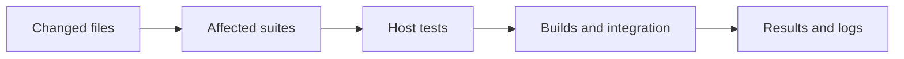

# Verification operations

This is the execution guide for the [application development process](../../process/README.md). It defines the target test coverage, suite selection and evidence. The process document owns test generation, PR order, manual-test format and GitLab review.

Component test PRs add the suites. Concrete application checks are listed in verification cases.

## Current state and target

When present, the communication host suite runs production L2 (layer 2) with controlled L1 (layer 1) services and simulated time. Its expectations come from the identified design revision; known implementation defects remain strict expected failures. Unit tests, real-service integration, device verification and acceptance remain pending; the case catalogue records the gaps.

The application contains the Wi-Fi service, portal and COMMUNICATION workflow; other components still contain placeholders. CI builds, publishes and reuses only the `application` profile. The bring-up firmware and its source-pattern QC are archived under `preThesis/06-bringup-zephyr` and have no CI. The pinned application toolchain and compiler cache remain active. External cloud importer compatibility and device results remain unverified.

Component routing for WIFI, PORTAL and L2_COMMUNICATION selects the communication suite when its test folder exists. Shared system pages and requirements also select it. Other suites are added with their test PRs. Application delivery follows receipt-based case VT-07.

## Test levels

| Level | Test basis | What runs |
| --- | --- | --- |
| Unit tests (target for the application) | Detailed design and interfaces | Individual functions, libraries and service logic, including boundaries and specified failures. Host tests cover portable code; hardware-dependent units require device runs. |
| L2 deterministic simulation | Detailed design and interface contracts | Production L2 workflows with controlled L1 responses, simulated time and injected events. The cases check states, ordering, retries, cancellation and recovery. |
| Host integration and target integration | Architecture and interface contracts | Connected production components: L2 with implemented L1 services, interacting services, and wrappers with Zephyr drivers. Reports identify any remaining substitutes. |
| System verification (target) | Whole-system requirements | Complete operator flows and failure behavior. Automatable cases run in CI; physical behavior is checked on the device. |
| Final system acceptance (target) | User needs and product scope | Manual runs on the complete device, with evidence and human sign-off. |

CI means continuous integration. L2 simulation checks application behavior with substituted services. Integration tests use real L1 services. A simulated deadline checks time logic, while a device measurement checks physical timing.

## CI selection and results



| Change | Implemented selection |
| --- | --- |
| Requirements, architecture or design | Document validation and available application host scenarios. |
| Application source or configuration | Application build and available application host scenarios. |
| Application host tests | Host scenarios and document validation, without a target build. |
| Build toolchain or quality workflow | Application build and affected tooling/host regressions. |
| Tooling-only edits | Tooling regressions; build input edits also select the application build. |
| Merge-gate source | Merge-gate regression tests. |
| Daily publication, integration dispatch or `firmware` label | Application build and available host scenarios, or daily reuse of an exact verified application artifact. |
| Integration push | Application build and available host scenarios; retain the verified application artifact. |
| Weekly or full dispatch | Every available suite and a pristine application build. |
| Archived bring-up firmware | No build, host tests, native tests, QC evaluation or publication. |

The [selector](firmware_changes.py) supplies every suite output. Static checks run on every active batch. An unchanged daily publication can skip the batch.

The host batch runs production unit/service tests, deterministic L2 scenarios and
real-service integration together. The integration executable links production
COMMUNICATION, WIFI, PORTAL and STORAGE; only Zephyr kernel/driver/network, HTTP
server and settings APIs are substituted. The substitute follows the pinned ESP
driver's scan completion and connected-versus-connecting disconnect behavior.
It cannot prove target scheduling, socket transport, flash power-failure behavior
or radio/audio interference. JUnit reports the level per scenario.

Coverage runs separately from ASan/UBSan so sanitizer-generated checks do not
inflate the branch denominator. Both executions must pass. GCC instruments production C with `--coverage -O0` when
`STETHO_COVERAGE_DIRECTORY` is set. `host_coverage.py` invokes the matching `gcov`
with JSON line/branch output and reports unit, L2 and integration totals separately
in `GITHUB_STEP_SUMMARY`. Raw counters, gcov JSON, per-source line/branch counts and
`coverage.md` remain in `artifacts/ci/host-coverage/` inside the static evidence
artifact. Missing selected levels or production counters fail collection. XFAIL
execution can cover a branch without verifying its behavior. There is no numeric
threshold: this baseline exposes gaps for review instead of choosing an arbitrary
percentage. Host compilers and commands remain in JUnit; firmware build selection
and the required firmware check remain in place.

`manual_test_records.py` validates completed JSON runs and reports the count in the
job summary. An empty run directory explicitly means execution and Nico's sign-off
are pending. The manual record format, reusable procedures and executed records
are test-stage artifacts; the validator and workflow belong to Process/CI.

Application host scenarios run within `Quality / Static Checks` only when `available_component_suites()` finds the suite in the checkout. The communication suite, when present, writes `artifacts/ci/application-host.xml`. The following reporter lists each scenario, VT ID (verification-test identifier) and result in the job summary. Missing, empty, unmapped, skipped or unsuccessful selected results fail the required check. Documented pytest expected failures are shown as XFAIL and remain known defects; they are accepted by result accounting. Strict unexpected passes fail pytest and result accounting. Result accounting also rejects missing selector outputs.

The required check names remain `Quality / Static Checks`, `Zephyr / Firmware Build` and `agent-gate`. Selected work must produce a result; missing outputs, failures and cancellations do not silently pass. Workflow-level path filters are avoided because even documentation-only PRs need required results. Protected branches need matching workflow triggers.

Static checks cover formatting, configuration parsing, workflow and shell validation, and local Markdown links and anchors. PlantUML envelope checks confirm start/end markers; rendered diagrams are checked separately. Supported application host tests also use ASan (AddressSanitizer) and UBSan (UndefinedBehaviorSanitizer) to detect memory errors and undefined behavior.

The portal page check executes JavaScript using Node 24.19.0 from
`.ci-validation-tools/node`. The existing `validation_tools.py` workflow step
installs the hash-pinned Linux x86-64 runtime alongside actionlint and ShellCheck;
an older prepared image downloads it using the checked-out pin. A missing or
unusable runtime fails CI. Windows local execution and its explicit skip/override
are described in the host run instructions.

## Execution environment

Static checks and builds run in disposable home-lab VMs (virtual machines). GitHub-hosted runners handle routing, result accounting and artifact promotion. Heavy work has no hosted fallback. Fork builds receive no privileged credentials. Hardware flashing, serial access and device-network operations require owner authorization.

The [quality workflow](../../../../.github/workflows/quality-gates.yml) runs for PRs into `integration`, integration pushes, scheduled verification and manual dispatch. Tool and board versions are defined by [toolchain.json](toolchain.json), the workflow and the hash-locked dependency files.

### Prepared environments

Static jobs validate `/opt/stethoscope-ci` against the required Python version, package state and dependency hashes. Firmware jobs validate `/opt/zephyr-workspace` against Zephyr/module revisions, compiler inputs and Espressif binary hashes. Missing or changed inputs trigger setup. Validators are checksum-checked before reuse or download.

Every build starts with a clean CMake build tree. Compiler outputs can be reused through the pinned 512 MiB ccache, separated by toolchain/cache versions. PRs read entries; successful integration verification saves them. Weekly and full verification disable compiler-cache reuse. Disposable guest writes are discarded; the base images remain read-only.

## Evidence and publication

A result identifies the production source, test source, toolchain and configuration. Each suite supplies machine-readable reports plus a readable coverage summary: behavior checked, expected outcome, actual outcome, substituted boundaries and pending device cases. A failed case retains its inputs and logs for diagnosis and retest.

Diagnostic artifacts are retained for 14 days; firmware artifacts for eight days. Review evidence is copied to its durable review record before expiry, as defined in the [GitLab review process](../../process/README.md#github-development-and-gitlab-human-review).

Application publication requires successful selected verification and the single `application` profile, built from `coding/app/prj.conf`. The manifest entry has `component=application`, the version and SHA-256 (secure hash algorithm 256) checksum. The same version is printed at boot. Configuration, ELF (Executable and Linkable Format), binary, map, generated device tree and RAM/ROM reports are retained under `artifacts/firmware/application/`.

Daily builds, dispatches of `integration` and the `firmware` label publish only this application. Integration pushes retain `verified-firmware-<attempt>`. Exact-commit reuse accepts a successful same-repository integration run of this workflow, a clean matching manifest and exactly one application image with a valid checksum. Missing eligible artifacts trigger a build; corrupt selected artifacts fail publication. The bundle keeps the external artifact name `firmware-build-<attempt>`. Build guests hold no cloud credentials.

### External publication handoff

The homelab importer and Personal Cloud service are outside this repository. Their owner must check that they accept `profile=application`, `component=application` and `--profile application --parts 1`, replace the previous download only after the upload succeeds, and display the application image. Importer compatibility and an end-to-end download remain unverified here.

## Review findings

Critical and major review findings block delivery. Minor findings and nitpicks may remain open or be deferred. The merge gate exempts only explicitly classified CodeRabbit minor/nitpick findings from its configured immutable bot identity. Unknown severity, other unresolved reviewers' threads and unanswered owner questions still block. A current-head CodeRabbit changes request counts as a completed nonblocking review only when its structured summary and all associated findings account for minor/nitpick findings exclusively; missing, truncated, mixed or unrecognised evidence blocks. Native GitHub required approvals remain independent and cannot be replaced by this gate.

Use automatic CodeRabbit reviews. Request manually only when none triggered; never duplicate a running review or assume a fixed subscription quota.

## Failures and retests

The failing test, input and environment remain part of the evidence. Corrections rerun affected unit, L2 and integration suites. Interface changes also affect callers and services. Device retests identify the hardware and firmware configuration and retain the earlier failed record.

Post-merge recovery reruns failed jobs once. Only attempts 1 and 2 determine recovery: a green rerun reports recovery; the same recognized verification step failing twice proposes a revert. Setup, runner availability, upload and unclassified failures require inspection. Later manual reruns do not reopen the recovery decision. Revert PRs still pass the active protections.

## Setup and local checks

New component suites are added through their test PRs. Use the following commands for the implemented checks.

Setup uses Python 3.12+, Git and, on Windows, 7-Zip. Linux also needs venv support, xz/tar and the [Zephyr host prerequisites](https://docs.zephyrproject.org/latest/develop/getting_started/index.html). A checkout path without parentheses avoids the pinned Zephyr Windows Kconfig path limitation.

```powershell
winget install --id 7zip.7zip -e --silent
python Development/system/testing/ci/setup_zephyr.py
.ci-workspace/.venv/Scripts/python.exe -m pip install --require-hashes -r Development/system/testing/ci/requirements-ci.txt
```

Commands below use the pinned environment's Python. On Linux that executable is `.ci-workspace/.venv/bin/python`; on Windows it is `.ci-workspace/.venv/Scripts/python.exe`. Static checks also need actionlint and ShellCheck from [validation_tools.json](validation_tools.json). `validation_tools.py` installs their pinned Linux x86-64 binaries; a local Windows run uses native tools when available and prints a skip message for missing validators. CI requires both validators on every run. Host tests need pytest and a C compiler selected through `CC` (GCC in CI). The workflow records their dependency setup.

| Check | Command from the repository root |
| --- | --- |
| Static checks | `python Development/system/testing/ci/run_ci.py static` |
| Documentation | `python -X utf8 Development/system/testing/ci/validate_docs.py` |
| Application L2 host tests | `python -m pytest -q Development/system/coding/app/tests/host` |
| Application build | `python Development/system/testing/ci/run_ci.py build --application` |
| Tooling regression tests | `python -m unittest discover -s Development/system/testing/ci -p 'test_*.py'` |
| Merge-gate regression tests | `python -m unittest discover -s .github/agent-gate` |

`run_ci.py all` executes static checks and the application build. `build` and `build --application` are equivalent: both stage the single application image and identity manifest, and can publish locally when `cloud-publish` is installed. Available host scenarios, tooling and merge-gate tests have separate entry points. Install application host dependencies with `python -m pip install --require-hashes -r Development/system/testing/ci/requirements-host.txt` before running an available suite.

The [archived bring-up](../../../../preThesis/06-bringup-zephyr/README.md) retains its local build guide and optional QC (quality control) evaluator. Its checks depend on named bring-up modules, optional display/touch wiring, `qc.conf` and historical bring-up evidence. They do not define application quality gates.

## Tool reference

| Tool | Responsibility |
| --- | --- |
| `run_ci.py`, `build_support.py` | Check/build entry points, paths and firmware profiles. |
| `setup_zephyr.py`, `setup_zephyr.sh` | Pinned workspace setup; reruns complete interrupted setup and reuse downloads. |
| `prepared_env.py`, `validation_tools.py`, `compiler_cache.py` | Validate and reuse prepared environments, validators and compiler cache. |
| `firmware_changes.py` | Select affected suites. |
| `ci_evidence.py`, `ci_results.py` | Record execution identity and account for results. |
| `daily_build.py`, `release_reuse.py`, `firmware_release.py` | Daily selection, verified-artifact reuse and publication manifests. |
| `application_host_results.py` | Per-scenario application JUnit summary and result validation. |
| `native_review.py`, `post_merge.py` | Native protection migration and post-merge failure confirmation. |
| `validate_docs.py` | Links, diagram renders, indexes, repeated facts, available thesis sources and VT references (reported separately when present). |
| `test_*.py` | Regression tests for this tooling. |

Optional infrastructure references are kept below so the application reading path ends with test execution and evidence.

<details>
<summary>Runner maintenance</summary>

Host image setup and rollback live in HomelabServer's `scripts/ci-runner/STETHOSCOPE.md`. [GitHub Actions billing](https://docs.github.com/en/billing/concepts/product-billing/github-actions) describes hosted-runner accounting; home-lab runtime is separate.

</details>

[Native approval migration and rollback](NATIVE-REVIEW-MIGRATION.md) has a separate guide.
