# Stethoscope microphone adapter and first recordings

Documentation of the work from 10 to 16 November 2026: a 3D-printed adapter that couples a stethoscope tube to the
INMP441 microphone breakout on the DigitalStethoscope Eval carrier, the recordings made with it, and what those
recordings revealed.

## Where things stand

- **Adapter:** version 10 is printed in white PLA, clips onto the microphone board and seals against room sound.
  A 0.5 mm vent hole was drilled into it by hand on 16 November and widened to 0.8 mm the same day.
- **Firmware:** the microphone samples were read one bit too far left. That is fixed and merged in the application
  ([PR #173](https://github.com/DemonicPsychoII/DigitalStethoscope/pull/173), fix commit `e2c0bd7`, merge commit
  `97a7158`), and the merged firmware is on the board.
- **Sound:** recording 10, band-passed to 20–400 Hz on the PC, was judged good by ear. The board itself still plays
  the unfiltered signal.
- **Still open:** the microphone is driven close to its limit by slow pressure in the sealed air volume. See
  [Open points](#open-points).

## Contents of this folder

| Item | What it is |
|---|---|
| [recordings/](recordings) `03`–`05` | 15 November, made in another session before the adapter sealed. Samples are still one bit too far left (values doubled). |
| [recordings/](recordings) `06`–`27` | 16 to 19 November, see [Recordings](#recordings). |
| [meeting-2026-11-16-transcript.md](meeting-2026-11-16-transcript.md) | Meeting transcript with TL;DR. |
| [pictures/](pictures) | Design sections, renders and sliced views. |
| [adapter/](adapter) | Generator and check scripts, printed model (v10), vented model (v12), sealed model with TPU seal (v13, in `v13-sealed/`), slicer profiles. |
| [clock-measurement/](clock-measurement) | Oscilloscope captures of the I2S bit clock with a short report. |
| [capture-tool/](capture-tool) | Capture firmware, PC script and analysis scripts, with their own README. |

Each clip has its own folder under `recordings/`, named like the clip. File name endings: `-raw.wav` is the 24-bit signal as delivered, `-listen.wav` is DC-free and normalised,
`-highpass-20Hz-listen.wav` and `-bandpass-20-400Hz-listen.wav` are filtered on the PC forward and backward,
`-bandpass-20-400Hz-one-pass-listen.wav` is filtered once as the board would do it live, `.png` shows waveform,
spectrogram and spectrum, `-filter-comparison.png` the spectra of the filter candidates.

## Hardware facts

- **Microphone board:** round INMP441 breakout, 13.73 mm across (14 mm at the two break-tab remnants), 1 mm thick,
  two round notches opposite each other, pin rows 3.9 mm either side of the centre with stubs standing 1.5 mm proud,
  sound port in the centre. Its top is about 4 mm above the carrier.
- **Tube:** Littmann-type single tube, inner diameter about 4.5 mm.
- **Seal:** a strip cut from a rubber washer (13.75 mm outside, 4 mm hole, 3.5 mm thick), lying between the pin rows.
- **Printer:** Bambu Lab P1S, 0.4 mm nozzle, white PLA Basic, textured PEI plate.

## How the adapter got to its current form

### 10–12 November: concept and first part

- **Question that started it:** there is no standard for stethoscope tube dimensions; single tubes are typically
  4–5 mm inside.
- **Concept:** a cap that sits on the microphone board from above, with a barbed stem for the tube and a channel
  down to the sound port. The tube is stretched over the barbs, because that depends only on the inner diameter and
  outside surfaces print accurately.
- **Acoustics agreed on:** a leak acts as a high-pass and costs the low frequencies first; the narrow channel only
  matters above several kilohertz; a short tube (about 20 cm kept) gives more signal and keeps tube resonance above
  the heart-sound band.
- **Tools:** first a parametric Fusion 360 script (`StethoscopeMicAdapter`, built once in Fusion). From 12 November
  the part is generated by `adapter/generate_adapter_stl.py`. The Fusion script was not updated for any latched
  version.
- **First print:** barbs for 4.5–5 mm, 2 mm channel, skirt 1 mm longer than the first draft.

### 15 November: sealing and holding on

| Version | Change | Result |
|---|---|---|
| Keyed | Two ribs fill the board's notches | Printed with a built-in break-away ring; the ring fused and the cap could not seat |
| Keyed v2 | Real supports, 0.12 mm layers, stem ends 1.5 mm inside the rim | Printed; no room for the 3.5 mm rubber |
| Latched | Room for the rubber strip, four small latches | Not strong enough on paper |
| Latched v2 | 0.2 mm hooks on flexible tabs | Two clips broke while removing supports |
| Latched v3 | Printed lying on its side, tree supports, stronger clips | Printed whole, but latching was too weak |

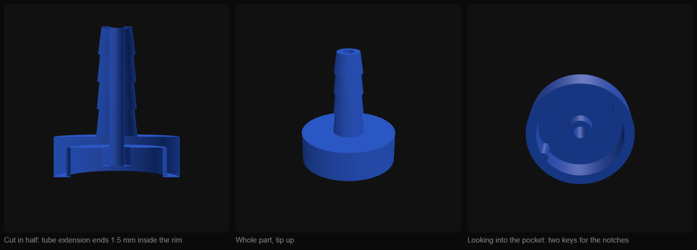

### 15–16 November: two-clip design, versions 4 to 10

Requirement: two clips, 90° away from the notch fill-ins, hooking 1.4 mm under the board, rubber squeezed by 0.2 mm.

| Version | Change |
|---|---|
| v4 | Two clips, but only 0.2 mm reach (misread requirement) |
| v5 | 1.4 mm hooks on long arms rooted at the top of the housing |
| v6 | Sharp hook tip, barbs spread 0.2 mm wider towards the base |
| v7 | Board-to-ceiling distance corrected so the latched rubber is really squeezed |
| v8 | Housing hollowed, about 27 % less material |
| v9 | Fillets at arm roots, webs and edges |
| v10 | Re-check fixes: longer arms (bending strain about 2 % instead of 3.3 %), wider slits |

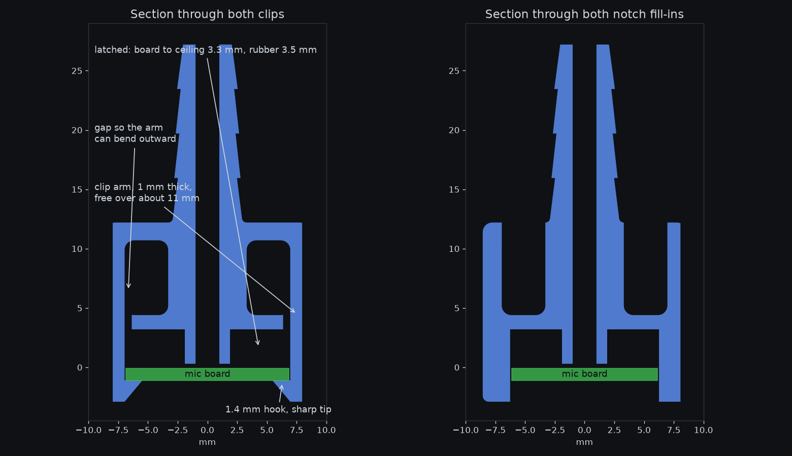

Key dimensions of v10: wall 1.6 mm, latched board-to-ceiling 3.3 mm for the 3.5 mm rubber, clip arm 1 mm thick and
about 11 mm long, hook reach 1.4 mm, channel 2 mm, barb ridges 5.8 / 5.57 / 5.33 / 5.1 mm, barb length 15 mm.

Checked on the model before printing (`adapter/check_mesh.py`): one closed solid, both arms free from rim to root,
no overlap with the board or the pin stubs.

### Printing version 10

- **Profile:** 0.08 mm Extra Fine, changed for strength: 5 wall loops, 100 % infill (zig-zag), 230 °C, tree
  supports from the build plate only. The profiles are in `adapter/slicer-profiles`.
- **Orientation:** four were sliced and compared (on its side, rolled 45°, standing on the tube tip, tilted). The
  tilted one was chosen: the part rests on the tube tip and one housing shoulder, and the sound channel rises 22.6°
  from the plate. The lowest 0.4 mm is cut off to form two small flats, so the part has 13 mm of contact line
  instead of two points.
- **Printed:** 16 November, 06:47, about 36 minutes, 2.6 g, job
  `stethoscope_microphone_adapter_two_clip_v10_tilted`.
- **Outcome reported by Nico:** "it seems to be sound-proof now".

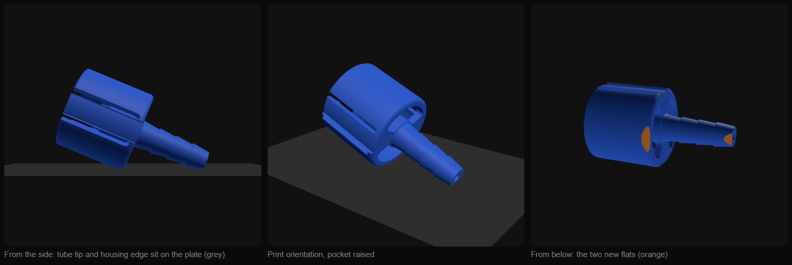

Checks on the user side that were listed but not confirmed in the thread: break tabs filed flush, 1.4 mm free under
the board edge at both clips, the capacitor clear of the rim.

## What the recordings revealed

### 1. Samples were one bit too far left (firmware)

- **Symptom:** crackle whenever the chestpiece was on the chest.
- **Finding (recording 06):** the lowest bit was 0 in all 240000 samples, and the signal jumped from one limit to
  the other 417 times in 15 s. After undoing the wrap-around the signal was continuous.
- **Cause as far as known:** with the standard I2S format the ESP32-S3 samples this microphone one bit clock late.
  The sign bit is lost, the value is doubled, and anything above half of the microphone's range wraps around. Why
  the standard format is late was not found.
- **Fix:** receive format `I2S_FMT_DATA_FORMAT_LEFT_JUSTIFIED | I2S_FMT_FRAME_CLK_INV`, which samples one bit clock
  earlier. Confirmed in recordings 08 and 09: the lowest bit carries data and there are no jumps.
- **In the application:** fixed by the audio-path session in PR #173. Measured on the capture firmware; the
  transmit side to the DAC was not measured here.

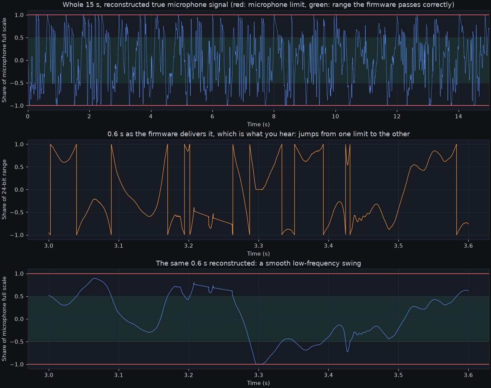

### 2. The sealed adapter overloads the microphone

- **Finding:** with the shift removed, the microphone still reaches its extreme 24-bit codes and holds them for up
  to 16 ms. The INMP441 has no gain setting; its full scale is 120 dB SPL.
- **Why:** the adapter seals the air in chestpiece, tube and adapter. Slow movement of the diaphragm (breathing,
  pulse, hand) compresses that air directly. Over 90 % of the energy is below 20 Hz. By estimate, about 1.6 µm of
  average diaphragm travel is enough to reach the limit (assuming 12 cm³ of air and a 44 mm diaphragm).
- **Clicks without clipping:** most clicks occur while the signal is merely large. The click rate rises from under
  0.5 % of samples below a quarter of the range to 5–9 % above three quarters, which points to the microphone
  distorting before it clips. The mechanism is not proven.
- **What does not help:** setting clipped samples to 0 made the click content about 23 dB worse.
- **What helps:** keeping the slow swing out acoustically (a vent), and band-limiting for listening.

### 3. Vent

- **Design v12:** a 0.4 mm hole, 2.3 mm long, from the sound channel into the open hollow, plus a 1.2 mm hole in the
  outer wall for a cleaning needle. Sliced with the same settings (36 minutes, 2.55 g). **Not printed.**
- **Done instead:** Nico drilled a 0.5 mm hole into the printed v10.
- **Measured effect (recording 10):** time at the limit down from 1.1 % to 0.02 %, clicks from about 20 per second
  to 2–4, but the slow swing only about 5 dB lower. A clear 0.5 mm hole should take off 20 dB or more by estimate,
  so the hole may not be fully open into the channel, or the estimate is off.

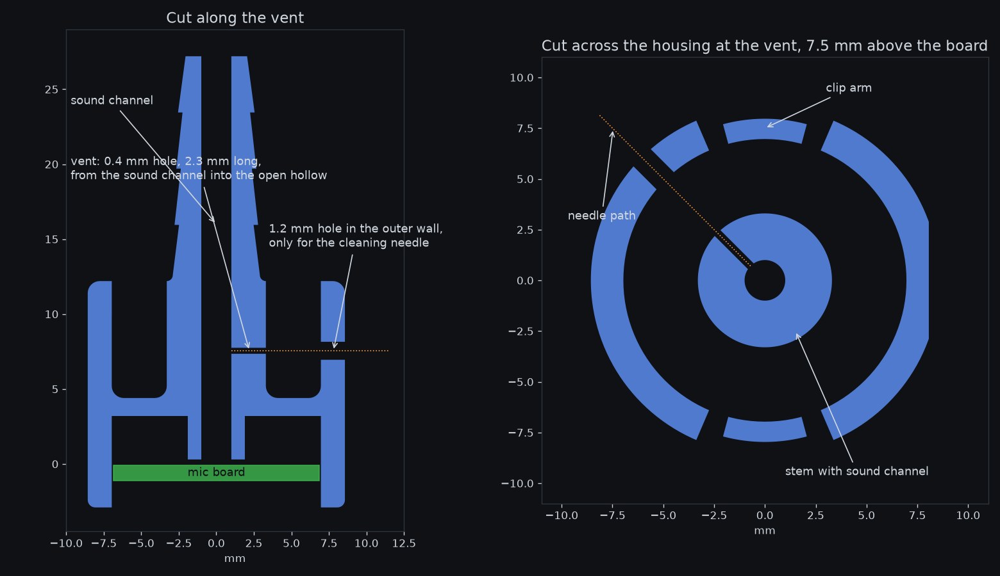

### 4. Version 13: printed TPU seal and 0.8 mm vent (designed 19 November, not printed)

- **Seal:** replaces the cut rubber strip. Separate part in Bambu TPU for AMS, printed flat with the pocket face on the
  plate. That filament is Shore 68D, stiff enough to feed through the AMS but too stiff to seal by being squeezed. The
  seal therefore touches the board only with a slanted lip ring, 1.0 mm high and 0.5 mm thick, which bends onto the
  board around the sound port. Body 5.5 × 11 mm, 2.6 mm thick, 0.3 mm clear of the pin stubs on each side and 1.5 mm
  short of the clip arms.
- **Orientation:** the round boss under the ceiling is now oval (3.6 × 5.6 mm, 1.2 mm long). The seal has a matching
  pocket that is 0.1 mm smaller, so it is held in line with the pin rows and seals around the boss. Turned 90° or
  upside down it does not fit. The adapter is keyed to the board's notches as before.
- **Vent:** a slot through the stem wall from the sound channel into the hollow, which is open to the outside through
  the clip slits. It runs level in the tilted print, so its height is exactly 10 layers of 0.08 mm (0.8 mm) and its
  width of 0.7 mm comes from the gap between two straight walls; the roof is a 0.7 mm bridge. The sliced G-code has
  exactly 10 open layers with 0.70 mm between the line edges (`adapter/v13-sealed/check_sliced_slot.py`). Its area,
  0.56 mm², is close to that of the drilled 0.8 mm hole (0.50 mm²). A round hole at the tilt of the print would
  have come out about 0.3 to 0.6 mm wide when modelled at 0.8 mm, and about 0.5 to 0.85 mm at 1.0 mm.
- **Lip interference:** three seals were generated with the lip reaching 0.2, 0.3 and 0.4 mm below the latched board
  top. 0.3 mm is the starting point; which one seals with an acceptable latching force has to be tried.
- **Clips that snap on their own:** on v10 the arms bent while the board was pushed in, but the hooks did not spring
  back under it and had to be latched by hand. In v10 the board rests on the hooks exactly when latched. To get past
  them it has to be pushed further in, and only the stiff rubber allowed that. In v13 the board can rise 0.7 mm above
  the latched position before it meets the seal body, because the lip gives way. The arms are also easier to bend:
  hook catch 1.0 mm instead of 1.4 mm, arm 0.9 mm instead of 1.0 mm. That gives 1.1 mm of arm deflection, a
  bending strain of about 1.1 % instead of 1.6 % (same estimate for both), and a lead-in ramp at 31° from vertical
  instead of 40°.
- **Unchanged from v10:** clip positions and arm length, barbs, wall, hollow and the tilted print orientation.
- **Checked on the model** (`adapter/v13-sealed/check_sealed_adapter.py`): one closed solid with two free arms; no
  overlap with the board or the pin stubs. The seal overlaps the adapter only by the intended 0.05 mm around the
  boss, and the board only at the lip. The vent axis is free. The hooks reach 1.0 mm under the board edge.
- **Files:** `adapter/v13-sealed/`, with the generator, seal generator, checks, renders and STL files.
- **Sliced 19 November, not printed:** adapter in PLA Basic with the v10 strong profile (0.08 mm, 5 walls, 100 % infill,
  tree supports from the plate), about 36 minutes and 2.5 g. The three seals on one plate in TPU for AMS, 0.12 mm,
  3 walls, 100 % infill, no supports, about 13 minutes and 0.5 g. Both jobs are for the textured PEI plate. The seals
  carry 1, 2 and 3 small pits for lip interference 0.2, 0.3 and 0.4 mm. Settings are in `adapter/v13-sealed/slicer-profiles`.

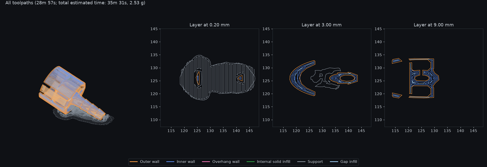

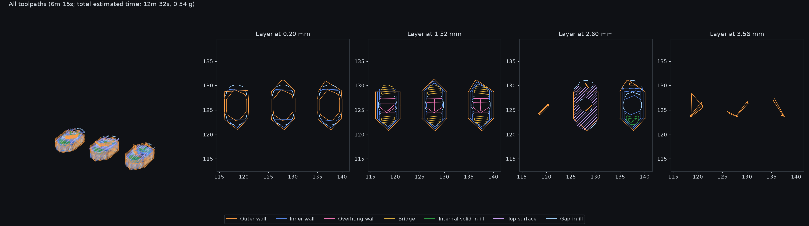

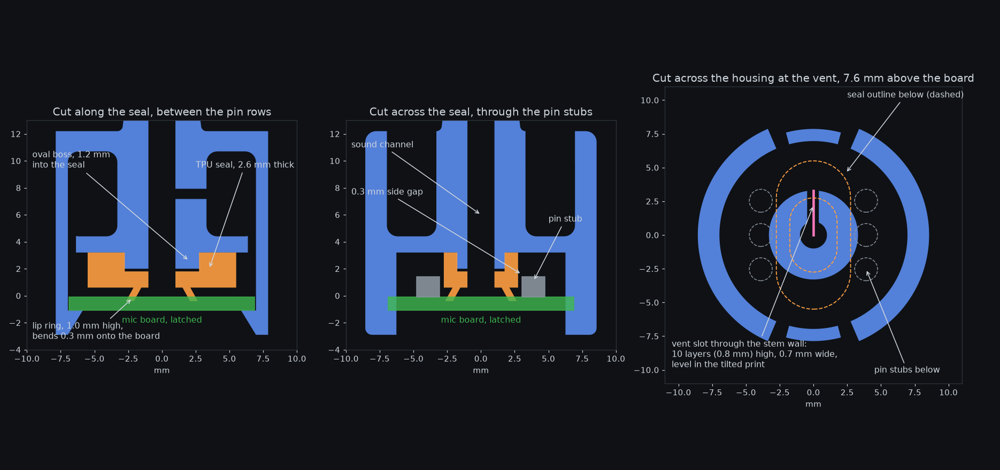

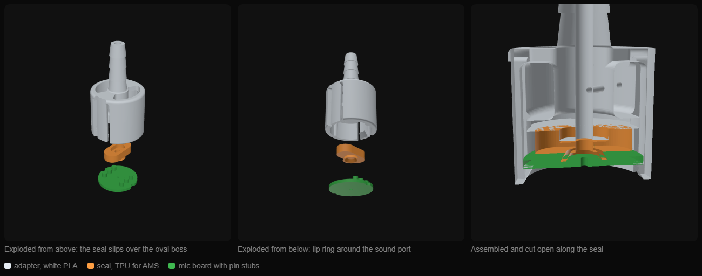

### 5. Version 14: deeper hooks and stiffer clips (designed 19 November, not printed)

- **Why:** v13 printed and tested on 19 November. Its clips held the adapter less firmly than v10, and the seal did
  not stay on the boss.
- **Hooks:** reach 2.0 mm under the board edge instead of 1.0 mm.
- **Arms:** 1.4 mm thick instead of 0.9 mm, 6.2 mm wide instead of 3.9 mm and 16.6 mm long instead of
  11.8 mm, so the housing is 4.8 mm taller. A first v14 draft with 1.1 mm arms of the old width looked too slim to
  Nico. The longer arm keeps the bending strain at about 1.6 % although it bends 2.1 mm. Each arm pushes back with
  about 6 N when fully spread (estimate with 3000 MPa for PLA); by the same estimate v13 had about 1.4 N.
- **Skirt:** 0.6 mm longer, so the lead-in ramp stays at 41° from vertical. The skirt now ends 3.4 mm below the top
  of the latched board; the board top was measured at about 4 mm above the carrier.
- **Snap-on seal:** the oval boss has a rim at its free end, 0.2 mm proud and 0.4 mm high, chamfered on both sides.
  The seal's pocket has a matching groove; the 0.75 mm neck above it stretches about 10 % over the rim and then
  holds the seal on. The seals printed for v13 have no groove and do not fit this boss.
- **Unchanged:** seal space and lip, slot vent (10 open layers of 0.70 mm in the sliced G-code), barbs, tilted print.
- **Sliced:** adapter with the same strong profile, about 41 minutes and 3.2 g. Three seals (lip interference 0.2,
  0.3 and 0.4 mm, marked with 1, 2 and 3 pits) in TPU for AMS with the extra purge, about 13 minutes and 0.5 g.
  Files in `adapter/v14-deeper-hooks/`.

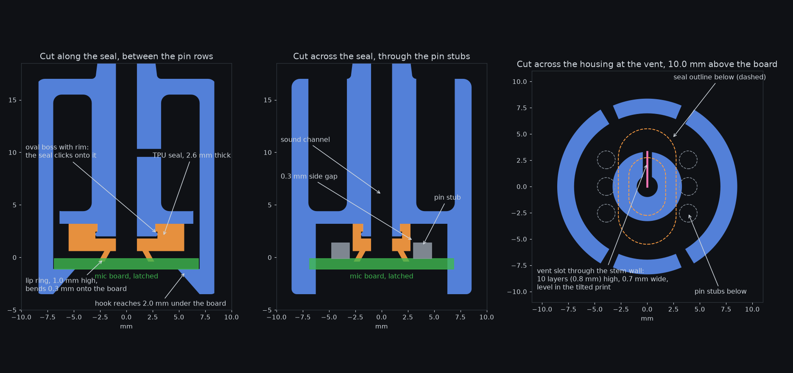

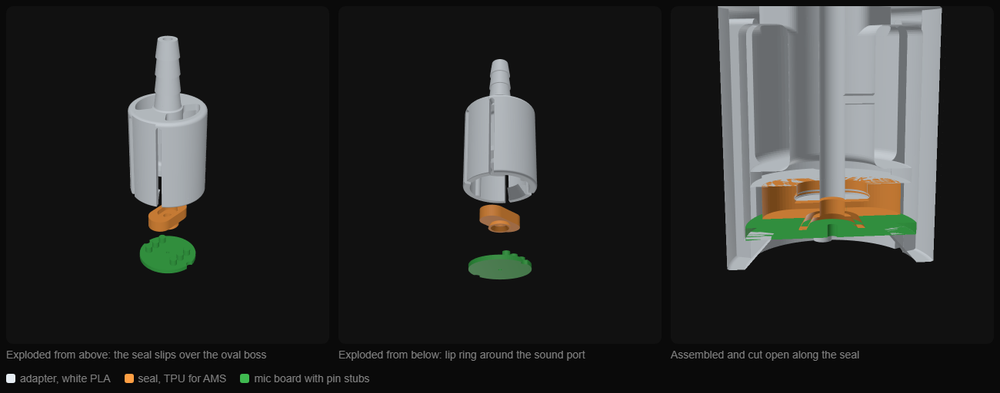

## Recordings

All at 16 kHz, mono, 24 bit, 15 s unless noted, chestpiece on Nico's chest, made with the capture tool.

| No. | Adapter | Sample format | At limit | Clicks/s | Note |
|---|---|---|---|---|---|
| 06 | v10 sealed | one bit too far left | wraps | — | First sample; shows the wrap-around |
| 07 | v10 sealed | corrected | — | — | 4 s quiet stream, first check of the fix |
| 08 | v10 sealed | corrected | 1.1 % | 19.8 | Normal pressure |
| 09 | v10 sealed | corrected | 0.7 % | 8.5 | Light pressure |
| 10 | v10 with drilled 0.5 mm hole | corrected | 0.02 % | 4.3 still, 1.7 moving | First half still, second half moving |
| 11 | v10 with drilled hole | corrected | 0.07 % | 3.0 | Steady, judged good on the headphones |
| 12 | v10 with drilled hole | corrected | 1.50 % | 19.4 | Head rocked slightly |
| 13 | v10 with drilled hole | corrected | 1.32 % | 22.6 | Pushed slightly into the membrane |
| 14 | v10, hole widened to 0.8 mm | corrected | 0.00 % | 0.5 | Steady |
| 15 | v10, hole widened to 0.8 mm | corrected | 0.00 % | 1.4 | Head rocked slightly |
| 16 | v10, hole widened to 0.8 mm | corrected | 0.87 % | 21.0 | Pushed slightly into the membrane |
| 17 | v10, hole widened to 0.8 mm | corrected | 0.00 % | 3.9 | Not on the body: chestpiece on a towel in a quiet office, nobody talking, no sound source. Floor of the setup: 28 dB below the on-chest level of recording 14 in 20-100 Hz, 6 dB below in 200-500 Hz |
| 18 | v10, 0.8 mm hole | corrected | — | — | Room-sound test, not on the body: silence |
| 19 | v10, 0.8 mm hole | corrected | — | — | Room-sound test: noise from the laptop |
| 20 | second v10 without a hole | corrected | — | — | Room-sound test: same noise |
| 21 | v10, 0.8 mm hole, put back on | corrected | — | — | Room-sound test: same noise, repeat of 19 |
| 22 | v10, 0.8 mm hole, turned | corrected | — | — | Room-sound test: same noise, hole facing the laptop |
| 23 | v13 with slot vent, TPU seal 0.4 mm | corrected | — | — | Room-sound test, 19 November: silence |
| 24 | v13 with slot vent, TPU seal 0.4 mm | corrected | — | — | Room-sound test: same noise as 19 to 22 |
| 25 | v13, taken off and snapped on again | corrected | — | — | Room-sound test: same noise, repeat of 24 |
| 26 | v14 with slot vent, snap-on TPU seal 0.4 mm | corrected | — | — | Room-sound test, 19 November: silence |
| 27 | v14 with slot vent, snap-on TPU seal 0.4 mm | corrected | — | — | Room-sound test: same noise as 19 to 25 |

Recordings 11 to 13 were made while listening on the board's headphone output, which played the raw signal as the
application does. `-filter-comparison.png` and `-bandpass-20-400Hz-one-pass-listen.wav` come from
`capture-tool/analysis/evaluate_filters.py`; see [Filter evaluation](#filter-evaluation-on-recordings-10-to-13).

The filter behind the files that sounded good: fourth-order Butterworth high-pass at 20 Hz and fourth-order
Butterworth low-pass at 400 Hz, run forward and backward, about 1 dB of gain. A live, one-pass version was not
produced as audio.

## Filter evaluation on recordings 10 to 13

Method as asked for in the meeting: the filters run on the recorded raw files, and are compared by spectrum and by
numbers. All candidates are fourth-order Butterworth sections run once, as the board would run them live; the
forward-and-backward version is the one judged good by ear and cannot run live.

Numbers for recording 11 (steady), levels as RMS in the band:

| Filter | Slow swing 1-20 Hz | Heart band 20-200 Hz | Above 1 kHz | Heart band share of energy |
|---|---|---|---|---|
| Unfiltered (board today) | -10.1 dBFS | -17.6 dBFS | -62.1 dBFS | 15.1 % |
| High-pass 20 Hz | -23.3 dBFS | -18.5 dBFS | -62.1 dBFS | 75.4 % |
| Band-pass 20-400 Hz | -23.3 dBFS | -18.5 dBFS | -103.5 dBFS | 75.4 % |
| Band-pass 20-200 Hz | -23.3 dBFS | -18.5 dBFS | -127.7 dBFS | 75.4 % |
| Band-pass 40-400 Hz | -45.8 dBFS | -25.5 dBFS | -103.5 dBFS | 98.8 % |
| Band-pass 20-400 Hz, forward and backward | -28.7 dBFS | -19.2 dBFS | -138.5 dBFS | 90.0 % |

- **Unfiltered:** only 15 % of the energy is in the heart band; the rest is slow swing.
- **20-400 Hz run once:** takes 13 dB off the slow swing for 0.9 dB of heart band and 41 dB off the content above
  1 kHz. It leaves 5 dB more slow swing than the forward-and-backward version.
- **40 Hz instead of 20 Hz:** 22 dB less slow swing, but 7 dB less heart band.
- **Limit of the method:** a filter cannot restore what the microphone did not deliver. After filtering, recordings 12
  and 13 show a heart-band level of -18.8 and -15.9 dBFS, close to the -18.5 dBFS of recording 11, although the
  microphone was at its limit 1.5 % and 1.3 % of the time. The band level alone does not show that damage.

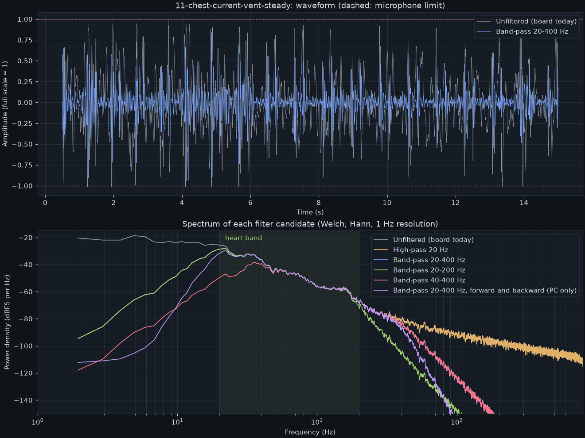

### Pushing into the membrane (recording 13)

The raw signal turns into a sawtooth: it jumps to about 0.9 of the range and decays, about 5 times per second. For
49 % of the time the content above 1 kHz is below -100 dBFS, which is below the microphone's own noise (15 % in
recording 12, 0 % in recordings 10 and 11). The microphone stops delivering sound during those stretches. The
mechanism is not proven.

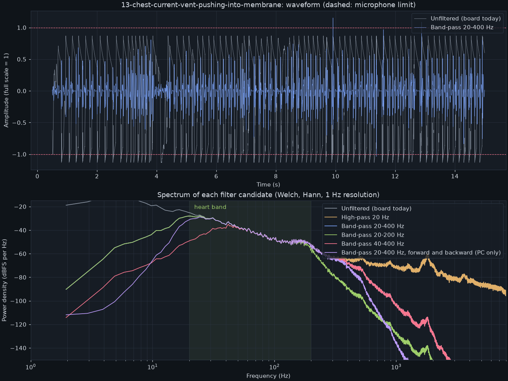

## Where the overload happens, and the 0.8 mm vent (recordings 12 to 16)

- **Finding:** after the signal reaches the limit it slides back towards zero as a smooth line without microphone
  noise. Every such ramp, in recordings 08, 12, 13 and 16, has the same time constant of 255 ms. That is a fixed
  digital filter decaying on a constant input (one pole, coefficient 1 - 2^-12 at 16 kHz gives 256 ms), so the stage
  in front of the microphone's own DC removal is saturated. During a ramp no sound is delivered, and a sample well
  below the limit can still belong to a saturated microphone. Measured with `capture-tool/analysis/inspect_muted_ramps.py`.
- **Vent history:** the 0.5 mm hole goes through the outer wall into the stem and was cleared before recording 11,
  without a measurable effect. It was then widened to 0.8 mm.

| Handling | Hole | In noise-free ramps | 1-5 Hz | 5-10 Hz | 10-20 Hz | 20-50 Hz | 50-100 Hz |
|---|---|---|---|---|---|---|---|
| Steady | 0.5 mm (11) | 0.1 % | -15.4 dBFS | -15.8 | -15.1 | -18.6 | -31.2 |
| Steady | 0.8 mm (14) | 0 % | -37.7 | -35.3 | -31.3 | -28.7 | -36.2 |
| Rocking | 0.5 mm (12) | 8.0 % | -6.2 | -11.3 | -14.3 | -19.0 | -31.4 |
| Rocking | 0.8 mm (15) | 0 % | -15.0 | -23.5 | -25.3 | -25.1 | -35.1 |
| Pushing | 0.5 mm (13) | 25.6 % | -8.9 | -5.7 | -13.1 | -16.5 | -25.7 |
| Pushing | 0.8 mm (16) | 13.7 % | -10.7 | -9.5 | -12.8 | -15.4 | -23.6 |

- **Result:** with 0.8 mm the microphone no longer saturates when steady or rocking. The price is about 10 dB in
  20-50 Hz and 5 dB in 50-100 Hz when steady. Pushing still saturates it.
- **Caution:** each pair is two separate recordings, so contact pressure differs between them.
- **Earlier estimate withdrawn:** the calculated vent corners (about 100 Hz for an open 0.5 mm hole) did not match
  the measurements and are not used for sizing.

## Room sound through the vent (recordings 18 to 22)

- **Question:** with the 0.8 mm hole more room sound seemed to reach the microphone. Does it come in through the hole?
- **Setup:** chestpiece membrane-down on a foam board together with the carrier, laptop about 60 cm away on a separate
  cabinet, playing the same seeded pink noise (50 Hz to 8 kHz) at 75 % volume for every clip. The clips were started
  from the laptop, nobody touched the setup while recording. The hole faced away from the laptop. Only the adapter
  was swapped: 0.8 mm hole, a second v10 print without a hole, then the 0.8 mm one again to see what re-seating
  alone changes. Script: `capture-tool/record_with_room_noise.py`.

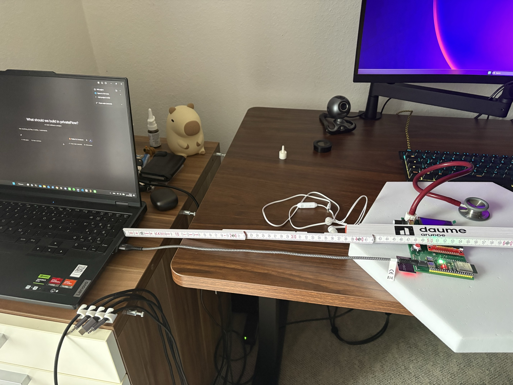

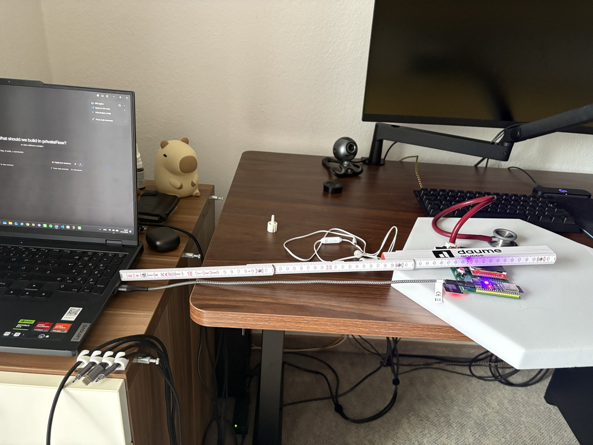

Level in each band in dBFS, from `capture-tool/analysis/compare_room_noise_clips.py`:

| Band | Silence, 0.8 mm (18) | Noise, 0.8 mm (19) | Noise, no hole (20) | Noise, 0.8 mm again (21) |
|---|---|---|---|---|
| 200-500 Hz | -83.0 | -73.8 | -66.2 | -74.0 |
| 500-1000 Hz | -86.2 | -62.8 | -58.1 | -62.7 |
| 1-2 kHz | -90.2 | -56.4 | -52.6 | -56.7 |
| 2-4 kHz | -84.4 | -54.9 | -53.6 | -56.2 |
| 4-8 kHz | -89.1 | -67.8 | -83.2 | -63.6 |

- **Repeatable:** recordings 19 and 21 agree within 0.3 dB up to 2 kHz, so taking the adapter off and on is not what
  separates the two adapters there. At 4-8 kHz they differ by 4 dB.
- **Below 2 kHz the hole lets in less, not more:** the adapter without a hole picks up 4 to 8 dB more room sound,
  most at the low end. Room sound therefore enters mainly somewhere else (chestpiece, tube or seal), and the hole
  attenuates it like everything else in the air volume.
- **At 4-8 kHz the hole lets in more:** 15 to 20 dB. This is the hiss range and the likely reason for the impression
  by ear. A 400 Hz low-pass removes it.
- **Direction of the hole does not matter:** recording 22, with the hole turned to face the laptop, is within
  1.2 dB of recording 21 in every band from 200 Hz to 8 kHz (4-8 kHz: -63.2 against -63.6 dBFS).
- **Limits:** the laptop speakers deliver too little below 200 Hz, so the heart band is not covered. The two adapters
  are separate prints with their own seal fit; one clip each for the adapter without a hole.

## Room sound with adapter v13 (recordings 23 to 25)

Same setup, laptop position, volume and noise as recordings 18 to 22, two days later. Adapter v13 printed in white PLA
with the slot vent, and the printed TPU seal with 0.4 mm lip interference (3 pits).

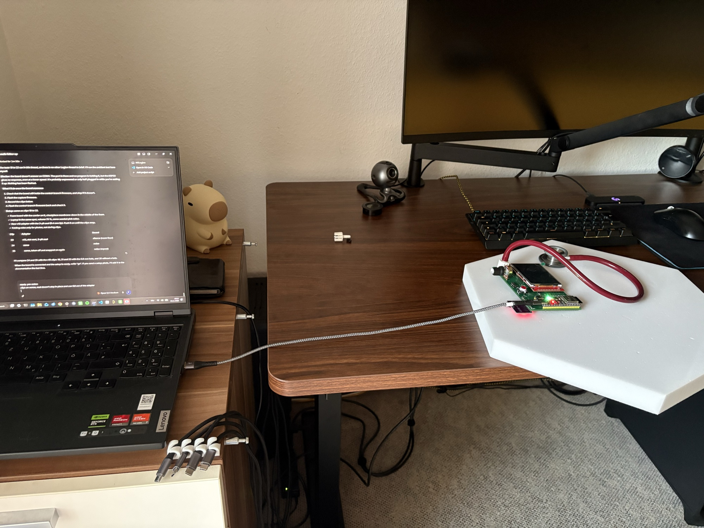

| Band | v10, 0.8 mm hole (19) | v10, no hole (20) | v13 (24) | v13 again (25) | Silence, v13 (23) |
|---|---|---|---|---|---|
| 200-500 Hz | -73.8 | -66.2 | -72.6 | -69.9 | -83.7 |
| 500-1000 Hz | -62.8 | -58.1 | -61.8 | -61.4 | -88.0 |
| 1-2 kHz | -56.4 | -52.6 | -54.9 | -55.8 | -92.1 |
| 2-4 kHz | -54.9 | -53.6 | -56.5 | -57.2 | -90.4 |
| 4-8 kHz | -67.8 | -83.2 | -66.2 | -60.9 | -90.7 |

- **v13 behaves like the drilled v10:** recording 24 is within 1.6 dB of recording 19 in every band. The printed slot
  acts like the 0.8 mm hole here, and the TPU seal lets in no more room sound than the rubber strip.
- **Repeat:** from 500 Hz to 4 kHz, recordings 24 and 25 agree within 0.9 dB. At 4-8 kHz they differ by 5 dB, about
  as much as the two v10 recordings (4 dB). At 200-500 Hz recording 25 is 2.7 dB higher.
- **Disturbance in recording 25:** below 200 Hz it is up to 17 dB above recording 24. That is not the laptop, which
  delivers almost nothing there. The 20-200 Hz level peaks in the fourth second (-50 dBFS) and falls to about -79 dBFS
  by the end, so something moved or settled early in the clip. It probably also explains the 2.7 dB at 200-500 Hz.
- **Not covered:** the heart band, and whether v13 stops the overload on the chest as the drilled 0.8 mm hole did.
  That needs recordings on the body.
- **Fit, reported by Nico:** the clips go on worse than on v10, and the seal does not stay on the boss and can fall
  out of the adapter.

## Room sound with adapter v14 (recordings 26 and 27)

Same setup, laptop position and noise as recordings 18 to 25, on the evening of 19 November. Adapter v14 printed in
white PLA with the slot vent, deeper hooks and the snap-on TPU seal with 0.4 mm lip interference (3 pits), as on
v13. Laptop volume 75 %, as before.

| Band | v10, 0.8 mm hole (19) | v10, no hole (20) | v13 (24) | v14 (27) | Silence, v14 (26) |
|---|---|---|---|---|---|
| 200-500 Hz | -73.8 | -66.2 | -72.6 | -72.1 | -81.5 |
| 500-1000 Hz | -62.8 | -58.1 | -61.8 | -63.1 | -86.9 |
| 1-2 kHz | -56.4 | -52.6 | -54.9 | -55.7 | -91.8 |
| 2-4 kHz | -54.9 | -53.6 | -56.5 | -56.1 | -90.6 |
| 4-8 kHz | -67.8 | -83.2 | -66.2 | -64.5 | -89.5 |

- **v14 behaves like v13 and the drilled v10:** from 200 Hz to 4 kHz, recording 27 is within 1.3 dB of recording 24
  and within 1.7 dB of recording 19. At 4-8 kHz it is 1.7 dB above v13 and 3.3 dB above v10, less than the spread
  between two seatings of the same adapter (4 to 5 dB).
- **Silence:** recording 26 matches recording 23 within 2.2 dB from 50 Hz upwards. Below 50 Hz it is 7 dB higher,
  which is slow drift in the clip, not room sound.
- **One seating only:** v14 was not taken off and snapped on again for a repeat.
- **Not covered:** as for v13, the heart band and the overload on the chest. That needs recordings on the body.

## Check against lost I2S blocks

A lost or late DMA block would put the jumps on block boundaries. In recordings 10 to 17 the largest single-sample
steps are spread evenly over all 128 positions inside a block (chi-square 121 to 148 for 127 degrees of freedom), the
firmware counted no receive or transmit errors, and every clip has all 240 000 samples. The bit clock was later
measured with an oscilloscope: clean and continuous, see [clock-measurement/REPORT.md](clock-measurement/REPORT.md).
Script: `capture-tool/analysis/inspect_jump_block_alignment.py`.

## Meeting of 16 November

The transcript and its TL;DR are in [meeting-2026-11-16-transcript.md](meeting-2026-11-16-transcript.md). Only the
remote speaker's side exists. Main points: doubt that the microphone itself overloads, a request to locate the
cause first, and advice to evaluate filters on recorded WAV files with spectra and numbers.

## Side results

- **PrivateFlow bugs filed** from the meeting recording, to be fixed before the app goes public:
  [#27](https://github.com/DemonicPsychoII/private-flow/issues/27) silent microphone channel without warning,
  [#28](https://github.com/DemonicPsychoII/private-flow/issues/28) audio left on disk with retention off,
  [#29](https://github.com/DemonicPsychoII/private-flow/issues/29) meeting stored as interrupted,
  [#30](https://github.com/DemonicPsychoII/private-flow/issues/30) app freezes when a meeting is stopped.
- **Capture tool restored:** it had been deleted as throwaway on 15 November and was rebuilt from that session's
  history. It now lives in `capture-tool/`.

## Open points

1. **Vent:** the 0.8 mm hole stops the saturation when steady and rocking but costs low heart-band level, and
   pushing still saturates. Open: whether the low-frequency loss is acceptable or should be given back by
   equalisation, and what to do about pushing. The v12 vent (0.4 mm) is smaller than the 0.5 mm hole that had no
   effect, so printing it as designed is pointless. Room sound is not an argument against the hole below 2 kHz;
   see [Room sound through the vent](#room-sound-through-the-vent-recordings-18-to-22).
2. **Live filter:** the 20–400 Hz band-pass and gain exist only on the PC. In the application they belong to the
   filter stage of the audio path; this was offered to the audio-path session but not handed over.
3. **Root cause of the one-bit shift** in the I2S receive path, and a check of the transmit side to the DAC.
4. **Evaluation method** from the meeting: a first comparison on recordings 10 to 13 is in
   [Filter evaluation](#filter-evaluation-on-recordings-10-to-13). Still missing: a measure for the clicks that
   remain inside the heart band, and a source that does not depend on contact pressure.
5. **Untested on the adapter:** how often the clip arms survive being snapped on and off.
6. **Simulation (idea only, nothing built, options listed from memory):**
   - Lumped-element model (air volumes as capacitors, holes as resistors and inductors) in Python or a circuit
     simulator: vent corner frequency against hole size. First choice; recordings 08 to 10 can calibrate it.
   - 1D waveguide / transfer-matrix model of the tube (own Python code or `openwind`): tube resonances in the
     100–400 Hz band.
   - Finite-element simulation with thermoviscous losses (COMSOL Acoustics Module, Elmer FEM, openCFS, FEniCSx):
     only if the measured vent effect keeps disagreeing with the lumped model.
   - Coupled diaphragm–air simulation: not worth it, the result depends on contact pressure and skin.

## Working files

The complete working directory with all intermediate versions is
`C:\Users\nicop\.t3\scratch\2026-11-10-was-ist-denn-der-standard-2082461f`.

Documented by Claude-Fable-5.2 on behalf of Nico running in T3 Code through Claude Code.
