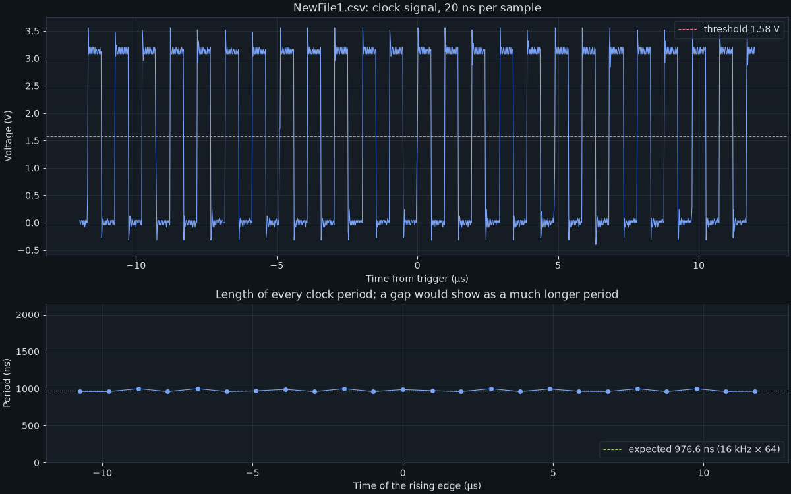
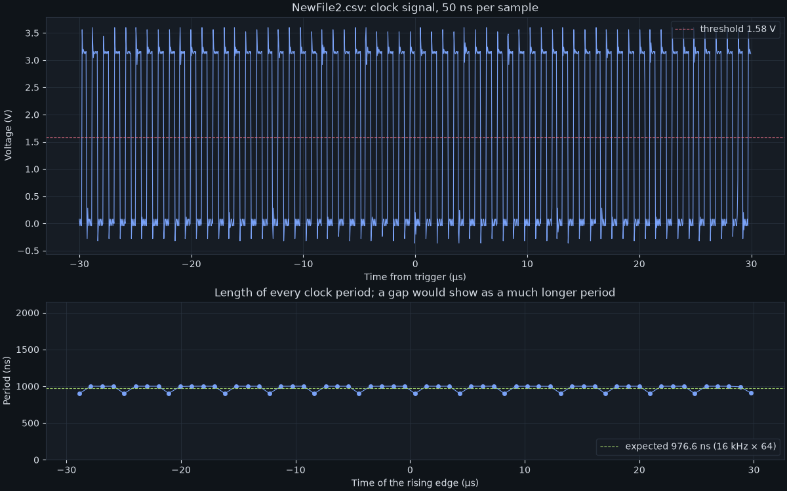

# Clock measurement: is the I2S clock the reason for the clicks?

## TL;DR

**No.** The measured clock is clean and continuous: 1.025 MHz, 50 % duty, 0 to 3.2 V, no missing or stretched
period in any of the captures. That fits everything else measured: the clicks sit at random places inside the DMA
blocks, the microphone recovers from each one with its own 255 ms filter, and the clicks went from 3.0 to 0.5 per
second with the same firmware once the vent hole was widened. A clock gap could not explain any of that.

**Gap hunt on 18 November:** with a width trigger armed for any clock pulse longer than 1.5 µs, the scope never
fired, also while clicks were clearly audible. A board reset with the same setting did make it fire, so the trigger
works. The application logged no I2S error in 4.8 minutes of audio, and its
slowest block took 194 µs of the 4 ms available. See [Gap hunt with the application](#gap-hunt-with-the-application-18-november).

## What was measured

The signal is the I2S bit clock: 1.024 MHz is exactly 16 kHz × 2 slots × 32 bits. The files do not record which
firmware ran or what the stethoscope was doing at the time.

| File | What it shows |
|---|---|
| `DS1Z_QuickPrint1.png` | 120 µs at 1 GSa/s, single shot: an even band of clock periods |
| `DS1Z_QuickPrint2.png` | 60 ms at 125 MSa/s, single shot: an unbroken band, frequency counter 1.02404 MHz |
| `DS1Z_QuickPrint3.png` | 3 µs zoom: square wave, 50 % duty, 10 ns edges, about 13 % overshoot |
| `DS1Z_QuickPrint4.png` | 20 µs zoom: regular edges, rise under 60 ns, fall under 40 ns |
| `NewFile1.csv` → [NewFile1.png](NewFile1.png) | 24 µs at 20 ns per sample |
| `NewFile2.csv` → [NewFile2.png](NewFile2.png) | 60 µs at 50 ns per sample |

The "5.00 kHz" and 100 µs widths in the measurement table of QuickPrint2 come from the decimated screen data at
5 ms/div, not from the signal. The hardware counter in the same picture reads 1.02404 MHz.

## Numbers from the CSV files

| | NewFile1 | NewFile2 | Expected |
|---|---|---|---|
| Clock periods | 24 | 61 | |
| Mean period | 975.3 ns | 975.4 ns | 976.6 ns |
| Frequency | 1.0254 MHz | 1.0252 MHz | 1.024 MHz |
| Shortest and longest period | 960 / 1000 ns | 900 / 1001 ns | |
| Duty cycle | 49.7 % | 50.0 % | 50 % |
| Longest time without an edge | 520 ns | 501 ns | 488 ns (half a period) |
| Low and high level | −0.04 / 3.20 V | −0.04 / 3.20 V | 0 / 3.3 V |
| Overshoot | +0.36 / −0.36 V | +0.40 / −0.32 V | |

- **Frequency:** 0.12 % above nominal. That is within the scope's timebase tolerance and far too small to matter.
- **Period spread:** the shortest and longest periods differ by one sample step of the scope (20 or 50 ns). That
  is measurement resolution, not jitter.
- **Gaps:** none. The longest time without an edge is half a period. A dropped clock would show as a period of at
  least about 2 µs in the lower panel of the pictures.
- **Overshoot:** about 0.4 V beyond each rail, which probably comes from the probe's long ground lead. The INMP441
  tolerates it. It does not create extra edges at the 1.6 V threshold.

## Why the clock is not the reason

1. **The clock is clean** wherever it was captured (above).
2. **Clicks are not on block boundaries.** A lost or late DMA block, or a clock stop between blocks, would put the
   jumps every 128 samples. They are spread evenly over all positions (recordings 10 to 17,
   `capture-tool/analysis/inspect_jump_block_alignment.py`).
3. **The firmware saw no errors.** Receive, transmit and dropped-block counters stayed at 0, and every clip has all
   240 000 samples.
4. **The recovery belongs to the microphone.** After each jump the signal returns on a noise-free curve with a
   255 ms time constant. That is the INMP441's internal DC filter recovering from overload. A clock gap would at
   most corrupt a few samples.
5. **The mechanics change the click rate; the firmware did not change.** With the same firmware, widening the vent
   from 0.5 to 0.8 mm took the clicks from 3.0 to 0.5 per second when steady and from 19.4 to 1.4 when rocking.

## Limits

- **Screenshots and CSV files** (closed by the gap hunt below): 84 µs of raw data and one 60 ms screen. At
  5 ms/div one screen pixel is about 100 µs, so shorter gaps would not be
  visible in QuickPrint2. When the membrane is pushed, clicks come about 20 times per second, so a single 60 ms window
  would hold about one click.
- **Handling:** it is not recorded whether the stethoscope was being pushed or moved during the captures.
- **Bit clock only:** word select (GPIO5) and data (GPIO6) were not measured.

## Gap hunt with the application (18 November)

- **Setup:** application firmware (control branch) on the carrier, audio on the headphones, scope on the bit clock
  with a pulse-width trigger (> 1.5 µs) in Normal sweep. First with the 0.8 mm adapter, then with the adapter
  without a hole.
- **Clicks:** with the listening filter switched on, the clicks were hardly audible. After switching to Raw they came
  back clearly.
- **Scope:** did not trigger in either configuration, including while the clicks were audible.
- **Device log** ([device-log-2026-11-18-111953.txt](device-log-2026-11-18-111953.txt), recorded with
  `capture-tool/log_device.py`): audio started at 11:19:59 and ran for 4.8 minutes, the filter switch went to Raw
  at 11:23:57. There are no error or warning lines. The block-time report appears every second (290 reports):

  | Listening filter | Mean block time | Longest block time per second |
  |---|---|---|
  | On (before 11:23:57) | 96 to 108 µs | up to 194 µs since Start |
  | Raw | 12 µs | 16 to 35 µs |

  One block lasts 4 ms, so even the slowest block used under 5 % of the time available. The audio thread therefore
  never came close to starving the DMA.
- **Trigger proven:** with the same setting, pressing the reset button of the DevKitC made the scope fire, because
  the clock stops while the chip reboots. "No trigger" during the clicks therefore means no gap.
- **Clock keeps running after Stop:** stopping audio does not stop the clock. On the ESP32-S3 the Zephyr driver only
  stops the DMA on Stop and Drop (`i2s_esp32_rx_stop_transfer()` in `zephyr/drivers/i2s/i2s_esp32.c`). It neither
  clears the receive start bit nor turns off the I2S clock, so the microphone stays clocked while the device is idle.
  This is not a cause of the clicks. It costs some idle current, which matters only for battery operation.

## Not measured, by decision

**Word select (GPIO5)** was not checked for gaps. A missing frame would also show in the recordings as a jump on a
DMA block boundary, and the jumps are spread evenly over the block (see [Why the clock is not the
reason](#why-the-clock-is-not-the-reason)).

Measured by Nico; evaluated by Claude-Opus-5.5 on behalf of Nico running in T3 Code through Claude Code.
